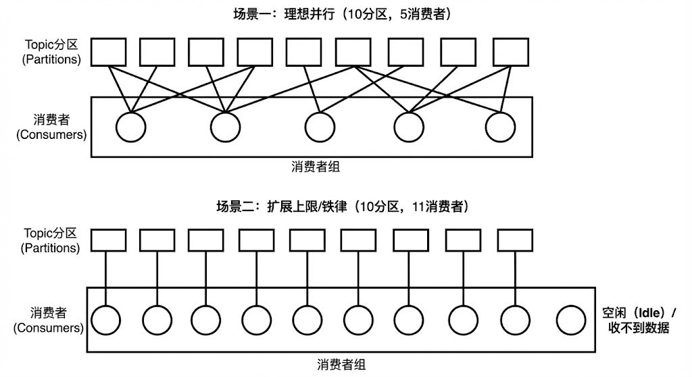
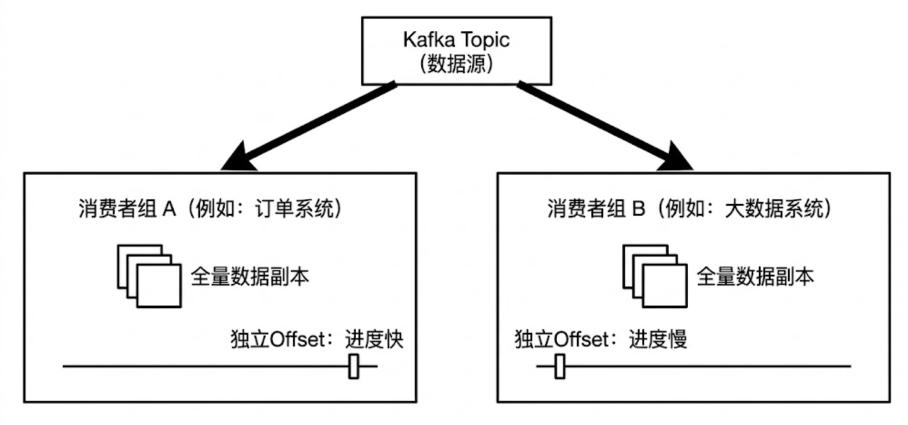
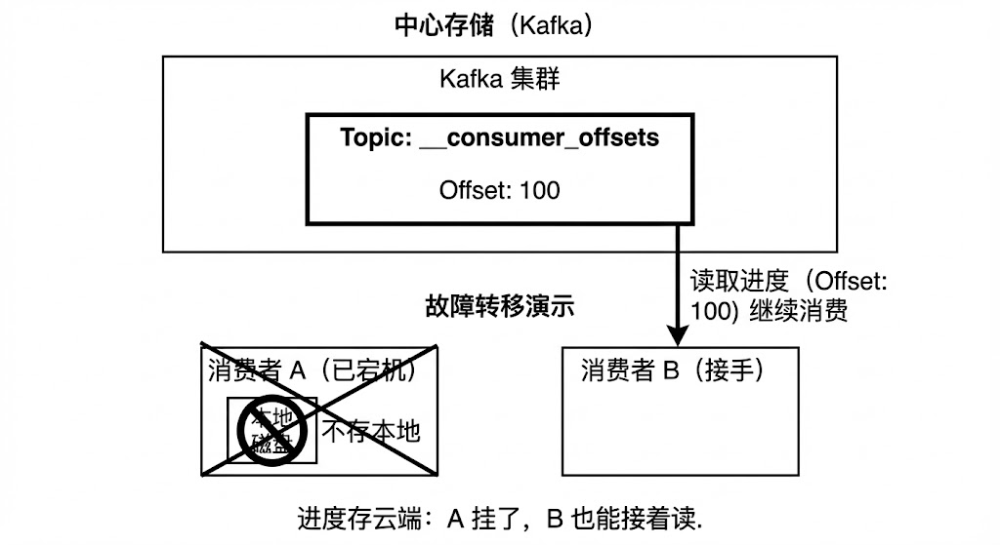

### 一、 知识点讲解

消费者组是 Kafka 消费端的逻辑容器。

Kafka 通过消费者组机制，巧妙地在同一个系统中同时支持了**“消息队列（点对点）”和“发布订阅（广播）***两种模式。

它的核心原则是：<u>一个 Partition（分区）在同一个消费者组内，只能被一个消费者线程消费。</u>

#### 并行消费与扩展性（队列模式）

如果你想提高消费速度，通常的做法是增加消费者数量。

- 在同一个组内，Kafka 会把 Topic 的多个 Partition 分配给不同的消费者。
- 例如：Topic 有 10 个分区，组里有 5 个消费者。Kafka 会自动分配，让每个消费者负责 2 个分区。
- **铁律：** 如果组里的消费者数量超过了分区数量（例如 11 个消费者，10 个分区），那么多出来的那个消费者会**闲置（Idle）**，收不到任何数据。这也是 Kafka 扩展性的物理上限。

#### 广播机制（发布订阅模式）

如果你需要多个不同的业务系统（比如“订单系统”和“大数据分析系统”）都消费同一份数据，且互不干扰。

- 只需要让它们分别属于**不同的消费者组**（Group A 和 Group B）。
- Kafka 会给 Group A 发一份全量数据，同时给 Group B 也发一份全量数据。
- 各个组维护自己独立的 **Offset（消费进度）**，你快一点、我慢一点，完全解耦。

#### 消费进度的保存

消费者组的 Offset 不是存在本地的，而是存在 Kafka 内部一个名为 __consumer_offsets 的特殊 Topic 中。这保证了即使某个消费者挂了，组内其他消费者接手后，能知道从哪里继续消费。

---

### 二、 面试标准回答

消费者组（Consumer Group）是 Kafka 实现水平扩展和消费解耦的核心机制。它通过逻辑分组，规定了消息消费的并发度和可见性范围。

**第一，实现高吞吐的并行消费**

在 Kafka 中，Partition 是并发的最小单元。

消费者组允许我们将一个 Topic 的多个 Partition 分散给组内的多个 Consumer 实例并行处理。

Kafka 保证同一个 Partition 在同一个组内只能被一个 Consumer 消费。这意味着，我们可以通过增加 Partition 数量并同时增加组内 Consumer 数量，来线性提升系统的消费吞吐量。

**第二，统一了两种消息模型**

Kafka 不像 RabbitMQ 那样区分 Queue 和 Topic，而是通过消费者组来定义：

- **队列模式（P2P）：** 所有消费者都在同一个组，消息在组内进行负载均衡，每条消息只被处理一次。
- **发布订阅模式（Pub/Sub）：** 不同的业务系统使用不同的消费者组。Kafka 会将消息广播给每一个订阅该主题的消费者组，实现逻辑解耦。

**第三，故障转移与重平衡。**

消费者组具备高可用特性。

如果组内某个消费者宕机，Kafka 的 Group Coordinator 会触发 Rebalance 机制，将该消费者原本负责的 Partition 重新分配给组内其他存活的消费者。这保证了即使部分节点故障，整个消费链路依然可用。
