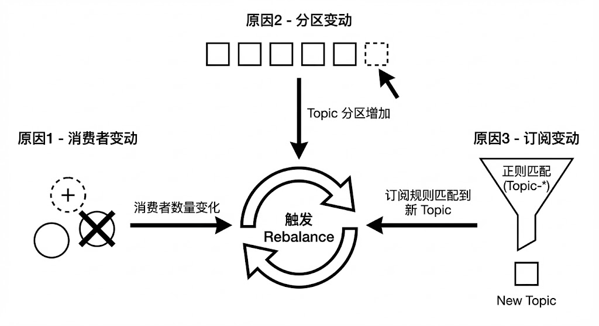
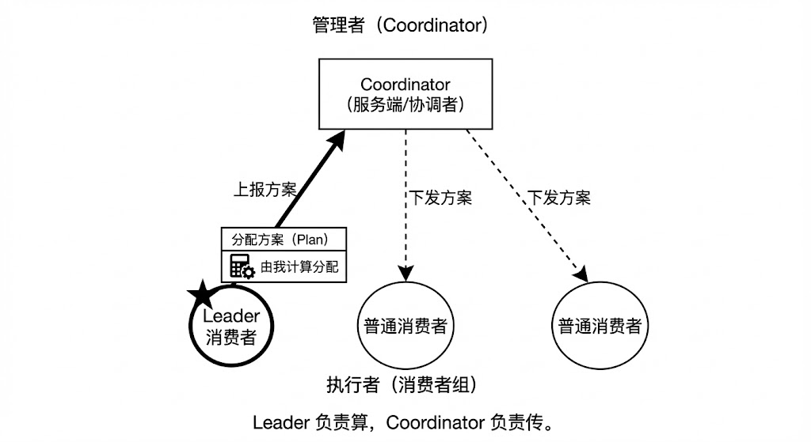

### 一、 知识点讲解

Rebalance 本质上是一个协议，规定了一个 Consumer Group 下的所有 Consumer 如何达成一致，来分配订阅 Topic 的所有 Partition。

比如 Topic 有 10 个分区，组里有 5 个消费者。Rebalance 就是为了决定“谁负责消费哪几个分区”。一旦消费者数量变化或分区数量变化，就需要重新分配，这就叫 Rebalance。

#### 什么时候会触发 Rebalance？

只要“映射关系”打破了，就会触发：

- **消费者变了：** 新消费者加入（启动新实例）、老消费者挂了（宕机）、老消费者主动离开（关闭）。*注：网络抖动导致的心跳超时也会被判定为“挂了”。*
- **分区变了：** 你在控制台给 Topic 增加了分区。
- **订阅变了：** 消费者组订阅的是正则匹配（比如 `topic-*`），此时新建了一个符合规则的 Topic。

#### 核心角色：Coordinator（协调者）

Kafka 服务端有一个角色叫 Group Coordinator。它负责管理消费组的状态。

当 Rebalance 发生时，所有的消费者会向 Coordinator 汇报，Coordinator 选出一个消费者作为 Leader（通常是第一个加入的）。

注意： 分配方案不是 Coordinator 算的，而是 Leader 消费者 算的。Leader 算好后发给 Coordinator，Coordinator 再下发给组内其他消费者。

#### Stop The World

在默认的 Rebalance 过程中（Eager 模式），所有的消费者都会停止消费，等待分配方案完成。

这就好比公司要做组织架构调整，调整期间所有人都不许干活，直到调整完。

- 如果 Rebalance 耗时 1 分钟，这 1 分钟内消费完全暂停，导致消息大量堆积（Lag）。
- 如果网络抖动频繁触发 Rebalance，就会陷入“重平衡风暴”，系统基本处于瘫痪状态。

---

### 二、 面试标准回答

Kafka 的 Rebalance 是指消费者组内实例重新分配订阅主题分区的过程。它是 Kafka 实现消费者端高可用和线性扩容的核心机制。但它是一个阻塞式的操作，频繁触发会严重影响消费吞吐量。

**第一，触发时机（3 种情况）。**

Rebalance 主要在以下三种情况下被触发：

1. **组成员数量发生变化：** 最常见。比如新 Consumer 加入，或者已有 Consumer 崩溃（心跳超时）或主动下线。
2. **订阅的主题分区数发生变化：** 比如运维动态增加了 Topic 的 Partition 数量。
3. **订阅的主题数量发生变化：** 比如使用正则订阅，集群里新增了匹配的主题。

**第二，Rebalance 的过程（两个阶段）。**

整个过程由服务端的 Group Coordinator 协调：

1. **JoinGroup 阶段：** 所有消费者向 Coordinator 发送 JoinGroup 请求。Coordinator 会选出一个 Consumer 作为 **Leader**，并将成员列表元数据发给它。
2. **SyncGroup 阶段：** Leader 根据配置的分区分配策略（如 Range、RoundRobin、Sticky）计算出每个人的分配方案，然后发给 Coordinator。Coordinator 再将具体的方案下发给所有 Consumer。

**第三，主要危害**

在 Rebalance 期间，整个消费组会暂停消费（Consumer 会停止拉取数据，提交 Offset）。

如果 Rebalance 过程耗时过长，或者因为网络不稳定导致频繁 Rebalance，会导致消息积压（Lag）飙升。这在线上是需要极力避免的。
