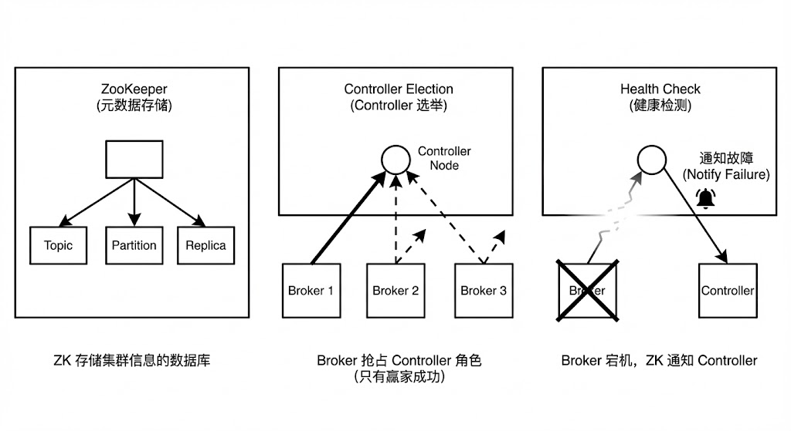

### 一、 知识点讲解

在旧版 Kafka（2.8 之前）中，ZooKeeper 是 Kafka 集群的“大脑”和“数据库”。Kafka 本身是无状态的，它依赖 ZooKeeper 来保存所有元数据并进行集群协调。

然而，随着 Kafka 要承载的数据量越来越大，这种严重依赖外部组件的架构成了绊脚石。废除 ZooKeeper的核心目的是：让 Kafka 变成一个完全独立的、能够自我管理的分布式系统，从而实现更快的元数据同步和更强的扩展性。

#### **ZooKeeper 扮演的具体角色**

- **元数据存储：** Kafka 的 Topic 有哪些？分区怎么分？Replica 都在哪？这些信息全部存在 ZK 的 ZNode 中。
- **Controller 选举：** Kafka 集群中必须有一个 Broker 当老大，负责管理集群状态。谁来当老大？靠抢占 ZK 的一个临时节点。谁抢到谁就是 Controller。
- **健康检测：** Broker 启动时会在 ZK 注册临时节点。Broker 挂了，临时节点消失，ZK 通知 Controller 进行故障转移。

#### **为什么要废除？**

- **运维复杂度：** 为了维护 Kafka，你必须先维护一套 ZooKeeper 集群。这是两套完全不同的分布式系统，运维门槛和成本双倍增加。
- **元数据加载瓶颈：** 当 Controller 宕机触发重新选举时，新的 Controller 必须从 ZK 读取全量的元数据。如果集群有 100 万个分区，这个读取和初始化过程可能需要几秒甚至几十秒。这期间集群是不可写的。
- **扩展性限制：** 由于 ZK 的写性能和 Watch 机制的限制，导致 Kafka 单集群能支持的分区数量存在上限（通常是几十万级别）。

#### 替代方案：KRaft 模式

Kafka 2.8+ 引入了 KRaft（Kafka Raft）模式。

- **原理：** Kafka 不再把元数据存 ZK，而是存在一个内部的特殊 Topic里。
- **共识：** 利用 Raft 算法，让几个 Broker 组成**仲裁团**来管理这些元数据。这意味着 Kafka **自己管理自己**，不再需要外挂。

---

### 二、 面试标准回答

在 Kafka 的演进历程中，ZooKeeper 曾长期扮演着分布式协调者和元数据存储中心的角色。但为了解决运维复杂性和元数据扩展性这两大瓶颈，Kafka 推出了 KRaft 模式 来彻底移除对 ZooKeeper 的依赖。

**第一，ZooKeeper 的作用**

它主要负责三件事：

1. **Broker 注册与健康监测：** 利用临时节点机制感知 Broker 的存活状态。
2. **Controller 选举：** 协助集群选举出唯一的 Controller 节点来调度任务。
3. **元数据存储与通知：** 存储 Topic、Partition、ISR 等核心元数据，并通过 Watch 机制通知 Broker 更新状态。

**第二，为什么要移除 ZooKeeper**

主要基于两个维度的考量：

1. **性能与扩展性：** 在旧架构中，元数据存储在 ZK 外部。当 Controller 发生故障转移（Failover）时，新 Controller 需要从 ZK 全量加载元数据，这导致了较长的不可用时间（RTO）。同时，ZK 的通信瓶颈限制了 Kafka 单集群支持的分区数（很难突破百万级）。
2. **运维复杂度：** 维护 Kafka 必须同时维护 ZK，这是两套不同的系统、不同的安全认证、不同的配置文件。移除 ZK 后，Kafka 成为一个纯粹的单体分布式系统，极大地降低了部署和运维负担。

**第三，KRaft 模式带来的改变。**

移除 ZK 后，Kafka 将元数据视为一种**“日志”**，存储在内部的 Topic 中，并使用 Raft 一致性算法 在 Controller 节点间同步。这使得元数据操作完全变成了内存操作，极大地缩短了 Controller 的故障恢复时间，并将 Kafka 的分区支持能力提升了一个数量级。
