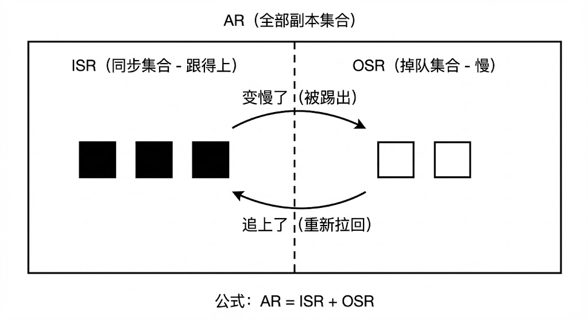
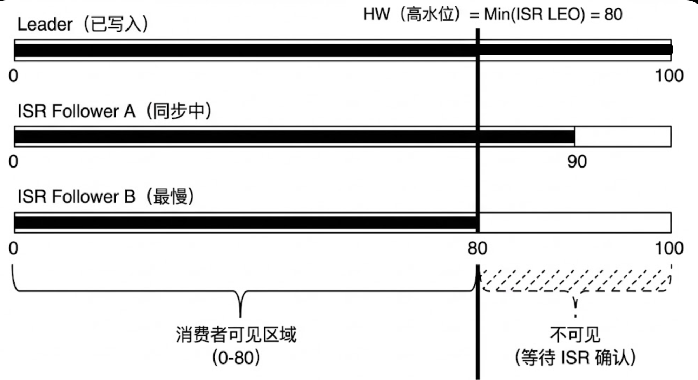

### 一、 知识点讲解

ISR 全称是 In-Sync Replicas（同步副本集合）。

在 Kafka 的 Partition 中，所有的副本（Replica）统称为 AR (Assigned Replicas)。

AR 被拆分成了两部分：

1. **ISR (In-Sync Replicas)：** 那些“跟得上”Leader 更新进度的副本。
2. OSR (Out-of-Sync Replicas)： 那些“掉队”严重的副本。
3. AR = ISR + OSR。

Kafka 的 Leader 动态维护着这个 ISR 列表。如果一个 Follower 慢了，就被踢出 ISR 放入 OSR；如果它追上来了，又会被重新拉回 ISR。

#### 谁有资格进 ISR？

早期 Kafka 是根据“落后的消息条数”来判定的，但这有个大坑：流量突峰时，所有 Follower 都会瞬间落后几十条消息，导致 ISR 列表被清空，引发集群震荡。

0.9 版本以后，判定标准只有一个：时间。

参数 replica.lag.time.max.ms（默认 10s or 30s）。

只要 Follower 向 Leader 发起 Fetch 请求的时间间隔，或者拉取数据的进度没有落后超过这个时间阈值，它就是安全的。哪怕它差了 1 万条数据，只要它在拼命拉，且最近一次拉取是在阈值时间内，它就在 ISR 里。

#### 高水位

ISR 不仅仅是个名单，它决定了消费者能读到哪里。

Kafka 有一个概念叫 HW (High Watermark，高水位)。Leader 会取 ISR 中所有副本 LEO (Log End Offset) 的最小值作为 HW。

- **例子：** Leader 写入了 Offset 100。ISR 里有两个 Follower，一个同步到了 90，一个同步到了 80。
- **结果：** HW = 80。
- **影响：** 消费者只能读到 0-80 的数据。81-100 的数据虽然在 Leader 上，但为了保证一致性（防止 Leader 挂了数据丢失），在所有 ISR 确认之前，这些数据对消费者**不可见**。

#### Leader 选举的“候选人池”

当 Leader 宕机时，Controller 会从哪里选新 Leader？

默认情况下，只能从 ISR 列表里选。因为 ISR 里的节点数据是最全的。

如果 ISR 为空（所有副本都挂了或都严重落后），且配置了 unclean.leader.election.enable=true，才会从 OSR 里选一个“烂”的当 Leader（这会导致数据丢失，生产环境通常禁用）。

---

### 二、 面试标准回答

ISR 是 Kafka 动态维护的一组“与 Leader 保持同步的副本集合”。它是 Kafka 提供的数据可靠性与可用性之间的动态平衡机制。

**第一，ISR 的定义与维护。**

Kafka 的 Leader 节点会维护一个动态列表。只有那些能够及时跟随 Leader 同步数据的 Follower 才有资格留在 ISR 中。如果 Follower 发生网络阻塞或 Full GC 导致同步滞后超时，会被暂时剔除到 OSR 中；待其追上进度后，会自动回归 ISR。

**第二，ISR 对数据一致性的意义。**

ISR 决定了消息的提交点。

当生产者设置 acks=all 时，Leader 必须等到 ISR 列表中所有副本都成功写入消息，才会向客户端返回成功。

同时，ISR 中最慢的那个副本的 LEO决定了整个分区的 HW。消费者只能消费到 HW 之前的数据，这保证了即使 Leader 挂掉，已消费的数据也不会在副本切换中丢失。

**第三，Leader 选举。**

ISR 也是 Leader 选举的候选池。

当 Leader 宕机时，优先从 ISR 中选举新 Leader，因为这能保证数据不丢失。只有在极端情况下（ISR 全挂），如果开启了 unclean 选举，才可能从 OSR 中选举，但这会牺牲数据一致性。
