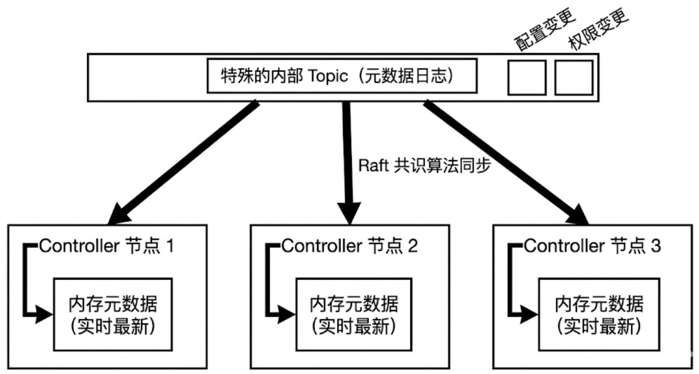

### 一、 知识点讲解

在 KRaft 模式出现之前，Kafka 的元数据是存在 ZooKeeper 里的。Kafka Controller 就像一个“缓存”，每次启动或故障转移，都要从 ZK 把所有数据拉取到内存里。

KRaft 模式的核心变革在于：它把元数据也看作是“消息日志”。

Kafka 内部引入了一个特殊的 Topic。集群的配置变化、权限变化、分区变化，不再是修改 ZK 里的节点，而是向这个内部 Topic 追加一条“元数据事件记录”。

通过 Raft 共识算法，Controller 节点之间实时同步这个日志，保证内存里的元数据永远是最新的。

#### **从“外部存储”到“内部日志”**

- **旧模式（ZK）：** 状态存储在外部系统。Controller 故障切换时，新 Controller 必须从 ZK 全量加载元数据。如果分区有 100 万个，这个加载过程可能耗时几分钟，期间集群无法写入。
- **KRaft 模式：** 状态就是日志。所有 Broker 都保存了元数据日志的副本。当 Controller 挂了，Standby Controller 的内存里已经有了最新的数据（因为它一直在同步日志），所以它几乎可以**毫秒级**接管，无需耗时的加载过程。

#### Controller Quorum（仲裁团）

在 KRaft 模式下，不再依赖 ZK 选主。

集群中会有几个特定的 Broker 被指定为 Voters（通常是 3 个或 5 个），它们组成了 Controller Quorum。

它们利用 Raft 算法选举出一个 Active Controller。其他的 Voter 则是 Standby。这就相当于 Kafka 内部自己集成了一个专用的、轻量级的 ZooKeeper。

#### 极简的部署架构

以前部署 Kafka，必须先部署 ZK，还要配置两套安全认证、两套网络策略。

现在，Kafka 作为一个单体进程（Unified），既负责发消息（Broker 角色），也可以负责管元数据（Controller 角色）。运维成本直接减半。

---

### 二、 面试标准回答

KRaft 是 Kafka 2.8 引入并在后续版本（3.3+）标记为生产就绪的去 ZooKeeper 架构模式。它的核心原理是利用 Raft 共识算法，将 Kafka 的元数据以日志 的形式存储在系统内部的一个特殊主题中，从而实现了元数据的自我管理。

**第一，解决了元数据扩展性瓶颈。**

在 ZK 模式下，Controller 的故障恢复时间与元数据量成正比。当分区数达到百万级时，加载元数据极慢。

而在 KRaft 模式下，元数据是事件驱动的。备用 Controller 会实时同步元数据日志，内存状态始终保持最新。因此，无论集群规模多大，Controller 的故障转移都能在毫秒级完成。这让 Kafka 单集群支持的分区数提升了一个数量级。

**第二，简化了运维复杂度。**

移除了 ZooKeeper 这个外部依赖，意味着我们不再需要维护两个分布式系统。Kafka 变成了统一的进程，部署、监控、安全配置都只需要针对 Kafka 本身进行，降低了系统的物理复杂度和运维成本。

**第三，基于 Raft 的内部共识。**

Kafka 内部选出了一组 Broker 组成 Controller Quorum。它们通过 Raft 协议保证元数据的一致性。这种设计使得元数据的传播路径更短，写入性能不再受限于 ZooKeeper 的写瓶颈。
