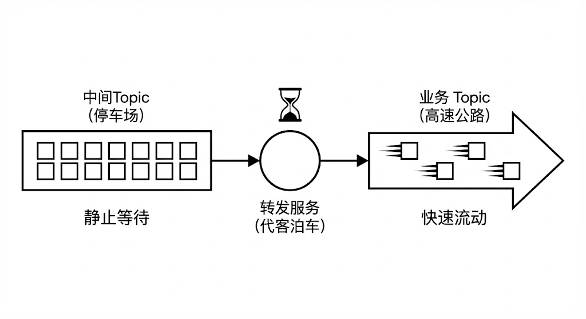
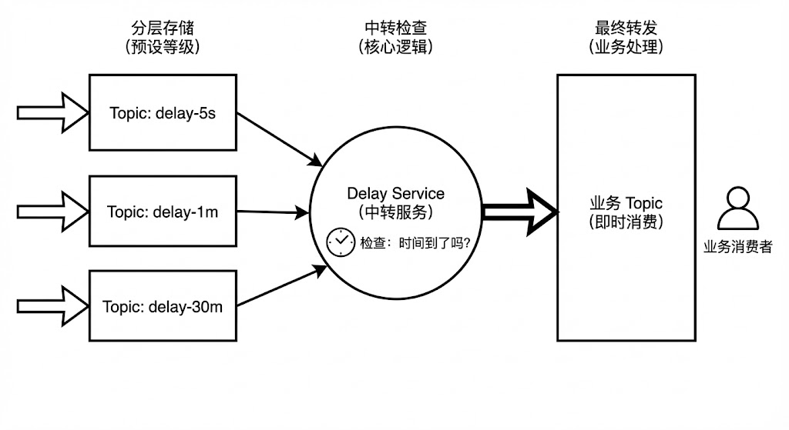
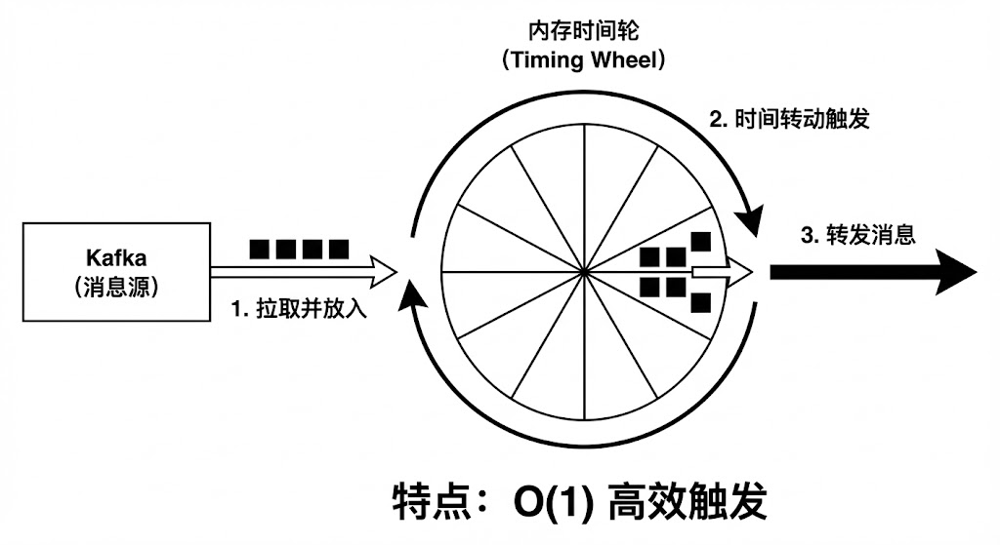
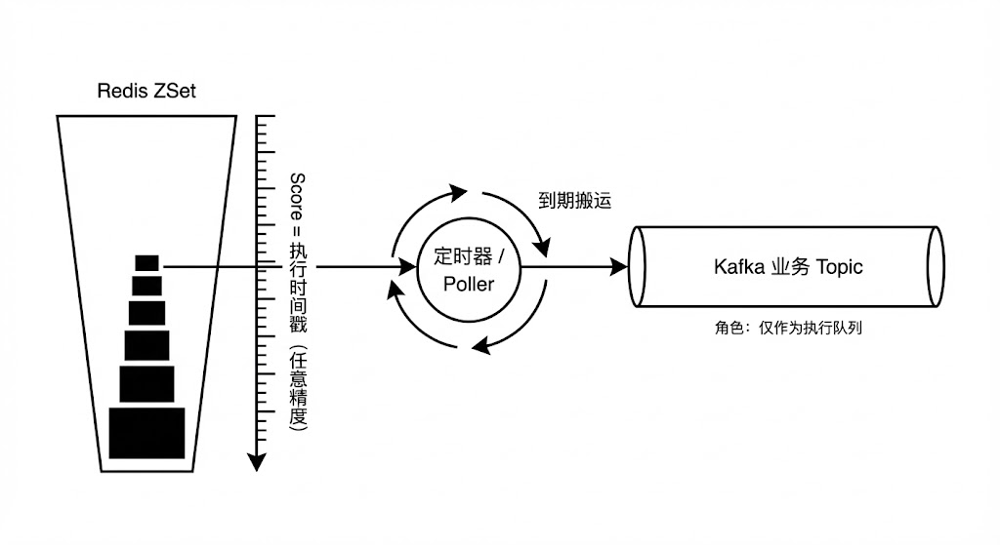

### 一、 知识点讲解

在 Kafka 中实现延时队列，本质上是构建一个“暂存转发”系统。

我们要解决的核心矛盾是：消息发出来了，但还不能被业务消费者看到。

所以，我们需要建立一系列“停车场（中间 Topic）”，让消息先在那里停一会儿。等时间到了，再由一个专门的“代客泊车员（转发服务）”把消息开到“高速公路（业务 Topic）”上。

#### 架构模式：多层级延时 Topic

既然 Kafka 没法对每一条消息单独倒计时，那我们就批量处理。

- **设计：** 我们预设几个固定的延时等级，比如 `delay-5s`、`delay-1m`、`delay-30m`。这每一个等级对应一个独立的 Kafka Topic。
- **流程：**
    - **生产：** 业务方想发一条 1 分钟后执行的消息，就发给 `delay-1m` 这个 Topic。
    - **中转（核心）：** 我们需要写一个独立的**Delay Service（延时服务）**。它作为消费者，订阅所有的延时 Topic。
    - **检查：** Delay Service 从 `delay-1m` 拉取消息。它会检查消息的时间戳：
        1. 如果时间到了（$$T_{now} \ge T_{create} + 1min $$），就把它转发给真正的业务 Topic。
        2. 如果时间没到，它就暂停拉取（Pause）或者在内存里用**时间轮**等一会儿。
    - **消费：** 真实的业务消费者只订阅业务 Topic，对前面的过程无感知。

#### 为什么不能简单地 Consumer Sleep？

有的同学可能会问：“我直接在消费者里读到消息，算一下时间，Thread.sleep(剩余时间) 不行吗？”

***绝对不行。***

Kafka 的消费是顺序的。如果你在处理 Offset=10 的消息时 Sleep 了 1 分钟，那么 Offset=11, 12, 13 的消息全都被堵住了。即使 Offset=11 的消息只需要延时 1 秒，它也得陪着等 1 分钟。这就是典型的队头阻塞。

所以必须把不同延时的消息隔离到不同的 Topic 中。

#### 进阶方案：时间轮

如果 Delay Service 只是简单的轮询 Kafka，效率很低。通常会在 Delay Service 内部引入 时间轮算法。

- 从 Kafka 拉取一批消息 -> 放入内存时间轮 -> 时间轮转动触发任务 -> 转发消息。
- 这样可以将大量的定时任务管理优化到 O(1) 的复杂度。

#### 基于 Redis 的混合方案（备选）。

如果业务对延时的精度要求非常高（支持任意秒数），上述 Topic 方案就不够用了。

此时我们会引入 Redis ZSet。

1. 消息先存入 Redis ZSet，Score 设为执行时间戳。
2. 启动一个定时器（或 Redisson 延时队列）轮询 ZSet。
3. 到期后将消息搬运到 Kafka 的业务 Topic 中。
4. 这里 Kafka 纯粹作为“执行队列”，延时逻辑由 Redis 承担

---

### 二、 面试标准回答

Kafka 本身是为高吞吐流式计算设计的，并不原生支持延时队列。如果非要在 Kafka 上实现，业界标准的做法是借鉴 RocketMQ 的设计理念，采用“基于 Topic 的多级延时桶”方案。

**第一，多级 Topic 中转。**

我们无法实现任意精度的延时（比如 3分21秒），通常是支持固定的延时级别（如 5s, 1m, 1h）。

我们为每个级别创建一个单独的 Topic（例如 topic_delay_1m）。

1. **生产者**根据需要的延时时长，将消息发送到对应的延时 Topic 中。
2. 我们部署一组专门的**转发服务**来消费这些延时 Topic。
3. 转发服务判断消息是否到期。如果到期，则生产到真正的**目标业务 Topic**；如果没到期，则等待。
4. **业务消费者**只订阅目标业务 Topic，从而实现延时效果。

**第二，如何解决“等待”的效率问题**

在转发服务内部，我们不能简单地使用 Sleep，这会导致吞吐量暴跌。

通常我们会引入**时间轮**算法。消费者拉取一批消息后，将它们注册到内存中的时间轮里。时间轮转动触发回调，再异步地将消息发送到目标 Topic。这不仅避免了阻塞，还解决了大量定时任务的 CPU 消耗问题。
