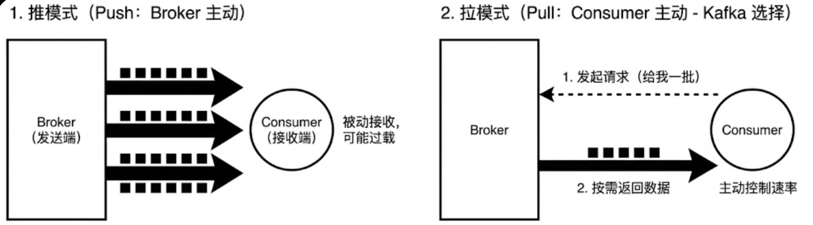
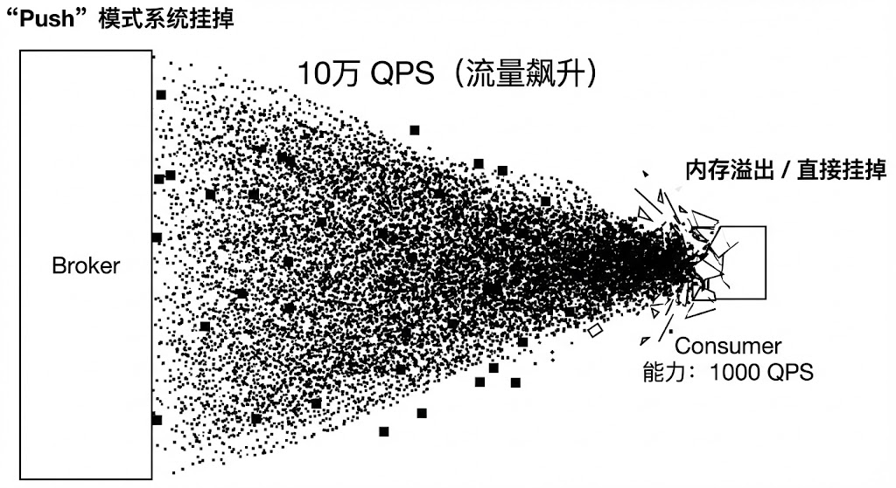
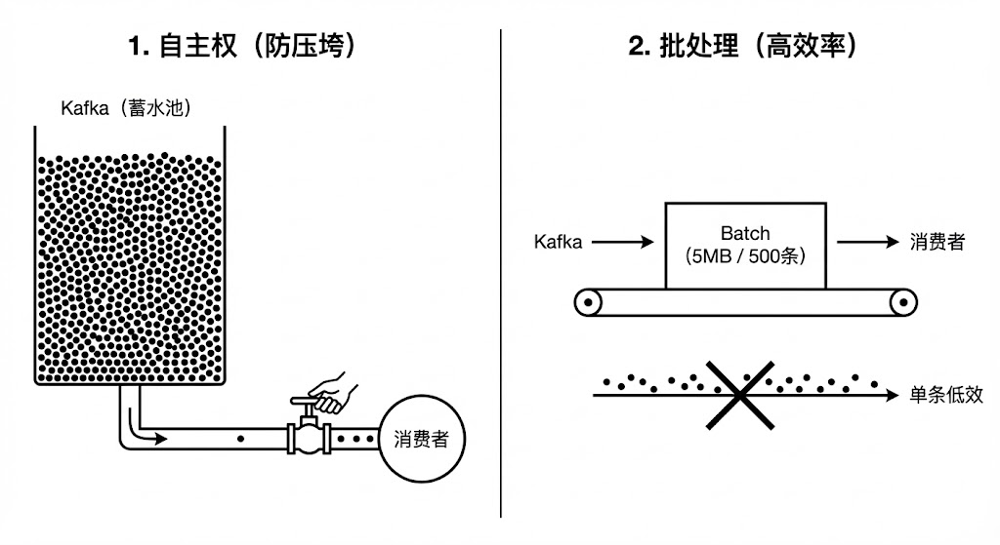
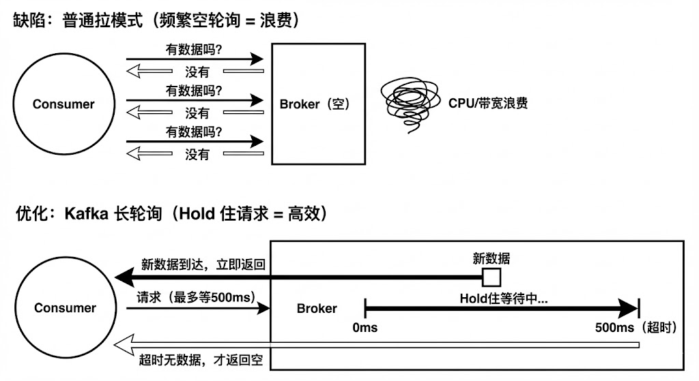

### 一、 知识点讲解

在消息系统中，数据的传输只有两种方式：

1. **推（****Push****）：** Broker 收到消息后，不管三七二十一，立刻推给消费者。
2. **拉（Pull）：** Consumer 主动向 Broker 发起请求：“有没有新数据？给我一批。”

Kafka 选择了 **Pull（拉模式）**。这是为了适应**不同消费速率**的下游系统，实现“削峰填谷”的根本保障。

#### 推模式的问题

如果使用推模式（Push），Broker 掌握主导权。

- **问题：** Broker 不知道消费者的处理能力。如果上游流量飙升到 10万 QPS，而消费者每秒只能处理 1000 条，Broker 依然会把 10万条消息硬推给消费者。
- **后果：** 消费者端的网卡被打满，或者内存缓冲区溢出，直接挂掉。这就好比填鸭式喂饭，不管你咽不咽得下去。

#### 拉模式的优势：按需消费

Kafka 的 consumer.poll() 方法就是拉模式的体现。

- **自主权：** 消费者可以根据自己的处理能力来决定拉取的速度。处理完一批，再拉下一批。如果处理不过来，就慢慢拉，消息堆积在 Kafka 里（Kafka 的磁盘存储就是为了这个设计的），不会把消费者压垮。
- **批处理：** 拉模式非常适合批量获取。消费者可以一次性申请：“给我拉 5MB 数据”或者“给我拉 500 条数据”。这比推模式一条条发要高效得多。

#### 拉模式的缺陷与优化（长轮询）

拉模式有一个缺点：如果 Broker 没有新消息，消费者会不断地发起空轮询，浪费 CPU 和带宽。

Kafka 的解决办法：长轮询。

在 poll 时可以设置超时时间。如果 Broker 里没有数据，它不会立刻返回空，而是Hold 住请求一小会儿（比如 500ms）。一旦这期间有新数据到了，立刻返回；如果超时了还没数据，再返回空。既保证了实时性，又避免了空转。

---

### 二、 面试标准回答

Kafka 在 Consumer 端采用的是 Pull（拉模式）。这是 Kafka 为了实现高吞吐和流量控制而做出的核心设计决策。

**第一，流量削峰**

这是最本质的原因。在分布式系统中，Producer 的发送速率和 Consumer 的消费速率往往是不对等的。

如果采用 Push 模式，Broker 很难精准掌握不同消费者的处理能力，极易导致DoS般的效果，将慢消费者压垮。

采用 Pull 模式，将控制权交还给 Consumer。消费者可以根据自身的处理能力，自主决定拉取的频率和批量大小，真正实现了“削峰填谷”。

**第二，高吞吐**

Kafka 追求极致的吞吐量。Push 模式通常倾向于以“条”为单位发送，而 Pull 模式非常自然地支持**批量**获取。

Consumer 可以在一次 Request 中拉取几十 MB 的数据，这极大地减少了网络交互次数和 IO 上下文切换，结合 Kafka 的零拷贝技术，能发挥出最高的性能。

**第三，长轮询解决空转。**

针对 Pull 模式可能导致的“无消息时空轮询”问题，Kafka 引入了长轮询机制。

当 Broker 没有数据时，不会立即返回空结果，而是会将请求挂起一段时间。一旦有新数据写入，立刻返回。这既保证了消息的准实时性，又避免了客户端 CPU 的无效空转。
