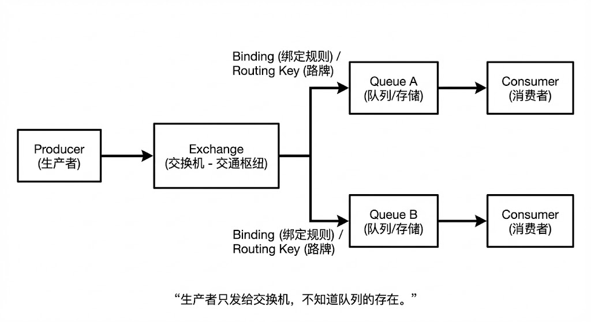
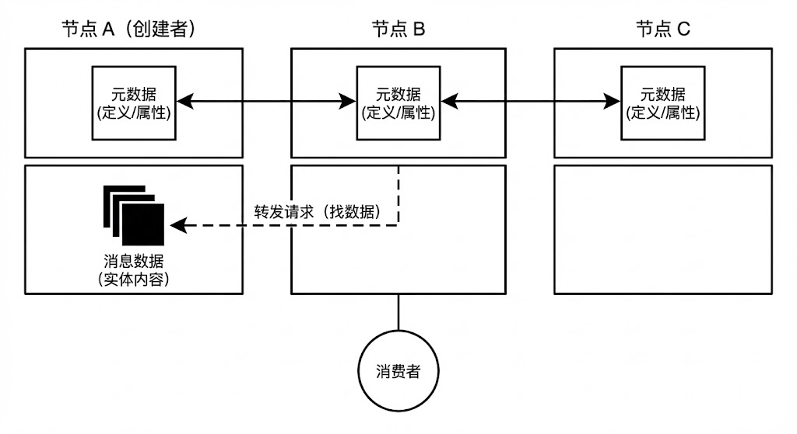

### 一、 知识点讲解

RabbitMQ 的架构由 Producer（生产者）、Broker（服务节点）、Consumer（消费者） 三大物理角色组成。

但在逻辑层面，它引入了比其他 MQ 更复杂的概念：Exchange（交换机） 和 Binding（绑定）。

生产者永远不会直接把消息发送给队列，而是发给交换机。交换机像一个“交通枢纽”，根据预定义的规则（Binding）和每条消息的“路牌”（Routing Key），将消息分发到具体的 Queue（队列） 中。

#### **核心组件**

- **Producer：** 产生消息。它连接到 Broker，建立 Channel，然后把消息发送给 Exchange。注意，Producer 甚至不知道 Queue 的存在。
- **Exchange（交换机）：** 这是 RabbitMQ 的灵魂。它接收消息，根据 **Routing Key** 和 **Exchange Type**（Direct/Fanout/Topic/Headers），决定把消息扔进哪个 Queue。如果没有匹配的 Queue，消息就会被丢弃（或进入死信队列）。
- **Queue（队列）：** 真正存储消息的地方。消息在这里排队等待被消费。
- **Binding（绑定规则）：** 它是 Exchange 和 Queue 之间的桥梁。它告诉 Exchange：“如果你收到 Routing Key 为 `xyz` 的消息，请把它转发给 Queue A”。

#### 网络连接模型：Connection 与 Channel

这是 RabbitMQ 性能的关键设计。

- **Connection：** 是一个物理的 **TCP 长连接**。建立 TCP 连接（三次握手）是非常消耗资源的。
- **Channel（信道）：** 是在 TCP 连接内部建立的**虚拟连接**。它是多路复用的。
    - 这意味着，你的应用程序可能有 100 个线程在发消息，它们可以共用**同一个 TCP Connection**，但每个线程使用**不同的 Channel**。
    - 这极大节省了操作系统 TCP 连接资源的开销。

#### 逻辑隔离

一个 RabbitMQ Broker 里可以创建多个 vhost（如 /、/pay、/order）。不同的 vhost 之间是完全逻辑隔离的，它们拥有独立的 Exchange、Queue 和权限机制。这让一台 RabbitMQ 服务器可以安全地服务于多个不同的业务线。

#### 集群架构：元数据同步

RabbitMQ 的集群（Cluster）不同于 Kafka。

- **元数据：** 如 Queue 的名字、Exchange 的属性、Binding 关系，会在集群所有节点间**全量同步**。
- **消息数据：** 默认情况下，**只存在于创建该 Queue 的那个节点上**。其他节点只知道“数据在节点 A 上”，如果消费者连了节点 B，节点 B 会把请求转发给节点 A。

*注：为了高可用，通常会配置镜像队列来同步消息数据。*

---

### 二、 面试标准回答

RabbitMQ 的架构是基于 AMQP 标准协议 实现的。它的核心设计理念是“消息路由与存储分离”。从架构上，我们可以从逻辑模型、连接模型和集群模型三个维度来理解。

**第一，逻辑模型**

这是 RabbitMQ 区别于 Kafka 的最大特征。

- **解耦：** 生产者不直接与队列交互，而是将消息发送给 **Exchange（交换机）**。
- **路由：** Exchange 根据 **Routing Key** 和预定义的 **Binding（绑定关系）**，将消息精准分发到通过 **Queue（队列）** 中。

这种设计支持了极其灵活的路由策略，如 Direct（点对点）、Fanout（广播）、Topic（通配符匹配），非常适合复杂的业务场景。

**第二，连接模型**

为了减少 TCP 连接创建和销毁的开销（三次握手），RabbitMQ 引入了 Channel（信道） 的概念。

Channel 是建立在 TCP 连接之上的虚拟连接，实现了多路复用。我们的业务线程通过轻量级的 Channel 进行通信，而底层复用同一个物理 TCP 连接，这极大地提高了系统的网络资源利用率。

**第三，集群与高可用模型**

RabbitMQ 的原生集群主要用于扩展吞吐量，但默认不保证数据高可用。

在生产环境中，我们必须配置 镜像队列

- 这使得 Queue 的数据会在集群的多个节点之间进行同步复制。
- 一旦主节点宕机，集群会自动选举出新的主节点，从而保证消息不丢失，实现真正的高可用。
