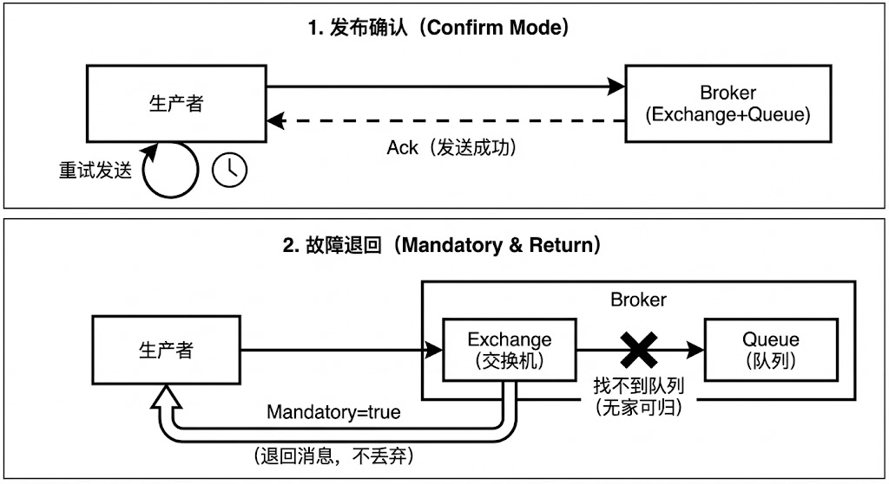
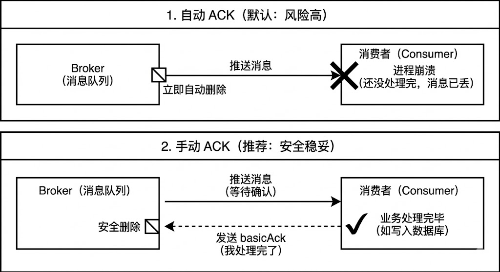

### 一、 知识点讲解

一条消息从出生到终结，会经历三个阶段：

1. **发送阶段：** 生产者把消息发给 Broker。
2. **存储阶段：** Broker 把消息写进磁盘，并同步给其他节点。
3. 消费阶段： 消费者从 Broker 拿走消息并处理。

这就好比送快递：快递员得把货送到站点（发送），站点得把货存好别丢了（存储），收件人得亲自签收确认（消费）。任何一步出问题，包裹就丢了。

#### **发送端：由于网络抖动，Broker 没收到怎么办？**

AMQP 协议虽然提供了事务，但性能太差，会把吞吐量拉低几百倍，生产环境基本不用。

- **发布确认机制：** 这是标准解法。生产者开启 Confirm 模式后，每发一条消息，Broker 收到并处理后会专门回传一个 `ack` 给生产者。
    - 如果收到 `ack`，说明发送成功。
    - 如果收到 `nack` 或者超时未收到，生产者必须**重试发送**。
- **Mandatory 与 Return 机制：** 有时候消息发到了 Broker，但 Exchange 找不到对应的 Queue。这时候消息会默认被丢弃。设置 `mandatory=true` 并配置 `ReturnListener`，Broker 就会把这些“无家可归”的消息退回给生产者，而不是悄悄丢掉。

#### 服务端：Broker 宕机或重启了怎么办？

RabbitMQ 默认是把消息存在内存里的，一重启就没了。必须做持久化，这包含三层含义，缺一不可：

- **Exchange 持久化：** 声明时 `durable=true`。否则重启后交换机没了。
- **Queue 持久化：** 声明时 `durable=true`。否则重启后队列没了。
- **Message 持久化：** 发送消息时设置属性 `delivery_mode=2`。否则重启后，交换机和队列还在，但里面的消息没了。
- **进阶（集群高可用）：** 哪怕磁盘持久化了，如果这台机器硬盘坏了呢？必须配置**镜像队列**，把消息同步复制到集群的其他节点上。

#### **消费端：拿到消息还没处理完，进程挂了怎么办？**

- **关闭自动 ACK：** 默认情况下，RabbitMQ 是一把消息推给消费者，就自动认为“消费成功”并在队列中删除消息（`autoAck=true`）。如果消费者逻辑还没跑完就崩溃了，消息就永久丢失了。
- **开启手动 ACK：** 将 `autoAck` 设为 `false`。只有当业务代码完全执行成功（比如数据库写入完毕）后，再调用 `channel.basicAck()` 告诉 Broker：“我处理完了，你可以删了”。

---

### 二、 面试标准回答

RabbitMQ 要保证消息不丢失，必须在生产者、MQ 服务端、消费者这也是通常所说的全链路可靠性保障。

**第一，在生产者端，启用发布确认机制**

我们不能想当然地认为消息发出去就一定到了。必须开启 Confirm 模式。

只有当收到 Broker 回传的 ACK 确认信号后，我们才认为消息发送成功。如果收到 NACK 或超时，我们需要结合本地消息表或重试机制进行重新发送。

同时，为了防止“路由失败”导致消息丢失，我们会设置 mandatory 参数并绑定 ReturnListener，确保无法路由的消息能被退回处理。

**第二，在服务端，开启持久化与高可用**

这一步是为了防止 Broker 宕机导致内存数据丢失。我们需要做“三层持久化”：

1. **Exchange** 设置 `durable=true`。
2. **Queue** 设置 `durable=true`。
3. Message 的 delivery_mode 设置为 2（持久化）。
4. 此外，单机持久化还不够。在生产环境中，我们必须配置镜像队列，确保消息被同步复制到集群中的其他节点。这样即使主节点宕机，数据也不会丢失。

**第三，在消费者端，使用手动 ACK**

我们严禁使用默认的“自动应答”模式。

必须将 autoAck 设置为 false。只有当我们的业务逻辑完全执行成功（例如数据已落库）之后，才手动调用 basicAck 确认。如果业务处理抛出异常，我们可以调用 basicNack 让消息重新入队或进入死信队列，防止消息被误删。
