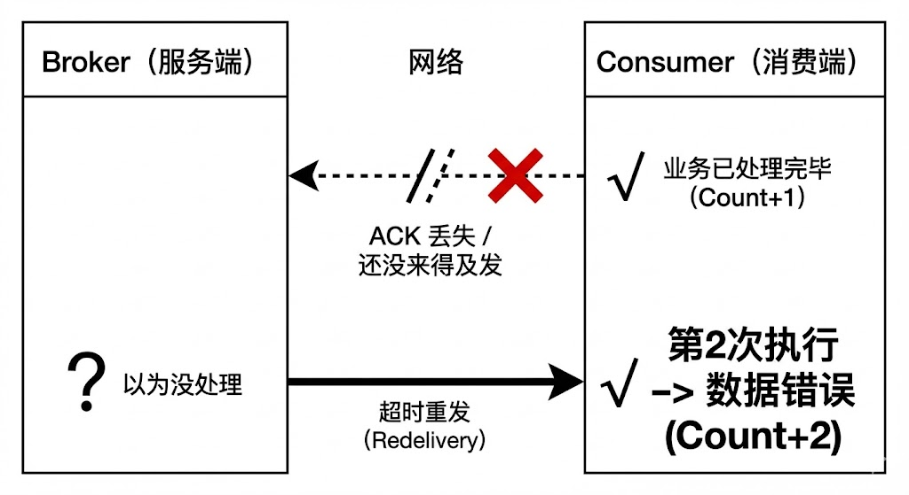
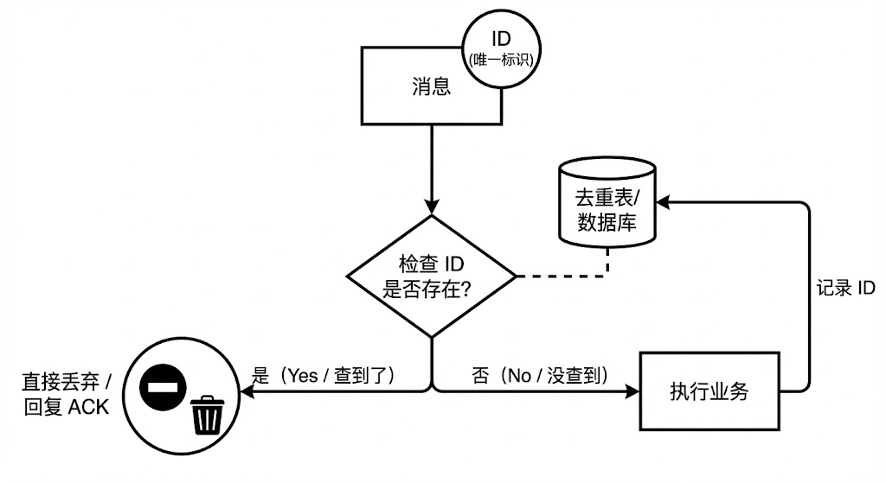

### 一、 知识点讲解

在 RabbitMQ 中，重复消费的根源通常在于 ACK机制的失败。

正常流程是：消费端接收消息 -> 处理业务 -> 发送 ACK 给 Broker -> Broker 删除消息。

但在异常情况下（比如消费端处理完了业务，还没来得及发 ACK 就挂了，或者 ACK 包在网络中丢了），Broker 会认为这条消息没被处理，于是会将消息**重新入队**并投递给下一个消费者。

这时候，业务逻辑就会被执行第二次。如果业务逻辑不是“幂等”的（比如是简单的 count = count + 1），数据就错了。

#### 什么是幂等性

这是解决重复消费的唯一银弹。

它的数学定义是 $$f(f(x)) = f(x) $$。

用通俗的编程语言解释就是：无论我对同一条消息消费多少次，数据库里的结果都是一样的，不会因为多消费了一次就多扣了一次钱。

#### 核心解决方案：唯一标识

要实现幂等，前提是每一条消息必须有一个全局唯一的 ID

消费者在处理前，先拿着这个 ID 去“查账”：

- **查过了？** 说明消费过了，直接丢弃或回一个 ACK。
- **没查过？** 执行业务，并把这个 ID 记下来。

#### **常见实现载体**

- **数据库唯一键：** 利用数据库的主键或唯一索引约束。
- **Redis 原子操作：** 利用 `SETNX` 命令，谁先设置成功谁处理，处理过的不能再设置。

---

### 二、 面试标准回答

在 RabbitMQ 的实际应用中，由于网络抖动或消费者宕机导致 ACK 丢失，消息重复投递是无法在中间件层面完全屏蔽的。

解决这个问题的核心原则是：假设消息一定会有重复，在消费端的业务逻辑中实现幂等性。

**第一，基于数据库的唯一约束**

这是最简单且最可靠的方法。

我们可以在数据库中建立一张“去重表”，或者利用业务表中的唯一索引。

当重复消息到来时，业务逻辑尝试插入数据，数据库会抛出 DuplicateKeyException。我们捕获这个异常，不进行任何业务处理，直接手动 ACK 确认掉这条消息即可。

**第二，基于 Redis 的前置校验**

如果业务对吞吐量要求很高，频繁利用数据库报错来去重不合适，我们会引入 Redis。

在处理消息前，先利用 Redis 的 SETNX 命令尝试设置消息的 MessageID。

- 如果返回 `Success`，说明是第一次消费，继续执行业务。
- 如果返回 `Fail`，说明该 ID 已经存在，判定为重复消费，直接跳过。

*注意：Redis 方案通常需要配合数据库做最终兜底，防止 Redis 宕机或数据丢失。*
