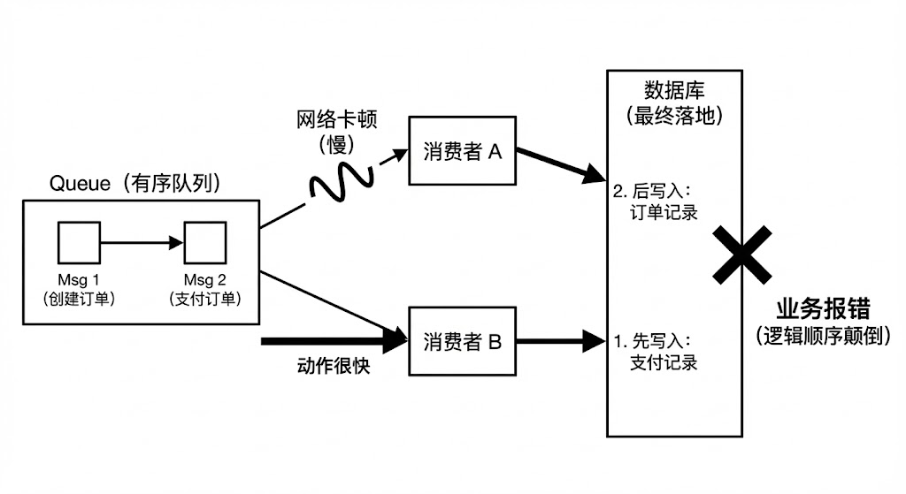
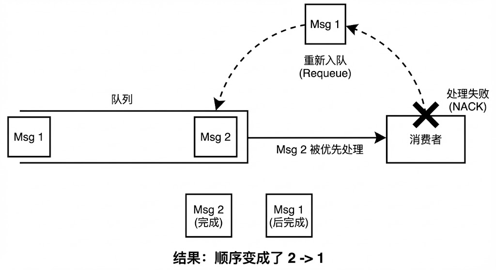
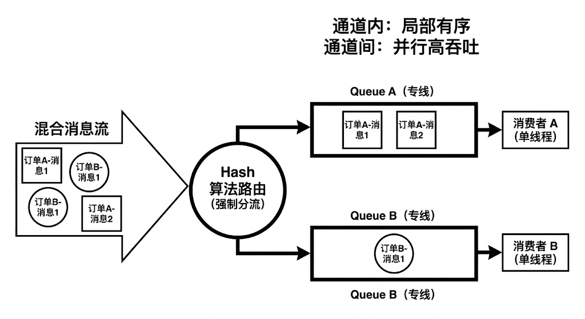

### 一、 知识点讲解

在 MQ 领域，保证顺序通常指的是**“局部有序”**。比如：我们不需要保证用户 A 的注册消息和用户 B 的下单消息谁先谁后，我们只需要保证同一个订单的“创建 -> 支付 -> 发货”这三个动作是严格按顺序执行的。

RabbitMQ 导致乱序的核心原因只有一个：并行。

#### 乱序场景：多个消费者

RabbitMQ 的 Queue 本身是有序的。但是，为了提升处理速度，我们通常会给一个 Queue 配置多个消费者（或者一个消费者内部开多线程）。

- **现象：** Queue 里有 Msg 1（创建）和 Msg 2（支付）。
- **过程：** 消费者 A 拿到了 Msg 1，消费者 B 拿到了 Msg 2。
- **结果：** 假如消费者 A 处理因为网络卡顿慢了一点，消费者 B 动作很快，先处理完了 Msg 2。
- **结局：** 数据库里先有了“支付记录”，后有了“订单记录”，业务直接报错。

#### 消息重试

即使只有一个消费者，如果开启了手动 ACK。

- Msg 1 处理失败，消费者发送 NACK 并让其重新入队。
- RabbitMQ 会把 Msg 1 重新塞回队列头部。
- 在 Msg 1 还没被再次取出的间隙，Msg 2 可能已经被处理了。顺序又乱了。

#### 解决方案的核心：内存队列

既然多消费者会导致乱序，那最简单的办法就是“一个 Queue 只给一个消费者消费”。

但是这样吞吐量太低了。

折中的办法是“逻辑拆分”：

我们将这一类需要保序的消息（比如同一个 OrderID 的所有消息），通过 Hash 算法，强制路由到同一个特定的 Queue中，并且这个 Queue 只由一个消费者（单线程）来处理。

这样，不同 OrderID 的消息可以在不同的 Queue 并没有行处理，既保证了局部有序，又保证了整体的高吞吐。

---

### 二、 面试标准回答

RabbitMQ 仅保证Queue 内部的消息是 FIFO 的。但在实际生产中，由于多消费者并发处理或网络抖动，消息顺序极易被打乱。

要解决这个问题，必须遵循“同源消息串行化”的原则，通常我们有两种方案。

**第一，简单方案：单 Queue 单 Consumer（牺牲吞吐）。**

最直接的方法是，对于需要保序的业务，我们建立一个专门的 Queue，并且只配置一个消费者节点，且该消费者内部只使用单线程。

这强行将并行改为了串行，绝对保证了顺序。但缺点极其明显：系统的吞吐量受限于单机的处理能力，一旦消息量大，会产生严重积压。这只适用于低频的关键业务。

**第二，进阶方案：基于 Hash 的队列拆分（推荐）。**

为了兼顾顺序和性能，我们在 Producer 端进行逻辑拆分：

1. 我们创建 N 个 Queue（比如 `Order_Queue_1` 到 `Order_Queue_4`）。
2. 发送消息时，利用 **Consistent Hashing Exchange（一致性 Hash 交换机）** 插件，或者在客户端计算 `Hash(OrderID) % N`。
3. 这保证了**同一个订单的所有消息（创建、支付、发货）一定会落入同一个 Queue 中**。
4. 每个 Queue 依然只配置一个消费者（单线程）。
5. 通过这种方式，我们在局部（单个订单）上实现了严格顺序，在全局上实现了 N 倍的并发吞吐。
