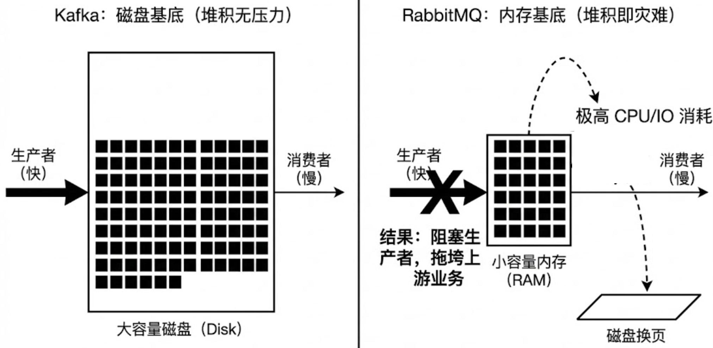
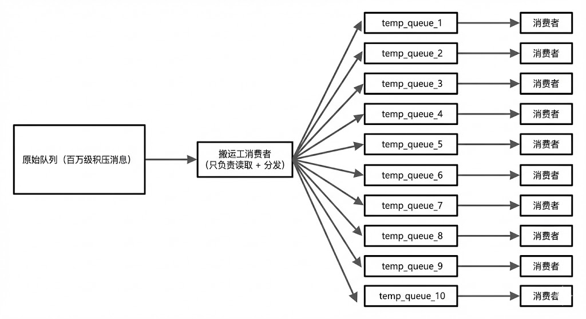
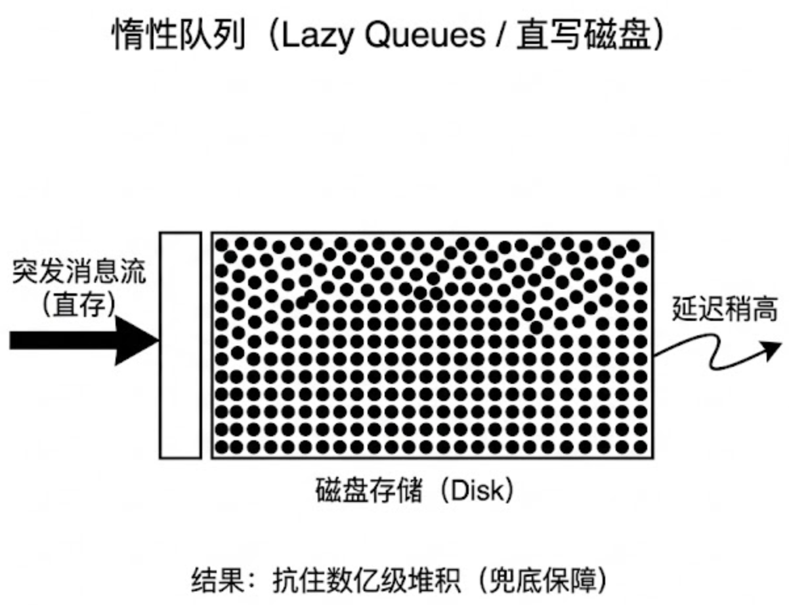

### 一、 知识点讲解

消息堆积的本质很简单：生产者的发送速率 > 消费者的处理速率。

但是在 RabbitMQ 中，堆积比 Kafka 更可怕。

- **Kafka** 本来就是存磁盘的，堆积几亿条也没事，顶多读得慢点。
- **RabbitMQ** 是设计为内存存储的。一旦积压，内存不够用，它就会把内存里的消息往磁盘上刷。这个过程极其消耗 CPU 和 IO，会导致生产者的发送被阻塞，进而拖垮上游业务。

#### 临时扩容的局限性

你可能会觉得：“堆积了？那我就加 10 台消费者机器不就行了？”

不一定有用。

如果原来的架构是一个 Exchange 绑定一个 Queue，而这个 Queue 只有一个消费者。哪怕你加了 10 台机器，因为 RabbitMQ 的 Queue 往往受到单线程或锁的限制，或者消费者逻辑本身有瓶颈（比如数据库锁），简单的加机器并不能线性提升吞吐。

#### 核心解法：临时队列分片

面对海量积压（比如几百万条），最有效的办法是“搬运 + 分流”。

我们不直接消费积压的队列（因为太慢）。我们把原来的消费者改成一个“搬运工”。它只做一件事：从原队列拿消息，然后**轮询**分发到临时的 N 个新队列中（比如 `temp_queue_1` ... `temp_queue_10`）。然后我们部署 10 倍的消费者去分别消费这 N 个临时队列。这相当于在应用层手动做了一次**MapReduce**，利用多队列的并行度来瞬时吞吐数据。

#### RabbitMQ 自身的优化：Lazy Queues

在 RabbitMQ 3.6 以后，引入了 Lazy Queues（惰性队列）。

如果你的业务天然就有波峰波谷，容易堆积，可以将队列配置为 x-queue-mode: lazy。

这种队列会直接把消息存到磁盘，不再强依赖内存。虽然延迟稍微变高了一点，但它能抗住数亿级的堆积而不崩盘，是解决堆积隐患的兜底手段。

---

### 二、 面试标准回答

RabbitMQ 的消息堆积通常是由于下游消费能力不足或消费端逻辑报错导致的。针对这个问题，我们分为“紧急处理”和“长期治理”两个阶段来解决。

**第一，紧急处理方案（临时扩容与分流）。**

如果线上已经发生了严重积压，单纯增加消费者实例往往因为 SQL 瓶颈或队列争抢而效果不佳。我们的标准 SOP 是：

1. **停掉现有的业务消费者**，防止它们继续慢速处理阻塞队列。
2. 上线一组**临时消费者**。这组程序没有任何业务逻辑，只负责快速从原队列取出消息，并**轮询转发**到我们临时建立的 N 个新队列（例如 10 个 `temp_queue`）中。
3. 上线 N 倍数量的**工作消费者**，分别监听这 N 个临时队列。
4. 通过这种“逻辑分片”的方式，我们将单队列的瓶颈转化为多队列并行消费，通常能以 10 倍以上的速度消化积压。等积压清空后，再切回原架构。

**第二，消费端性能调优。**

在日常开发中，我们需要优化消费逻辑：

1. **调整** `**prefetch_count**`**：** 这是关键参数。如果设为 1，网络交互太频；设太大，消费者处理不过来。通常根据业务耗时设置在 10-50 之间，实现批量拉取。
2. **批量写入：** 如果瓶颈在数据库，将单条 `Insert` 改为批量提交，减少 I/O 开销。

**第三，服务端配置优化**

为了防止堆积耗尽 RabbitMQ 的内存导致集群崩溃，我们在生产环境中会将可能产生积压的非低延迟队列配置为 Lazy Queues。让消息直接落盘，虽然牺牲了一点点延迟，但极大提升了队列的堆积容量上限，保证了服务的稳定性。
