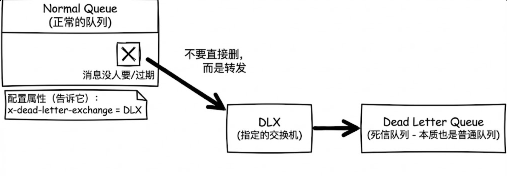
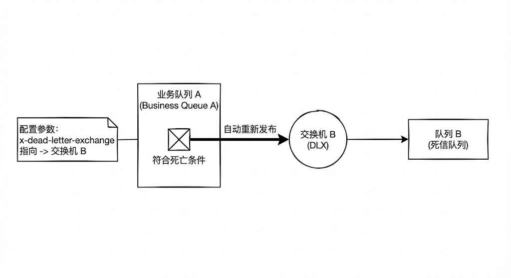
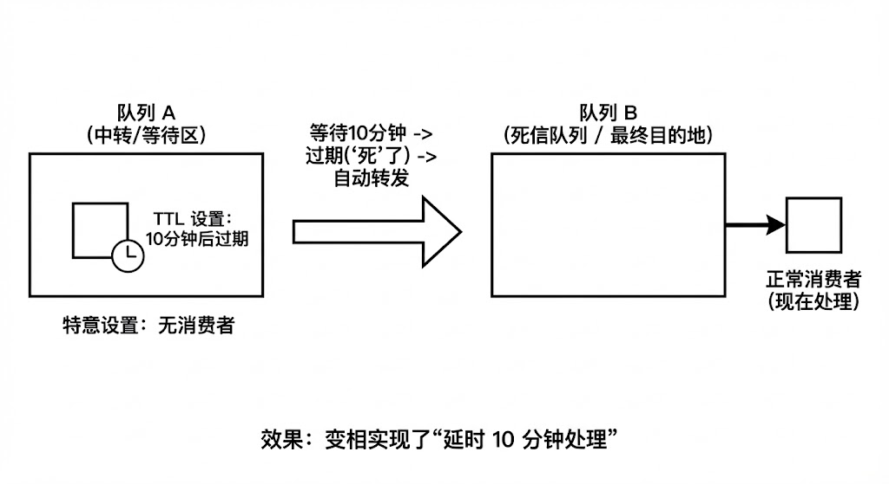

### 一、 知识点讲解

首先要纠正一个误区：RabbitMQ 中并没有一种专门的队列类型叫“死信队列”。

所谓的“死信队列”，其实就是一个普通的队列。

这就好比“回收站”文件夹，它本质上也是个文件夹，只是我们规定把删掉的文件都扔进去而已。

在 RabbitMQ 中，我们给一个正常的队列配置一个属性，告诉它：“如果你里面的消息没人要，或者过期了，不要直接删掉，而是转发给另一个指定的交换机（DLX）”。这个被转发到的最终队列，就是死信队列。

#### 触发条件

一条正常的消息变成“死信”，通常只有三种情况：

- **被拒收了：** 消费者调用了 `basic.reject` 或 `basic.nack`，并且明确指定 `requeue=false`（不再重新入队）。这就相当于消费者说：“这消息有毒，我处理不了，也不要给别人处理了，扔了吧。”
- **过期了（TTL）：** 消息设置了有效期（Time To Live），或者队列设置了消息存活时间。如果在规定时间内没被消费，它就“死”了。
- **队列满了：** 队列设置了最大长度（`x-max-length`），后面的新消息进不来，或者前面的老消息被挤出去了。

#### 死信的流转路径

这完全是配置出来的。

你在声明业务队列 A 的时候，需要给它加个参数 x-dead-letter-exchange，指向交换机 B。

一旦队列 A 里的消息符合上述三种“死亡”情况，RabbitMQ 就会自动把这条消息重新发布到交换机 B，最后落入队列 B。

这个队列 B，就是我们口中的死信队列。

#### 最经典的应用：延时队列

RabbitMQ 原生不支持“发一条消息，10分钟后再投递”。

但是我们可以利用死信队列“曲线救国”：

1. 建一个队列 A，**不设置消费者**，但是设置消息过期时间为 10 分钟（TTL），并绑定死信交换机。
2. 建一个队列 B（死信队列），配置正常的消费者。
3. 流程： 消息发给 A -> 在 A 里呆 10 分钟 -> 过期“死”了 -> 转发给 B -> 消费者从 B 收到消息。
4. 这就变相实现了“延时 10 分钟处理”的效果。

---

### 二、 面试标准回答

死信队列是 RabbitMQ 中用于处理无法被正常消费消息的一种机制。它主要用于异常数据留存、问题排查以及实现延时队列。它在物理上只是一个普通的队列，只是通过绑定死信交换机（DLX）接收了来自其他队列的“废弃”消息。

**第一，死信产生的来源**

在 RabbitMQ 中，消息变成死信主要有三种情况：

1. **消息被拒绝：** 消费者执行了 `basic.reject` 或 `basic.nack`，并且将 `requeue` 参数设为 `false`。
2. **消息过期（TTL）：** 消息在队列中的存活时间超过了设置的 TTL（Time To Live）。
3. **队列达到最大长度：** 队列配置了 `x-max-length`，导致超出限制的消息被溢出。

**第二，死信队列的原理。**

死信机制是在声明业务队列时配置的。

我们需要在业务队列的参数中设置 x-dead-letter-exchange，将其绑定到一个指定的 死信交换机。

当消息判定为死信后，RabbitMQ 会自动将其 Publish 到这个死信交换机，再由该交换机路由到具体的死信队列中。我们通常会为死信队列配备专门的消费者，将数据落库以便后续的人工排查或重试。

**第三，延时队列**

除了做异常兜底，死信队列最常用的场景是配合 TTL 实现延时队列。

因为 RabbitMQ 原生不支持延时投递。我们通常创建一个没有消费者的队列，设置 TTL（例如 30 分钟）并绑定死信交换机。消息发送后在该队列暂存，过期后自动转发到死信队列被业务消费者处理，从而实现“订单超时取消”等业务逻辑。
