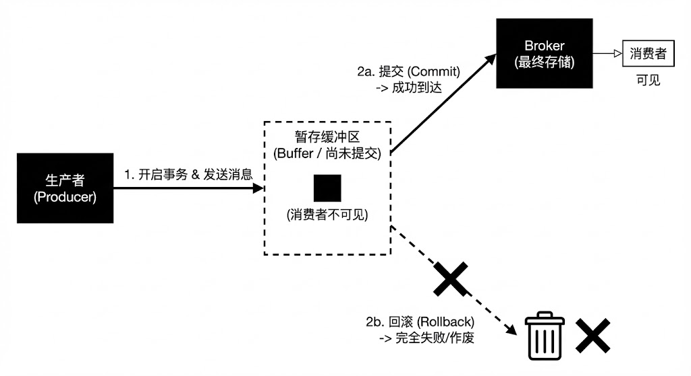
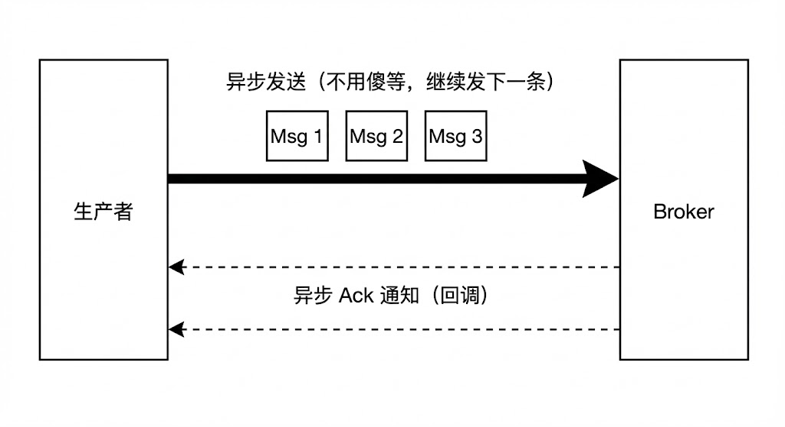

### 一、 知识点讲解

RabbitMQ 的事务机制是基于 AMQP 协议层面的标准实现。

它的初衷是为了保证生产者发送消息的原子性：<u>要么消息成功到达 Broker 并持久化，要么完全失败。</u>

这就好比数据库事务，开启后，你发的消息只是暂存在一个“缓冲区”里，只有当你提交了，消费者才能看到；如果出错回滚，刚才发的消息就全当作废。

#### 操作指令

在客户端（Channel）层面，主要涉及三个原生方法：

- `**channel.txSelect()**`**：** 将当前信道设置成“事务模式”。
- `**channel.txCommit()**`**：** 提交事务。告诉 Broker“把刚才发的消息都落实了吧”。
- `**channel.txRollback()**`**：** 回滚事务。告诉 Broker“刚才发的消息我不想要了，撤销”。

#### 缺陷：同步阻塞

这是它被弃用的根本原因。RabbitMQ 的事务是同步的。

当你开启事务并发消息时，RabbitMQ 必须将消息写入磁盘（或内存），然后等待客户端发送 `Commit` 指令。

在收到 `Commit` 并处理完成之前，**当前的 Channel 是被阻塞的**，无法发送下一条消息。

这种“发一条、等回应、再发下一条”的模式，会导致吞吐量**下降 2 到 3 个数量级**（几千倍的性能损耗）。哪怕是千兆网卡，TPS 可能也只有几百。

#### 替代方案：发布确认

为了解决事务太慢的问题，RabbitMQ 引入了 Confirm 模式。

- 它是**异步**的。生产者发完消息不用傻等，可以继续发下一条。
- Broker 收到消息后，会异步回调通知生产者 `Ack`。
- 这既保证了可靠性，又几乎不损失性能，是目前行业的标准解决方案。

---

### 二、 面试标准回答

RabbitMQ 的事务消息是 AMQP 协议提供的一种保证消息传输原子性的机制。

但在实际的生产架构中，我们严禁使用或者说极不推荐使用事务模式，因为它的性能损耗是业务系统无法承受的。我们通常使用 **发布确认** 模式作为替代。

**第一，事务的实现原理**

通过 channel.txSelect() 开启事务，发送消息后，必须显式调用 channel.txCommit() 提交。只有提交成功，Broker 才会将消息投递给消费者。如果在提交前出现异常，我们可以调用 channel.txRollback() 进行回滚，确保消息发送的原子性。

**第二，少用的原因**

RabbitMQ 的事务机制是同步阻塞的。

这意味着生产者发送每条消息后，都必须等待 Broker 处理完磁盘写入并返回 Commit 成功的响应，才能发送下一条。这种串行化的交互方式导致系统的吞吐量会急剧下降，完全浪费了 MQ 高并发的特性。

**第三，Confirm 模式**

为了兼顾“可靠性”与“高性能”，我们统一采用 **发布确认** 机制。

Confirm 模式是异步的。生产者发送消息后无需等待，Broker 收到消息后会通过**回调**的方式通知生产者 Ack。

虽然 Confirm 机制不能保证严格的原子性（批量发送时），但它在保证消息不丢失的前提下，性能比事务模式高出数百倍，是目前生产环境的绝对主流选择。
