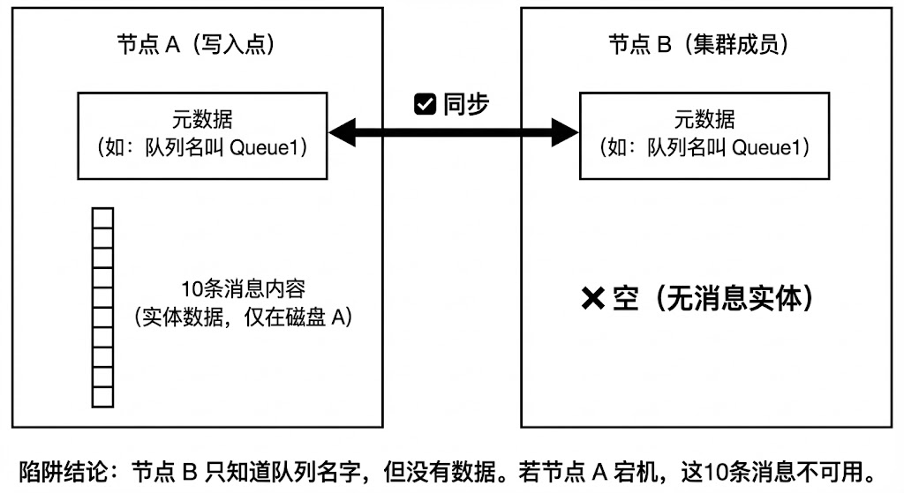
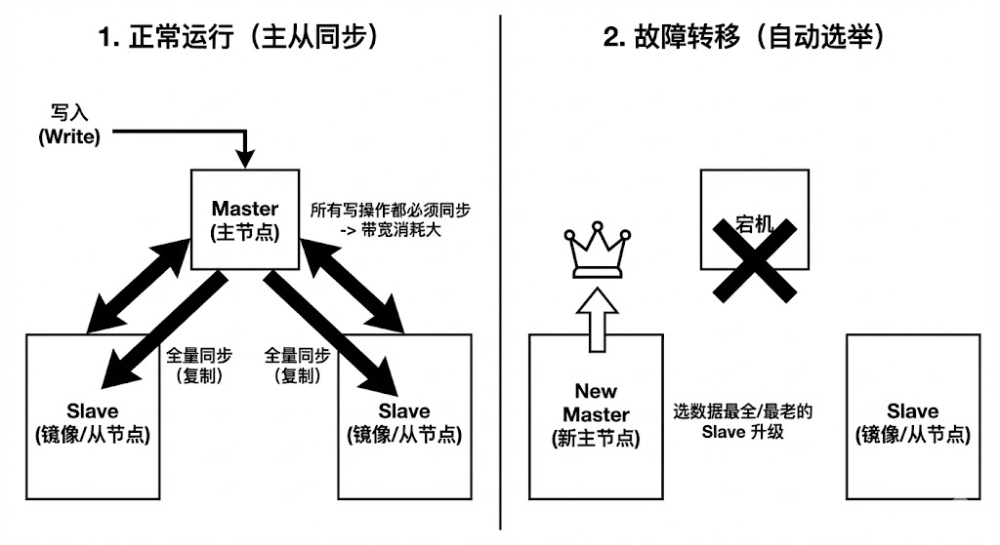

### 一、 知识点讲解

RabbitMQ 的原生集群模式有一个巨大的“陷阱”：**它默认只同步元数据，而不同步消息内容。**

这意味着，如果你往节点 A 的 Queue 里发了 10 条消息，这 10 条消息就只存在节点 A 的磁盘上。集群里的节点 B 知道有个 Queue 叫什么名字，但它那里是空的。如果节点 A 宕机，这 10 条消息就不可用了。

要实现真正的高可用，必须让数据在多个节点间复制，这主要依靠镜像队列或新一代的仲裁队列。

#### 镜像队列

这是 RabbitMQ 3.8 之前的主流方案。

**原理：** 采用**主从模式**

- 你通过配置策略，指定某个 Queue 需要在集群的另外 2 个节点上建立“镜像”。
- **Master 节点**负责处理所有的读写请求。写入 Master 的消息会同步复制到所有的 Slave 节点。
- **故障转移：** 如果 Master 挂了，集群会自动从 Slave 中选出一个最“老”的（数据最全的）升级为 Master。
- **缺点：** 性能损耗大。所有 Slave 都要同步数据，网络带宽占用高。且发生网络分区时，容易出现“脑裂”。

#### 仲裁队列

这是 RabbitMQ 3.8 引入的，用来替代镜像队列。

- **原理：** 基于 **Raft 一致性协议**。这和 ZooKeeper 的原理一样。
- **优势：** 它不要求所有副本都同步成功才算成功，只要“大多数”节点（比如 3 个里的 2 个）写入磁盘成功即可。
- **对比：** 相比镜像队列，仲裁队列在网络不稳定时的容错性更强，写入性能也更稳定，是官方推荐的未来标准。

#### 入口层高可用：HAProxy + Keepalived

光有数据层的高可用不行，客户端连接的 IP 也得高可用。

- 我们不能在代码里写死某一个 Broker 的 IP（因为它可能挂）。
- 通常做法是部署 **HAProxy** 做 TCP 层的负载均衡，对外暴露一个统一端口。
- 再配合 **Keepalived** 提供一个 **VIP（虚拟 IP）**，保证即使 HAProxy 挂了，VIP 也能漂移到备机上。

---

### 二、 面试标准回答

RabbitMQ 的高可用架构设计主要包含两个层面：数据存储层的高可用和流量接入层的高可用。默认的普通集群模式只能同步元数据，无法保证消息不丢失，因此我们必须配置队列复制机制。

**第一，数据存储层（镜像队列 vs 仲裁队列）。**

目前生产环境主要有两种方案：

1. **镜像队列**

这是传统的解决方案。我们通过配置 Policy，将队列的消息数据实时同步到集群中的其他节点。这就构建了一个 Master-Slave 架构。所有的读写都由 Master 处理，Slave 负责被动同步。一旦 Master 宕机，集群会自动提升一个 Slave 为新 Master。但这种方案的网络开销较大，且在网络分区时容易出现数据同步问题。

1. **仲裁队列**

这是 RabbitMQ 3.8+ 引入的基于 Raft 协议的队列类型。它通过 Raft 日志复制算法，保证数据在大多数节点落盘即可确认成功。相比镜像队列，它避免了全量同步的性能瓶颈，且在处理网络分区问题上更加健壮和安全。如果我们使用的是新版本，我会首选仲裁队列。

**第二，流量接入层（LB + VIP）。**

为了避免客户端与具体 Broker 节点的强耦合，我们在 RabbitMQ 集群之前通过 HAProxy 或 Nginx 搭建了一层 TCP 负载均衡。客户端只连接负载均衡器的 IP。同时，为了防止负载均衡器本身成为单点，我们结合 Keepalived 配置了 虚拟 IP，确保整个链路没有单点故障。
