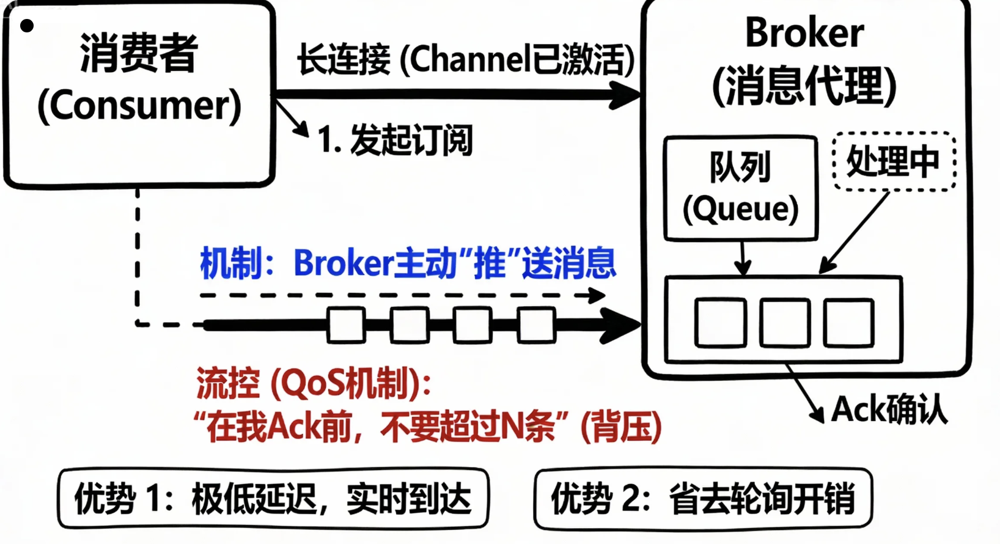
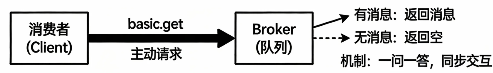

### 知识点讲解

#### 推模式

这是 RabbitMQ 的默认和推荐方式。

- **机制**：消费者向 Broker发起订阅。一旦订阅成功，Channel就处于激活状态。只要队列里有消息，Broker 就会主动通过这个建立好的长连接，将消息“推”送给消费者。
- **流控**：纯粹的“推”有一个隐患，就是如果 Broker 推送速度远快于消费者的处理速度，会把消费者压垮。因此，RabbitMQ 引入了 **QoS**机制。消费者可以告诉 Broker：“在我确认（Ack）之前，不要给我推超过 N 条消息”。这实际上是在推模式中加入了一种“背压”机制，实现了“基于推的流控”。
- **优势**：消息几乎是实时到达，延迟极低；省去了客户端不断询问服务器的轮询开销。

#### 拉模式

这是 RabbitMQ 提供的另一种备选方案。

- **机制**：消费者通过 `basic.get` 命令主动向 Broker 请求消息。这是一种“一问一答”的同步交互。客户端发送请求 -> Broker 检查队列 -> 如果有消息则返回消息，没消息则返回空 -> 连接结束（或等待下一次请求）。
- **劣势**：
    - **轮询开销大**：如果为了模拟实时性而使用 `while(true)` 循环去拉取，会产生大量的网络空转请求，严重浪费 CPU 和带宽。
    - **延迟高**：消息到达队列后，必须等到下一次客户端发起请求才能被消费，无法做到实时。
- **适用场景**：仅在极低频次、只需获取单条消息、或者不需要实时处理的离线脚本场景下使用。

---

### 面试标准回答

RabbitMQ **同时支持**推模式和拉模式，但在绝大多数生产实践中，我们使用的是**推模式**。

**第一，从底层实现来看：**

RabbitMQ 提供了两个核心 API。一个是 basic.consume，这是推模式。消费者一旦订阅，Broker 就会通过长连接主动将消息推送过来，这种方式实时性最高。

另一个是 basic.get，这是拉模式，属于“请求-响应”模型，每次获取消息都需要消费者主动发起询问。

**第二，从性能和应用场景来看：**

拉模式如果在循环中使用，会造成严重的网络无效请求（轮询），导致吞吐量下降。所以，除非是低频的脚本任务，否则一般不在生产环境的循环逻辑中使用拉模式。

**第三，推模式的补充设计**

虽然我们主要用推模式，但为了防止 Broker 推送过快压垮消费者，我们在工程实践中一定会配合 QoS（服务质量） 配置，也就是设置 prefetch_count。这样可以保证只有在消费者处理能力允许的范围内，Broker 才会继续推送消息。
