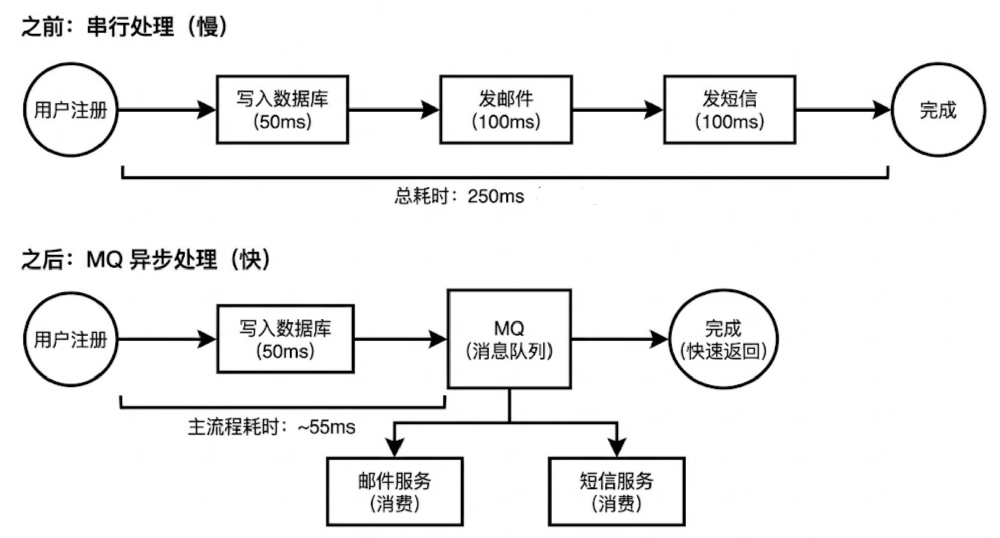
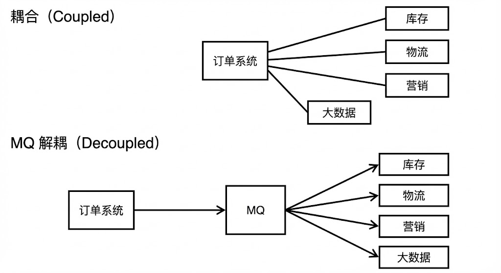
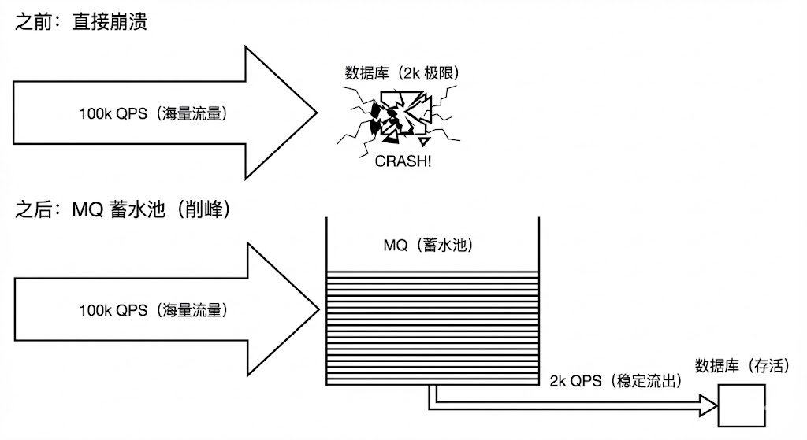

### 一、 知识点讲解

在单体应用或简单的微服务架构中，系统间通常使用 HTTP/RPC 进行同步调用。这就像是“打电话”，你必须等对方接通并说完话才能挂断。

MQ 的引入，把通信方式变成了“发微信”。你发完消息就去忙别的了（异步），对方什么时候看、什么时候回都可以（解耦），哪怕由于太忙暂时没回，消息也存在服务器里丢不了（削峰填谷）。

#### **异步处理**

    - **场景：** 用户注册成功后，需要发注册邮件、发短信验证码、初始化积分账户。
    - **痛点：** 如果串行执行，注册接口耗时 = 写入数据库(50ms) + 发邮件(100ms) + 发短信(100ms) = 250ms。用户体验很差，且受限于最慢的那个服务。
    - **MQ 方案：** 主流程只做核心的“写入数据库”，然后往 MQ 扔一条消息“用户注册了”，直接返回成功。耗时仅需 55ms。发邮件、发短信的服务去消费这条消息即可。

#### **系统解耦**

    - **场景：** 订单系统下单后，需要通知库存系统扣减、物流系统发货、营销系统发券。
    - **痛点：** 如果直接由订单系统调用下游接口，每当新增一个下游业务（比如新增大数据分析），订单系统都要改代码、重新部署。如果下游某个系统挂了，订单系统也会报错回滚，导致无法下单。
    - **MQ 方案：** 订单系统只负责把“订单已创建”这个事件发布到 MQ。谁关心这个事件，谁就自己去订阅。订单系统完全不需要知道下游有哪些人，也不受下游故障的影响。

#### **流量削峰**

    - **场景：** 秒杀活动，瞬间涌入 10万 QPS，但后端数据库只能抗住 2000 QPS。
    - **痛点：** 如果请求直接打到数据库，数据库瞬间宕机，整个系统瘫痪（雪崩）。
    - **MQ 方案：** 所有请求先进入 MQ 排队。后端服务按照自己的处理能力（比如每秒拉取 2000 条）慢慢消费。虽然用户可能会感到一点点延迟（排队中），但系统活下来了。MQ 在这里充当了一个巨大的蓄水池。

---

### 二、 面试标准回答

在后端架构中，消息队列主要解决了三个核心问题：解耦、异步和削峰。它通过引入异步通信机制，提升了系统的扩展性和稳定性。

**第一，系统解耦**

这是微服务架构中最重要的作用。通过 MQ，生产者（如订单服务）只需要将业务事件发布出去，不需要关心下游有哪些消费者（如库存、物流）。这打破了强依赖，使得下游服务的变更或新增不会影响上游核心链路，同时也防止了下游故障导致上游级联失败。

**第二，异步处理**

我们将非核心链路的业务逻辑（如发送通知、生成报表）从主流程中剥离出来，放入 MQ 异步执行。这极大地减少了核心接口的响应时间（RT），提升了用户体验和系统的整体吞吐量。

**第三，流量削峰填谷**

在秒杀或大促场景下，MQ 充当了缓冲区的角色。它将瞬时的高并发流量拦截在 MQ 中，让下游系统根据自身的处理能力（如数据库连接数限制）平滑地消费消息。这避免了数据库被瞬间流量打垮，保证了系统的可用性。

### 购买了课程的同学，本八股动画视频持续更新！

### 后续视频更新也会在群里分享，一定要先进群！
