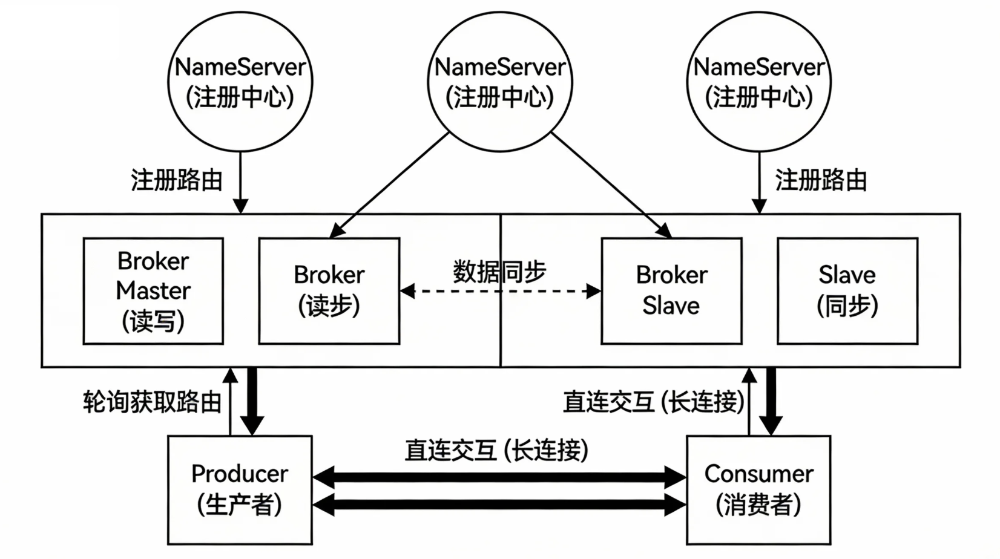
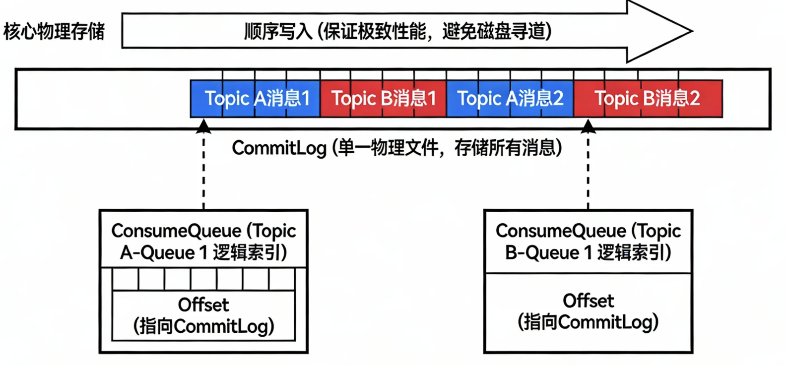
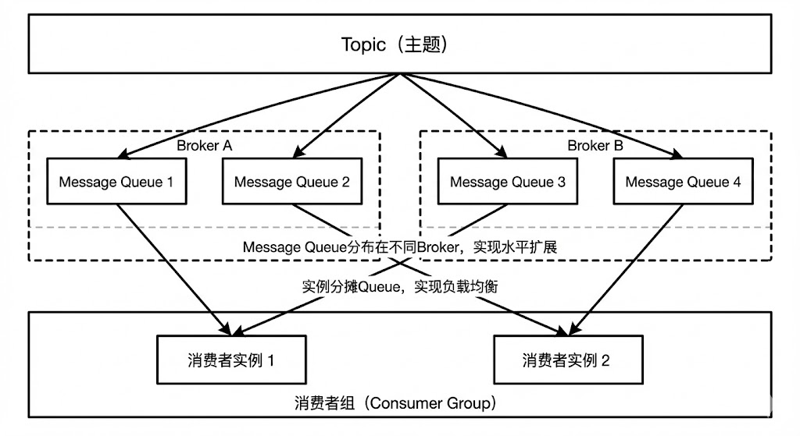

### 一、 知识点讲解

RocketMQ 的物理架构主要由四大核心组件构成：NameServer（注册中心）、Broker（服务节点）、Producer（生产者） 和 Consumer（消费者）。

#### **四大组件的交互逻辑**

- **NameServer（大脑）：** 这是一个近乎无状态的组件。它不像 Zookeeper 那样有复杂的选举机制，各个 NameServer 节点之间互不通信。Broker 会向每一台 NameServer 注册自己的路由信息。这种简单的设计让它极度稳定且高效。
- **Broker（躯干）：** 负责消息的存储与转发。它分为 Master 和 Slave，Master 负责读写，Slave 负责数据同步。
- **Producer/Consumer：** 通过轮询 NameServer 获取路由信息，然后直接与具体的 Broker 建立长连接进行交互。

#### 核心存储结构：CommitLog 与 ConsumeQueue

这是 RocketMQ 性能的“底牌”，也是它与 Kafka 最大的不同。

- **CommitLog：** 所有的消息，不管属于哪个 Topic，全部顺序写入到同一个物理文件中。这保证了**极致的顺序写性能**。
- **ConsumeQueue：** 这是一个逻辑索引。每个 Topic 的每个 Queue 对应一个 ConsumeQueue 文件，里面只存储消息在 CommitLog 中的偏移量（Offset）。
- **好处：** 即使你有上万个 Topic，由于只有一个 CommitLog 在写，磁盘磁头不需要频繁寻道。相比之下，Kafka 每一个 Partition 都是独立文件，Topic 多了会产生大量的随机 I/O，导致性能下降。

#### 消息消费模型：Message Queue

RocketMQ 将 Topic 拆分成多个 Message Queue，分布在不同的 Broker 上。这实现了水平扩展能力。消费者组内的每个实例分摊这些 Queue，实现负载均衡。

---

### 二、 面试标准回答

RocketMQ 的架构是一个典型的分布式、去中心化架构，主要由 NameServer、Broker、Producer 和 Consumer 四部分组成。其设计的核心优势在于高可用性以及对海量 Topic 的卓越支持。

**第一，轻量级的元数据管理**

与 Kafka 早期依赖 Zookeeper 不同，RocketMQ 自研了 NameServer。

它作为一个轻量级的注册中心，节点间不通信，不保证强一致性，只负责存储 Broker 的路由信息。这种“最终一致性”的设计极大提高了集群的抗风险能力，因为即使部分 NameServer 挂掉，只要有一台存活，整个集群的路由功能就不会瘫痪。

**第二，顺序写与索引分离**

RocketMQ 的存储设计非常独特。它采用 CommitLog 统一存储所有消息，通过顺序写压榨磁盘性能。

为了支持高效消费，它引入了 ConsumeQueue 作为逻辑索引。

这种“全量混存 + 局部索引”的架构，解决了 Kafka 在 Topic 数量过多时产生的随机 I/O 问题。因此，RocketMQ 在单机支持万级以上 Topic 时，吞吐量依然非常平稳。

**第三，Master-Slave 与 Dledger**

在 Broker 层面，RocketMQ 提供了成熟的主从同步机制。

- **Master 负责处理读写**，Slave 实时同步数据。
- 在 Master 宕机时，消费者可以自动切换到 Slave 进行读取，保证了业务不中断。

此外，新版本引入了基于 Raft 协议的 **DLedger 机制**，实现了 Master 的自动选举和秒级切换，进一步增强了系统的自愈能力。
