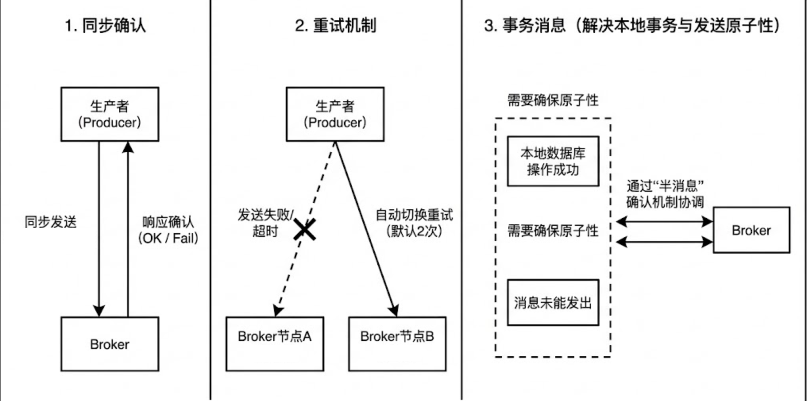
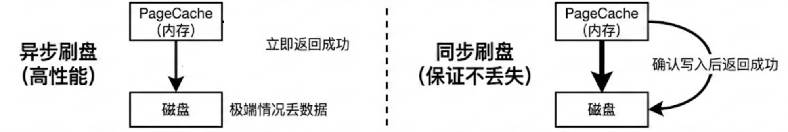
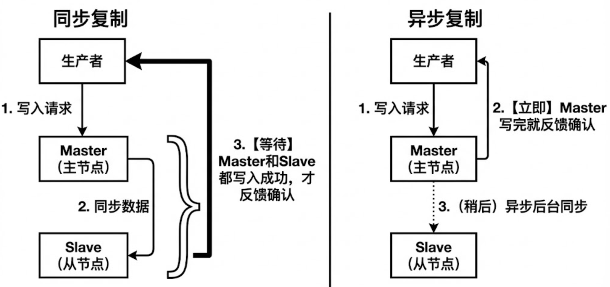
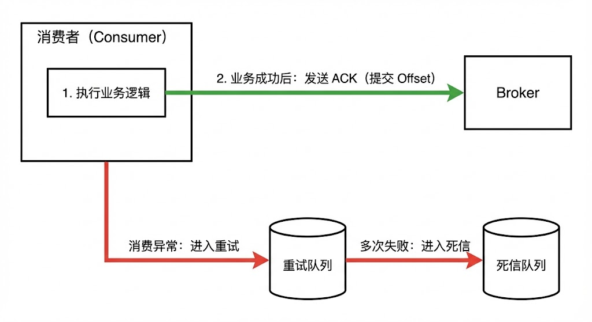

## 一、 知识点讲解

### 发送阶段：确认机制与重试

当生产者发送消息到 Broker 时，可能因为网络抖动导致发送失败。RocketMQ 采用的是**同步发送 + 响应确认**的机制。

- **同步确认：** 生产者发送消息后会阻塞等待 Broker 的响应。
- **重试机制：** 如果发送失败或超时，Producer 会自动切换到其他 Broker 节点进行重试（默认 2 次）。
- **事务消息：** 针对“本地数据库操作成功但消息没发出”的情况，RocketMQ 提供了事务消息，通过“半消息”确认机制，确保本地事务与消息发送的原子性。

### 存储阶段：持久化与多副本

消息到达 Broker 后，如果只放在内存里，一旦宕机就会丢失。

- **刷盘机制：**

    - **异步刷盘：** 消息写入 PageCache 后立即返回成功。性能高，但极端宕机情况会丢数据。
    - **同步刷盘：** 消息必须真正写入磁盘后才返回成功。这是保证不丢失的关键。
- **主从同步：**

    - 为了防止磁盘损坏，RocketMQ 采用多副本机制。
    - **同步复制：** 只有当 Master 和 Slave 都写入成功，才反馈给生产者。
    - **异步复制：** Master 写完就反馈，Slave 异步同步。

### 消费阶段：Offset 提交

消费者处理完业务逻辑后，需要告诉 Broker “我执行完了”。

- **先业务后提交：** 消费者一定要在业务代码执行成功后，再向 Broker 发送 ACK（提交 Offset）。
- **失败重试：** 如果消费异常，消息会进入重试队列，多次失败后进入死信队列，确保消息不会被无故丢弃。

---

## 二、 面试标准回答

RocketMQ 主要通过在**生产、存储、消费**三个阶段引入确认机制和持久化策略来保证消息的可靠性：

1. **在生产阶段：**
    1. 采用**同步发送**方式。Producer 发送消息后会同步等待 Broker 的 ACK。
    2. 利用**自动重试机制**。当发送失败时，Producer 会自动重投消息，并尽量避开故障 Broker。
    3. 对于分布式事务场景，使用 **RocketMQ 事务消息**，通过半消息机制确保本地事务与消息发送的最终一致性。
2. **在 Broker 存储阶段：**
    1. **配置同步刷盘策略**。将 `flushDiskType` 设置为 `SYNC_FLUSH`。这样只有在消息真正落盘后，Broker 才会给生产者返回成功响应，避免了宕机时 PageCache 中数据的丢失。
    2. **部署主从架构并开启同步复制**。将 `brokerRole` 设置为 `SYNC_MASTER`。这样消息不仅要写入 Master 的磁盘，还要同步到 Slave 节点并写入成功，才算发送成功。这解决了单点磁盘故障的问题。
3. **在消费阶段：**
    1. **坚持“先处理业务，再提交 Offset”**。Consumer 只有在消费逻辑成功执行后才返回 `CONSUME_SUCCESS`。
    2. 利用**消费重试机制**。如果消费失败，消息会自动进入重试队列，RocketMQ 默认会进行 16 次梯度重试，如果依然失败则进入死信队列，由人工介入处理。
