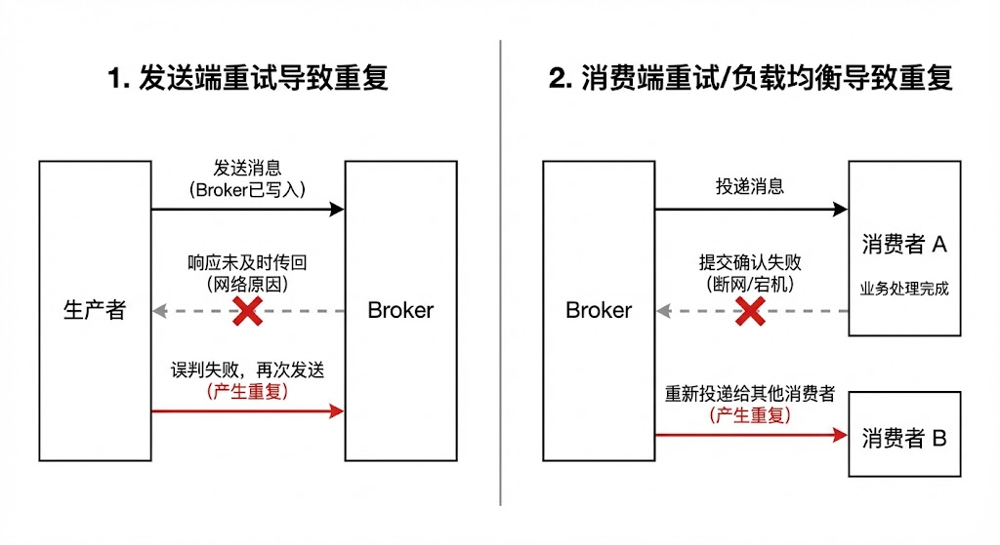

## 一、 知识点讲解

### 为什么会产生重复消息？

重复消息主要产生在以下两个环节：

- **发送端重试：** 生产者发送消息到 Broker，消息其实已经写成功了，但由于网络原因，Broker 的响应没能及时传回给生产者，生产者认为发送失败，于是又重发了一次。
- **消费端重试/负载均衡：** 消费者已经处理完了业务逻辑，但在向 Broker 提交消费位点时断网了或宕机了。Broker 没收到确认，会在重启或负载均衡后，将该消息再次投递给其他消费者。

### 接口幂等性

既然无法绝对避免重复投递，那么“避免重复消费”的重担就落在了**消费者端**。核心思想是：**无论同一条消息被投递多少次，业务处理的结果必须是一致的。**

常用的处理手段包括：

- **利用数据库约束：** 比如利用数据库的唯一索引。如果重复消费，插入操作会直接报错，从而保证数据不重。
- **去重表（去重记录）：** 在消费前先查一下“消息指纹”表，看这条消息 ID 是否已经处理过，如果处理过则直接跳过。
- **状态机控制：** 对于订单类业务，可以通过状态机逻辑（如：只有在“待支付”状态下才执行扣款），重复的请求由于状态不匹配会自然失效。

---

## 二、 面试标准回答

首先需要明确一点，RocketMQ **并不保证消息不重复投递**。在分布式架构下，解决重复消费问题的核心不在于让 MQ 不重发，而是在于**消费端做幂等处理**。

首先需要**明确重复的来源，**重复主要源于发送端的重试和消费端的负载均衡。由于 Message ID 在不同重试场景下可能会变，我们不能完全依赖 Message ID 来做去重。需要建立业务层面的唯一标识：在发送消息时，我会为每条消息设置一个业务唯一键，比如订单号、流水号。消费者在接收到消息后，通过 `msg.getKeys()` 获取这个 ID。

接着需要在消费端的进行幂判断

**数据库唯一索引：** 这是最简单有效的方式。比如在增加积分或创建流水记录时，将“业务唯一键”作为数据库的唯一索引。如果重复消费，数据库会抛出主键冲突，直接捕获异常并返回成功即可。

1. **Redis 缓存：** 在处理业务前，先去 Redis 中检查该 Business Key 是否存在（SETNX 操作）。如果已存在，说明处理过，直接跳过。
2. **状态机检查：** 针对有状态流转的业务（如支付状态），在更新前判断当前状态。例如：`update order set status = 'PAID' where order_id = 'xxx' and status = 'UNPAID'`。这种方式天生支持幂等。
