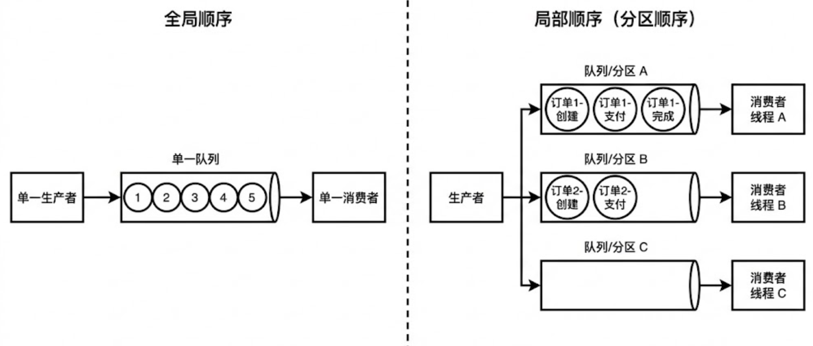
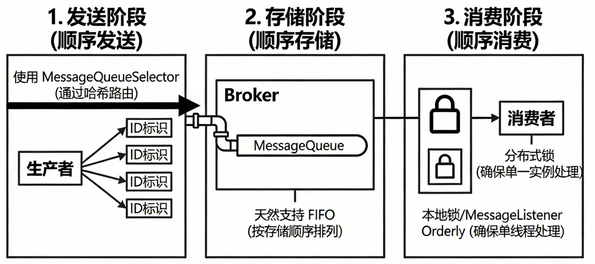

## 一、 知识点讲解

### 全局顺序 vs 局部顺序

- **全局顺序：** 整个 Topic 下所有的消息都按照先进先出的顺序排列。这要求只能有一个 队列，且只能有一个生产者和一个消费者。这会导致系统失去并发能力，实用性不高。
- **局部顺序（分区顺序）：** 只要保证同一个订单的“创建、支付、完成”这三条消息进入同一个 Queue，并由同一个线程消费，就能满足业务上的顺序需求。

### 保证顺序的三个关键环节

要实现顺序消费，必须在生产、存储、消费三个阶段同时发力：

**发送阶段（顺序发送）：**

- 生产者需要使用 MessageQueueSelector。在发送消息时，传入一个唯一标识，通过哈希算法将该 ID 的所有消息路由到同一个 MessageQueue 中。

**存储阶段（顺序存储）：**

- RocketMQ 的 Broker 本身就支持 FIFO。在同一个 Queue 内部，消息是按照存储顺序排列的，这一点由 Broker 内部设计天然保证。

**消费阶段（顺序消费）：**

- 消费者必须使用专门的监听器 MessageListenerOrderly。
    - **分布式锁：** 消费者在消费某个 Queue 之前，会先向 Broker 申请该 Queue 的锁。拿到锁后，才能开始消费，确保同一时刻只有一个消费者实例在处理这个 Queue。
    - **本地锁：** 在消费者内部，通过本地锁确保同一个 Queue 的消息被单线程处理，避免多线程并发导致顺序乱掉。

---

## 二、 面试标准回答

RocketMQ 主要通过**将消息局部有序化**，即“分区有序”的方式来解决顺序问题。要实现这一点，需要从发送端和消费端两方面协同：

**发送端需要保证消息路由到同一个 Queue**。在发送消息时，不能使用默认的轮询负载均衡策略，而是要使用 MessageQueueSelector。通过对业务特征值（如订单 ID、用户 ID）进行 Hash 取模，强制将同一业务逻辑的一组消息发送到同一个 MessageQueue 中。

**Broker 端需要维持 FIFO 存储。**同一个 Queue 在 Broker 内部是按照入队顺序存储的，只要保证了消息进入同一个 Queue，存储顺序就已经确定了。

**消费端保证锁定队列与单线程消费。**消费者需要注册 `MessageListenerOrderly` 监听器。在消费之前，Consumer 会向 Broker 请求该 Queue 的**分布式锁**，确保同一时间只有一个 Consumer 实例能处理该队列，防止在集群扩容或负载均衡时多个实例竞抢同一个 Queue 导致乱序。在 Consumer 内部，会对该 Queue 加**本地锁**，确保消息是按顺序提交给业务逻辑的。
