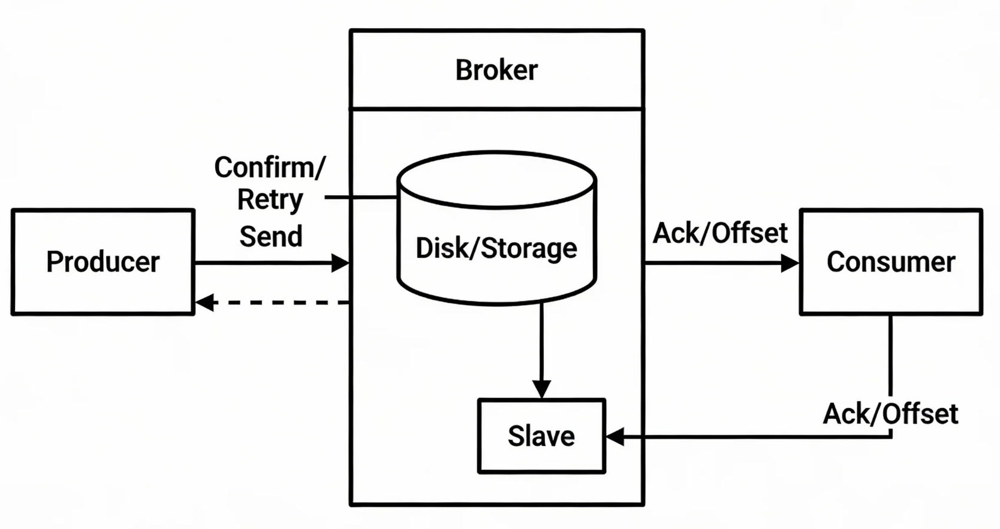

## 一、 知识点讲解

要理解 RocketMQ 如何防止消息丢失，我们需要观察一条消息从出生到消亡的完整生命周期。在这个过程中，任何一个环节的“断裂”都会导致消息丢失。

### 1. 生产阶段：确认机制

当生产者发送消息时，不能“发完就管了”。RocketMQ 采用了**同步/异步发送+回调确认**的模式。如果 Broker 成功接收并写入磁盘，会给 Producer 返回一个 `SEND_OK` 的状态。如果返回异常或超时，Producer 需要触发重试机制。

### 2. Broker 存储阶段：持久化与冗余

这是最容易丢消息的环节。RocketMQ 通过以下两种方式兜底：

- **刷盘策略**：消息到达 Broker 后是先存在内存还是直接存入硬盘？
    - *异步刷盘*：性能高，但掉电会丢数据。
    - *同步刷盘*：消息写入硬盘后才返回成功，安全性最高。
- **多机冗余（副本）**：通过部署主从架构，将数据同步到从节点。即使 Master 磁盘物理损坏，从节点依然保有数据。

### 3. 消费阶段：Offset

消费者处理完业务逻辑后，必须向 Broker 反馈“我做完了”。

- **手动提交**：只有当业务代码执行成功后，才更新Offset。如果消费过程中宕机，Broker 没收到确认，会重新投递该消息。

---

## 二、 面试标准回答

需要从消息流转的三个阶段来切入，构建全链路的可靠性保障：

在发送阶段：通常会使用同步发送模式，通过判断回执状态来确保消息到达 Broker。针对发送失败的情况，我会配置合理的重试次数，并开启失败自动切换 Broker 的功能。

在存储阶段，将刷盘策略配置为同步刷盘，确保每一条消息都真正写入磁盘硬件，而非仅仅停留在 PageCache。在集群层面，我会部署 Master-Slave 结构并将同步方式设置为同步复制。只有主从节点都写盘成功，才向生产端返回 ACK，以此应对单点硬件故障。

在消费阶段，核心原则是“先消费，后确认”。在代码中，我会确保在业务逻辑处理成功后才返回 CONSUME_SUCCESS。
