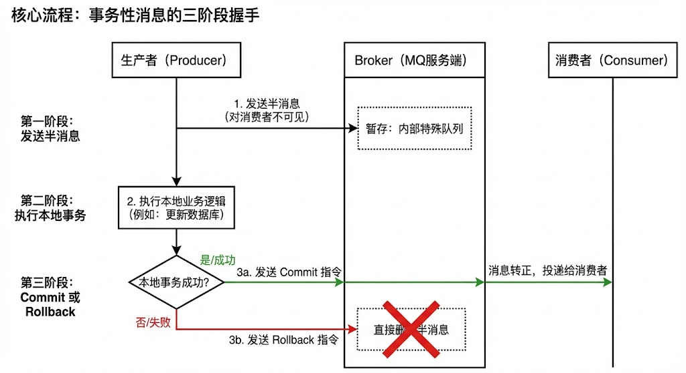

## 一、 知识点讲解

事务消息本质上是**两阶段提交的一种工程化实现，加上了一个补偿机制**。

通常我们在微服务中会遇到一个经典难题：

1. 先写数据库，再发消息？ -> 如果消息发送失败，数据库数据无法回滚，下游系统收不到通知，数据不一致。
2. 先发消息，再写数据库？ -> 如果数据库写失败，消息已经发出去了，下游系统处理了多余的数据，依然不一致。

RocketMQ 通过引入<u>“半消息”</u>**<u>和</u>**<u>“回查机制”</u>完美解决了这个问题。

### 核心流程

整个过程可以看作是一场“由于网络不可靠而设计的握手协议”：

**第一阶段：发送半消息**

- 生产者先发一条消息给 Broker。注意，这条消息对消费者是不可见的。Broker 收到后，将其暂存到内部的一个特殊队列，暂时不投递给下游。

*目的：* 确认 MQ 服务端是活着的，网络是通的。

**第二阶段：执行本地事务**

- 半消息发送成功后，生产者开始执行本地业务逻辑（比如更新数据库订单状态）。

**第三阶段：Commit 或 Rollback**

- 如果本地事务成功 -> 发送 **Commit** 指令。Broker 将半消息“转正”，投递到真实的主题中，消费者此时才能看到并消费。
- 如果本地事务失败 -> 发送 **Rollback** 指令。Broker 直接删除那条半消息，当做无事发生。

### 事务回查

如果生产者发了半消息，执行完本地事务后，因为网断了或者机器挂了，没能发 Commit/Rollback 给 Broker，怎么办？这条半消息会一直挂在 Broker 里吗？

不会。Broker 有个定时任务，发现某条半消息“卡”了很久（默认 60秒），它会主动反向去问生产者（Producer）：*刚才那条消息对应的事务到底成功没？我该发还是该删？*

生产者此时需要检查本地数据（通常是查数据库），告诉 Broker 最终结果。这保证了即使发生异常，数据最终也能保持一致。

---

## 二、 面试标准回答

RocketMQ 的事务消息，本质上是基于 **两阶段提交**和 **补偿机制** 来实现的分布式事务解决方案。它的目标是保证 **本地事务执行** 和 **消息发送** 这两个操作的原子性，最终实现数据的**最终一致性**。

它的执行过程主要分为三个阶段：

- **第一步：发送半消息。** 生产者先向 Broker 发送一条半消息。此时消息被持久化在 Broker 的一个内部 Topic 中（`RMQ_SYS_TRANS_HALF_TOPIC`），对下游消费者**不可见**。
- **第二步：执行本地事务。** 半消息发送成功后，生产者执行本地业务逻辑。
- **第三步：提交确认。** 根据本地事务的执行结果，生产者向 Broker 发送 `Commit` 或 `Rollback` 指令：
    - 如果是 `Commit`，Broker 会把消息从内部队列恢复到目标 Topic，消费者即可消费；
    - 如果是 `Rollback`，Broker 则删除该半消息。

RocketMQ 最大的优势在于它的事务回查机制。如果在执行本地事务或发送确认指令时，因网络断开或应用重启导致 Broker 没有收到 Commit/Rollback，Broker 会启动定时任务。它会主动向生产者发起回查，询问该条消息对应的本地事务状态。生产者通过查询本地数据库或其他状态记录，告知 Broker 是提交还是回滚。这不仅解决了网络丢包问题，也解决了生产者宕机导致的状态不一致问题。
