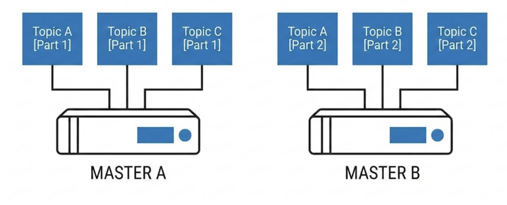
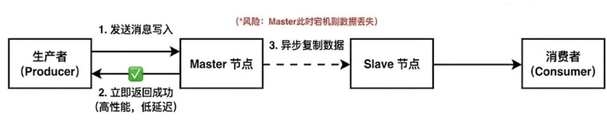
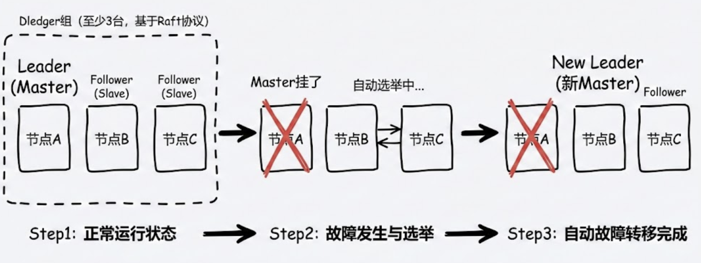

## 一、 知识点讲解

RocketMQ 的集群部署模式主要经历了从简单到复杂，从人工运维到自动故障转移的过程。理解这部分，关键在于看懂数据是怎么复制的，以及主节点挂了怎么办。

### 单 Master 模式

- **机制：** 只有一个 Broker。
- **特点：** 配置最简单，风险最高。
- **场景：** 本地测试、演示环境。**生产环境绝对严禁使用**，因为一旦机器宕机，服务彻底瘫痪。

### 多 Master 模式

- **机制：** 集群里全是 Master，没有 Slave。比如 2 个 Master，一个负责 Topic A 的一半队列，另一个负责另一半。
- **优点：** 配置简单，性能最高（没有同步数据的开销）。
- **缺点：****单机故障会“卡”消息**。如果 Master-A 宕机，它上面的消息在恢复前是无法被消费的。虽然数据没丢，但业务会受阻。
- **场景：** 对实时性要求没那么高，允许短时间消息不可消费的场景。

### 多 Master 多 Slave 模式

这是最经典的生产环境架构，每个 Master 配一个或多个 Slave。根据数据复制方式的不同，又分为两种核心流派：

- **异步复制**
    - **机制：** Master 收到消息，写完本地直接返回成功给生产者，然后再异步同步给 Slave。
    - **优点：** 性能高，延迟低。
    - **缺点：****有少量数据丢失风险**。如果 Master 刚写完还没来得及同步给 Slave 就宕机了，这部分数据就丢了。
    - **恢复：** Master 宕机后，消费者可以自动切换到 Slave 读取数据，但 Slave **不能自动切换**为 Master，需要人工介入恢复。
- **同步双写**
    - **机制：** Master 收到消息，必须等 Slave 也写成功了，才返回成功给生产者。
    - **优点：****数据绝对不丢失**。
    - **缺点：** 性能比异步低，延迟略高。
    - **恢复：** 同样不支持自动故障转移，Slave 只能读不能写。

### Dledger 模式

- **背景：** 上面的主备模式最大的痛点是 **Master 挂了，Slave 不能自动上位**。
- **机制：** RocketMQ 4.5 以后引入了基于 **Raft 协议** 的 Dledger 存储组件。
- **特点：** 也就是多副本模式。一个 Group 至少 3 台机器，通过 Raft 选举出 Leader。
- **核心优势：****自动故障转移**。一旦 Master 挂了，剩下的节点会自动选举出新的 Master，无需人工干预。这是目前对高可用要求极高的金融级场景的首选。

---

## 二、 面试标准回答

RocketMQ 的集群方式主要分为四种：单 Master、多 Master、多 Master 多 Slave（传统模式），以及基于 Raft 协议的 Dledger 模式。

在生产环境中，我们主要关注后两种，即主从架构。

针对多 Master 多 Slave 架构，根据数据同步机制的不同，主要分为：

- **异步复制模式**
    - **特点：** 只要 Master 写成功就返回成功。
    - **优势：** 拥有最高的吞吐量和最低的延迟。
    - **劣势：** 在 Master 突然宕机的情况下，可能会丢失少量未同步到 Slave 的消息。
    - **适用：** 适用于对性能要求极高，但对少量数据丢失有一定容忍度的场景（如日志收集）。
- **同步双写模式**
    - **特点：** 只有 Master 和 Slave 都写入成功，才向客户端返回成功。
    - **优势：** 保证**数据零丢失**，可靠性最高。
    - **劣势：** 写入性能比异步模式略低（通常损耗在 10% 左右），且如果 Slave 不可用，会导致发送失败。
    - **适用：** 适用于订单、支付等对数据一致性要求极其严格的核心业务。

传统的 Master-Slave 模式有一个痛点：不支持自动故障转移。当 Master 宕机时，Slave 只能提供读服务，不能自动升级为 Master 写数据，需要人工介入。

所以，RocketMQ 4.5 之后引入了 Dledger 模式。它基于 Raft 协议 实现了多副本的一致性。当 Master 宕机时，集群能自动选举出新的 Master，实现了真正的**高可用自动切换。**
