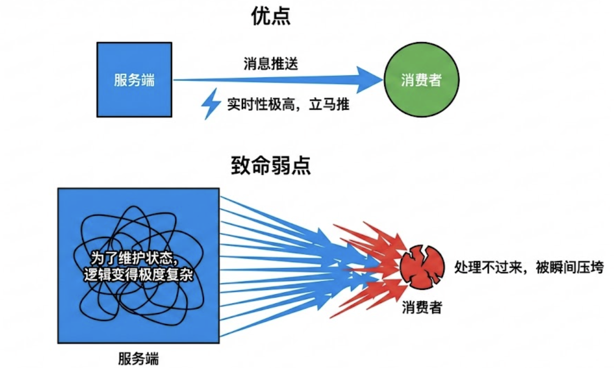
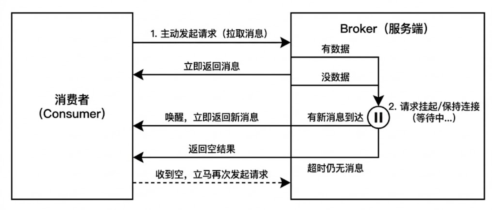

## 一、 知识点讲解

要理解为什么 RocketMQ 选择“拉模式”以及所谓的“推”是怎么做到的，需要看懂下面两个核心逻辑：

### 为什么“纯推”模式不好做？

如果是纯粹的服务端推送

- **优点**：实时性极高，消息到了立马推。
- **致命弱点**：服务端很难掌控消费端的处理能力。
    - 如果 Broker 推得太快，而消费者处理得慢，消费者会被瞬间压垮。
    - 如果为了防止压垮而让 Broker 维护每个消费者的状态，服务端的逻辑会变得极度复杂，且不仅消耗服务端资源，还难以在大规模集群中维持状态一致性。

### 解决方案：长轮询

RocketMQ 为了兼顾“拉模式的流控可控性”和“推模式的实时性”，采用了**长轮询**机制。这就是 `PushConsumer` 的幕后真相：

1. **Consumer 主动发起请求**：消费者客户端发起一个 HTTP/TCP 请求去 Broker 拉消息。
2. **Broker 的“挂起”策略**：
    1. **有数据**：Broker 立即把消息返回给消费者。
    2. **没数据**：Broker **不会立即返回**“空结果”，而是把这个请求**挂起**。
    3. Broker 会暂时保留这个连接，等待新的消息到来。
3. **唤醒机制**：
    1. 如果在等待期间，有新消息到了，Broker 会立即激活这个请求，把新消息返回去。
    2. 如果超时了还没消息，Broker 才会返回“空”。消费者收到空结果后，立马再次发起请求。

这种机制让消费者始终保持“即时响应”的感觉，同时掌握权在消费者手里（处理完上一批再拉下一批），天然解决了“消费不及时”导致的堆积问题。

---

## 二、 面试标准回答

RocketMQ 本质上是拉模式。虽然它提供了 PushConsumer 接口，但这只是客户端 SDK 封装出来的“伪装”。它底层是通过长轮询机制来实现的“伪推送”。

在 `PushConsumer` 模式下，消费者线程会不断向 Broker 发起拉取请求：

- **请求挂起**：当 Broker 收到请求后，如果队列里有新消息，就会立即返回；如果没有新消息，Broker 不会立即返回空结果，而是会将该请求挂起一段固定时间。
- **事件触发**：在这段时间内，一旦有新消息到达 Broker，或者挂起时间超时，Broker 才会将结果返回给消费者。
- **循环拉取**：消费者收到响应后，处理完消息，会立即发起下一次拉取请求。

**为什么要这样设计？**

这种设计结合了 Push 和 Pull 的优点：

- **解决流控问题**：如果是纯 Push 模式，Broker 很难感知消费者的处理速度，容易造成消费者下游积压甚至由于内存溢出而挂掉。采用 Pull 模式，消费者可以根据自己的吞吐能力按需拉取，天然实现了**背压**机制。
- **解决延迟问题**：如果是纯 Pull 模式（短轮询），轮询间隔很难设置。间隔太短浪费带宽和 CPU，间隔太长会导致消息延迟。**长轮询**保证了消息一旦到达就能立刻被感知，做到了近乎实时的低延迟。
