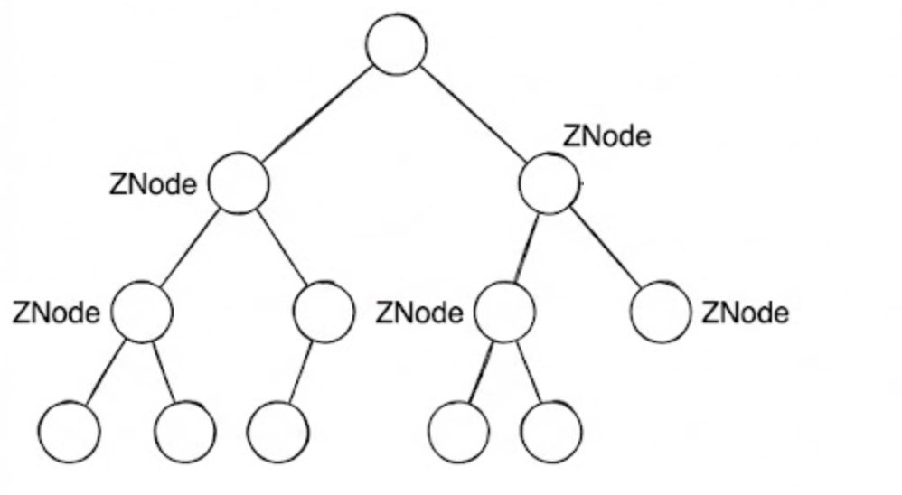
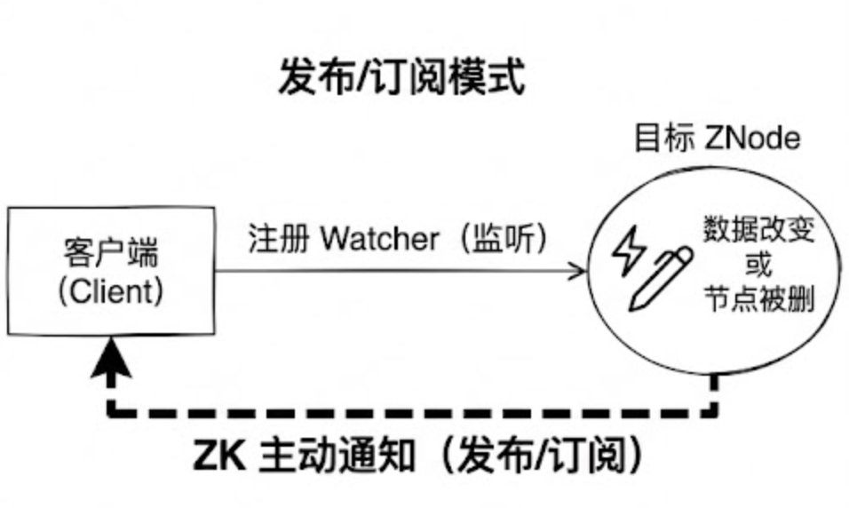

### 一、 知识点讲解

Zookeeper本质上是一个为分布式应用提供协调服务的中间件。你可以把它理解为一个高可用的分布式文件系统，加上了一套事件监听机制。它主要解决的是分布式系统中的“一致性”和“管理”问题，而不是用来存大量业务数据的。

#### 数据模型

ZK 的数据结构是一棵树，跟 Linux 文件系统很像。每个节点叫 ZNode，可以存少量数据（比如配置信息、状态标记）。

1. *关键点*：ZNode 分为持久节点、临时节点（客户端断开就删除了）、顺序节点。这是实现分布式锁等功能的基础。

#### 监听机制（Watcher）：

这是 ZK 的灵魂。客户端可以在某个 ZNode 上注册一个 Watcher。当这个节点的数据变了，或者节点被删了，ZK 会主动通知客户端。

1. *作用*：这实现了“发布/订阅”模式，比如配置改了，所有服务器立马收到通知。

#### 一致性协议（ZAB）：

ZK 保证的是 CP。通过 ZAB 协议，保证了集群中 Leader 和 Follower 之间数据的强一致性。写操作必须走 Leader，读操作可以走任意节点。

#### 应用场景

**第一，统一配置管理**

这是最常用的场景。在分布式系统中，很多服务的配置是一样的。我们把配置信息放在 ZK 的某个节点上，让所有服务去监听这个节点。一旦我们需要修改配置，只需要改 ZK 里的这一处，ZK 就会立刻通知所有连接的服务去同步更新，不需要重启服务器，实现了配置的热更新。

**第二，统一命名服务**

这其实就是服务发现。就像 Dubbo 这类 RPC 框架，服务提供者启动时，把自己注册到 ZK 上（创建节点）；服务消费者启动时，去 ZK 订阅自己需要的服务列表。这样，当服务上线或下线时，消费者能实时感知到，动态调整调用列表。

**第三，分布式锁**

这是为了解决多节点并发修改数据的问题。利用 ZK 的临时顺序节点特性：多个客户端同时去创建一个节点，谁创建成功（或者序号最小）谁就拿到锁。业务处理完后删除节点释放锁；如果持有锁的客户端宕机了，因为是“临时”节点，节点会自动删除，锁也就释放了，避免了死锁问题。

**第四，集群管理与 Master 选举。**

比如 HDFS 的 NameNode 高可用，或者 Kafka 的 Controller 选举。大家去 ZK 抢着建立同一个临时节点，谁建成了谁就是 Master。其他节点监听这个 Master 节点，一旦 Master 挂了，节点消失，其他节点收到通知立马再次发起选举，保证集群时刻有主节点在工作。

---

### 二、 面试标准回答

Zookeeper 是一个开源的分布式协调服务，它主要用来解决分布式系统中的一致性问题。简单来说，它提供了一个类似文件系统的目录树结构，配合一套高效的 Watcher 监听机制，来统一管理分布式系统中的状态和元数据。

它的应用场景主要为以下四点**：**

1. **统一配置管理**

将公共配置集中存储在 ZK 节点上，服务统一监听。配置变更时，ZK 实时通知各服务同步更新，实现配置热更新，无需重启。

1. **统一命名服务（服务发现）**

服务提供者向 ZK 注册，服务消费者订阅服务列表。服务上下线时，消费者可实时感知并动态调整调用关系。

1. **分布式锁**

利用临时顺序节点实现锁竞争，序号最小者获得锁；客户端宕机时临时节点自动删除，避免死锁。

1. **集群管理与 Master 选举**

通过竞争创建临时节点选举 Master，其他节点监听该节点；Master 挂掉后自动触发重新选举，保证集群高可用。

### 购买了课程的同学，本八股动画视频持续更新！

### 后续视频更新也会在群里分享，一定要先进群！
