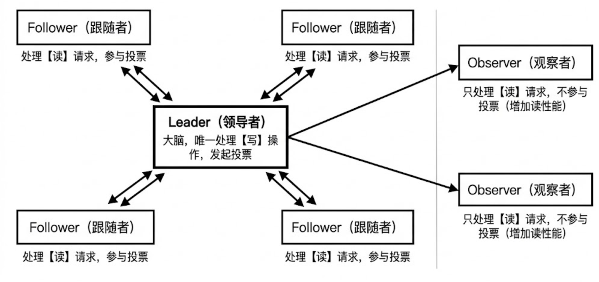

### 知识点讲解

ZooKeeper 的架构本质上是为了解决一个问题：在分布式环境下，如何让多个节点对某个数据达成一致。它采用的是 主从（Master-Slave）架构，且数据全量存储在 内存 中。

#### **集群角色**

    1. **Leader（领导者）：** 整个集群的大脑。**只有它能处理写操作**。所有的写请求，不管客户端发给谁，最后都要转交给 Leader 来统筹。它负责发起投票，决定数据能不能写进去。
    2. **Follower（跟随者）：** Leader 的小弟。主要做两件事：一是处理**读请求**；二是**参与投票**（选 Leader 的时候要投，Leader 说要写数据的时候也要投）。
    3. **Observer（观察者）：** 编外人员。它只处理**读请求**，**不参与任何投票**。引入它的目的很简单：想增加集群的读性能（增加机器），但又不想因为机器多了导致投票慢（写性能下降）。

#### **ZAB 协议**

    1. ZK 不用 Paxos，而是自己造了个 **ZAB** 协议。机制类似于“一言堂但需过半同意”：Leader 说要改数据，只要 **超过半数** 的 Follower 答应了，这事儿就成了。这保证了ZK在强一致性和高可用之间找到了平衡。

#### **数据模型：**

    1. 它的数据结构叫 **ZNode**，看着就像 Linux 的文件目录（/app/config/db...）。因为是树状结构且在内存里，查找和监听非常快。

---

### 面试标准回答

关于 ZooKeeper 的架构，简单来说，它采用的是典型的 **Leader-Follower（主从）架构**。

**第一，集群角色的分工。**

ZK 集群中只有一个 Leader，它是唯一的写请求入口，负责进行事务的发起和协调。

其他的节点是 Follower，它们主要负责处理客户端的读请求，同时参与 Leader 的选举以及写操作的过半投票。

如果业务场景是“读多写少”，我们通常还会配置 Observer 节点，它只负责读，不参与投票，这样可以在不降低写性能的前提下，横向扩展集群的读能力。

**第二，数据与存储模型。**

ZK 的数据模型是一棵 ZNode 树，类似于文件系统。为了保证极高的性能，ZK 将全量数据存储在 内存 中，同时配合磁盘的事务日志和快照来保证数据持久化，防止丢失。

**第三，核心的一致性保障。**

ZK 架构的核心驱动力是 ZAB 协议。简单说就是，所有的写操作都会被 Leader 转化为事务 Proposal 广播出去，只要集群中 超过半数 的节点确认，该事务就会提交。这就保证了在分布式环境下，数据能够保持强一致性，且集群只要有过半机器存活就能正常服务。
