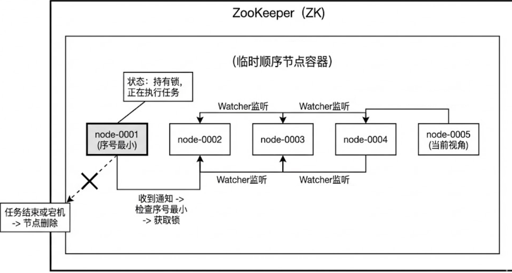

#### 一、 知识点讲解

ZooKeeper 实现分布式锁的核心在于利用其 文件系统的数据结构（ZNode） 加上 Watcher 监听机制。简单来说，就是大家都在 ZK 上排队，谁排第一谁拿锁，没排到的盯着自己前一个人，前一个人走了自己就补上。

#### **临时顺序节点**

    1. **为什么是“临时”？** 为了防止死锁。如果客户端拿了锁之后挂掉了，ZK 会自动删除这个临时节点，锁就自动释放了，其他节点有机会抢锁。
    2. **为什么是“顺序”？** 为了公平和排序。ZK 会给每个创建的节点自动加上一个递增的数字后缀（比如 `lock-0001`, `lock-0002`），这就天然形成了一个排队机制。

#### **获取锁的逻辑**

    1. 所有想要获取锁的客户端，都会在一个指定的锁目录下（比如 `/locks`）创建一个临时顺序节点。创建完后，客户端会检查 `/locks` 下的所有子节点。如果发现**自己创建的节点序号最小**，恭喜你，锁是你的了。

#### **等待锁的逻辑**

    1. 如果发现自己不是最小的怎么办？比如你是 `lock-0005`，前面还有 4 个哥们。**关键优化是** 你不需要盯着所有比你小的节点，也不需要盯着此时持有锁的那个 `lock-0001`。你只需要盯着**比你小一点点的那个节点**（即 `lock-0004`）。
    2. 如果大家都监听 `lock-0001`，一旦它释放，成百上千个等待者同时被唤醒去抢锁，ZK 压力会巨大。现在你只监听前一个，链式唤醒，非常优雅。

#### **释放锁：**

    1. 任务处理完，主动删除自己创建的节点。或者客户端宕机，ZK 自动删除节点。节点删除后，排在后面的那个节点（Watcher 监听着它的那个）收到通知，再次检查自己是不是最小的，然后获取锁。

---

#### 二、 面试标准回答

关于 ZK 分布式锁，其核心主要是利用了 ZooKeeper 的**临时顺序节点特性配合Watcher 监听机制**来实现的。

具体的实现流程，一般把它归纳为四个步骤：

第一是**请求锁**。当多个客户端并发请求锁时，它们都会在同一个特定的锁节点目录下，各自创建一个**临时顺序节点**。这里使用临时节点是为了防止客户端宕机后死锁，顺序节点则是为了确定抢锁的优先级。

第二是**判断锁**。客户端创建完节点后，会获取该目录下所有的子节点列表。如果发现**自己创建的节点序号是最小的**，就认为获取锁成功，开始执行业务逻辑。

第三是**等待锁**。这也是 ZK 实现的一个精髓。如果发现自己不是最小的，客户端不会去轮询，而是找到**比自己序号小的前一个节点**，对它注册一个 **Watcher 监听器**。这样做的好处是避免了‘羊群效应’，当锁释放时，只唤醒排在后面的那一个节点，而不是唤醒所有节点，大大减轻了网络和服务器的压力。

第四是**释放锁**。当业务执行完毕，客户端主动删除对应的临时节点；或者客户端连接断开，节点被自动删除。此时，排在它后面的那个节点会收到 Watcher 通知，进而再次判断并获取锁。
