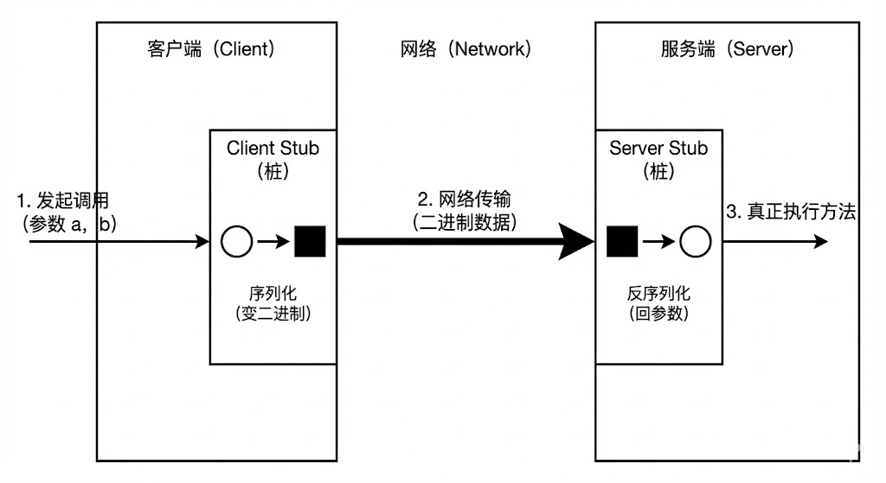

### 一、 知识点讲解

RPC 的全称是 Remote Procedure Call（远程过程调用）。

它的核心设计目标是：让程序员像调用本地函数一样，去调用远程服务器上的函数。

你写代码时是 result = service.add(a, b)，完全不需要关心这行代码怎么打包、怎么发给 B 机器、B 机器怎么解包、怎么传回来。

而 HTTP（这里主要指 RESTful API）是一种基于资源的通信模式，你需要关心 URL、Method（GET/POST）、Header、Body 等协议细节。

#### RPC 的机制

RPC 之所以能让你感觉在调本地函数，是因为它在客户端和服务端都安插了“桩”。

- **Client Stub：** 负责把你的参数（`a, b`）序列化成二进制，通过网络发出去。
- Server Stub： 负责收到二进制，反序列化回参数，真正去执行方法，把结果再打包发回去。

这个过程对开发者是透明的。

#### **载荷与传输**

- **数据包大小（序列化）：**
    - **HTTP (JSON)：** 为了可读性，包含大量冗余字符（如 `{ "name": "user" }`）。
    - **RPC (Protobuf/Thrift)：** 二进制压缩。同样的数据，可能只需要几个字节，没有字段名，只有位置信息。**更小，传输更快。**
- **传输协议：**
    - **HTTP：** 通常基于 HTTP/1.1，文本协议，Header 很重（User-Agent, Cookie 等一大堆元数据）。
    - **RPC：** 通常直接基于 TCP（如 Dubbo 协议）或者 HTTP/2（如 gRPC）。它可以自定义精简的头部，去除无用的元数据。**更轻，解析更快。**

#### 为什么要有 RPC？

既然 HTTP 通用性这么强，浏览器、手机都能用，为什么后端微服务之间还要搞一套 RPC？

答案是效率和契约。

- **效率：** 内部服务调用频次极高（甚至上亿次），哪怕每次调用节省 0.1ms 的序列化时间和 1KB 的带宽，累积起来也是巨大的成本节省。
- **契约（强类型）：** RPC 框架通常有 IDL 文件（如 `.proto`），强制约束了入参出参类型。不像 HTTP JSON 那样松散，这在大型团队协作中能减少很多“参数传错”的 Bug。

---

### 二、 面试标准回答

RPC（远程过程调用）和 HTTP（超文本传输协议）在分布式系统中都是节点间通信的方式。

严格来说，它们不在同一个维度：RPC 是一种调用远程服务的方法论/技术，而 HTTP 是一个具体的传输协议。事实上，很多现代 RPC（如 gRPC）底层就是基于 HTTP/2 实现的。

在实际开发和对比中，我们通常是指 “基于 TCP/二进制协议的 RPC” 与 “基于 HTTP/JSON 的 RESTful API” 之间的区别。

**第一，设计初衷与使用体验不同。**

- **RPC** 的核心目标是**透明性**。它让开发者像调用本地方法一样调用远程服务，屏蔽了网络细节。
- **HTTP (REST)** 的核心是**标准化**。它强调资源的通用交互，使用统一的接口。

**第二，传输效率与协议开销不同。**

- **序列化：** HTTP 通常使用 JSON，是基于文本的，可读性好但体积大，解析慢。RPC 通常使用 Protobuf、Thrift 或 Hessian 等二进制序列化协议，体积极其紧凑，CPU 解析效率极高。
- **报文头：** HTTP/1.1 携带了大量 Header（Cookie、User-Agent 等），对于微服务内部的高频调用，这些是纯粹的带宽浪费。RPC 通常使用自定义的 TCP 协议（如 Dubbo 协议），报文头极精简，专为服务间通信设计。

**第三，连接模型不同。**

- 传统的 HTTP/1.1 是短连接（虽然有 Keep-Alive 但仍有队头阻塞问题）。
- RPC 框架通常基于 **TCP 长连接**，并利用 **IO 多路复用** 技术，实现连接池管理和真正的并发复用，更适合内部高并发场景。

**第四，应用场景不同。**

- **RPC：** 主要用于公司内部**微服务之间**的通信。因为内部网络环境可控，我们更追求极致的性能和强类型的接口约束。
- **HTTP：** 主要用于**对外接口**，比如提供给前端、App 或第三方。因为 HTTP 协议是互联网通用的，兼容性最好，没有任何技术门槛。

### 购买了课程的同学，本八股动画视频持续更新！

### 后续视频更新也会在群里分享，一定要先进群！
