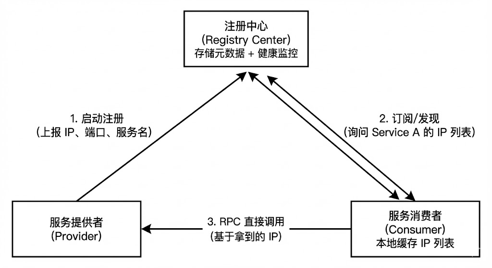
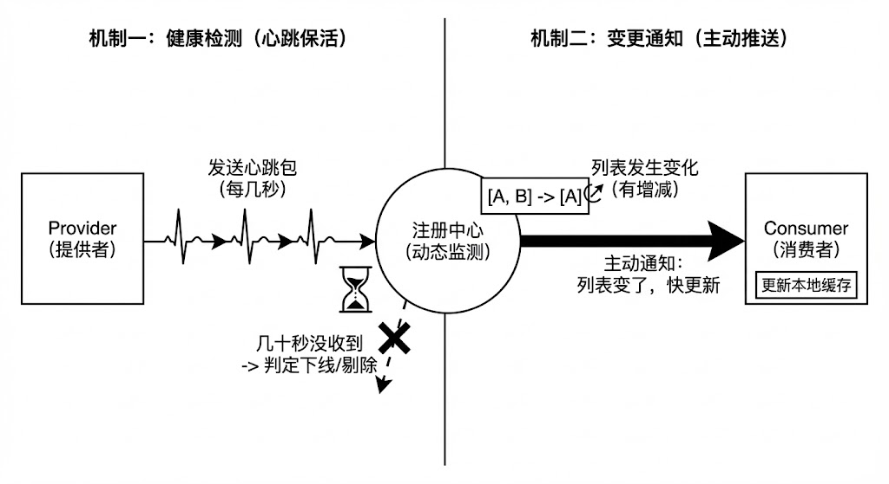
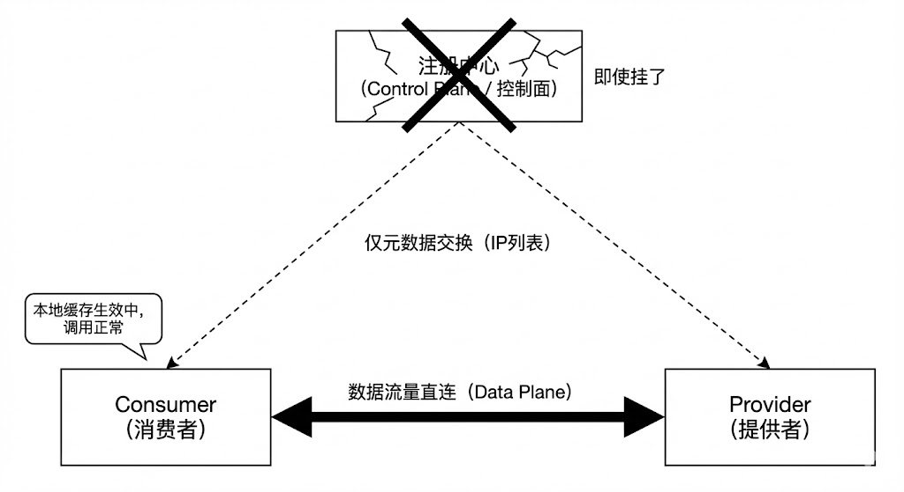

### 一、 知识点讲解

在微服务之前，我们调用远程服务可能直接在配置文件里写死 IP 和端口。

但在大规模集群中，服务提供者的机器会随时上下线、扩容缩容、IP 变更。如果还在代码里写死 IP，运维就炸了。

注册中心就是为了解决这个问题：<u>它让消费者不再依赖具体的 IP，而是依赖服务名。</u>

#### 核心三角关系

RPC 系统中存在三个角色，它们通过注册中心串联：

- **服务提供者：** 启动时，将自己的 IP、端口、服务名写到注册中心。这叫“注册”。
- **服务消费者：** 启动时，向注册中心询问“Service A 的 IP 列表是多少？”这叫“订阅/发现”。消费者拿到列表后，**缓存**在本地。
- **注册中心：** 负责存储这些元数据，并监控提供者的健康状态。

#### 关键机制：心跳与通知

注册中心不是静态的数据库，它是动态的。

- **健康检测：** Provider 会每隔几秒向注册中心发送心跳包。如果注册中心几十秒没收到心跳，就会判定该节点挂了，将其剔除。
- **变更通知：** 一旦服务列表发生变化（有新节点加入或旧节点挂了），注册中心会利用长连接或 UDP 广播，**主动通知**所有订阅了该服务的 Consumer：“列表变了，快更新你的本地缓存”。

#### 流量不走注册中心

这是一个极其重要的概念。

注册中心只负责“控制面”，不负责“数据面”。

Consumer 拿到 IP 列表后，是直接和 Provider 建立连接发送请求的。即使注册中心全挂了，只要 Consumer 本地缓存还在，且 Provider IP 没变，服务依然能正常调用，只是不能感知新变化而已。

---

### 二、 面试标准回答

注册中心是 RPC 架构中实现服务治理的核心组件。它主要解决了分布式系统中的服务解耦和动态发现问题，使得服务调用方无需感知服务提供方的物理位置变化。

**第一，注册与发现**

注册中心维护了一张“服务名”到“IP 地址列表”的动态映射表。

- **服务上线时：** Provider 将自己的元数据写入注册中心。
- **服务调用时：** Consumer 从注册中心拉取最新的服务列表，并**缓存到本地**。后续的 RPC 调用是基于本地缓存的列表进行负载均衡，直接发起连接，**流量并不经过注册中心**。

**第二，动态感知机制**

这是注册中心比静态配置文件强大的地方。

注册中心通过**心跳机制或临时节点**来维持 Provider 的存活状态。

一旦 Provider 宕机或扩容，注册中心会通过 Watch 机制或长轮询，实时将变更事件**推送**给所有相关的 Consumer。这保证了 Consumer 端负载均衡列表的最终一致性，防止请求打到死节点上。

**第三，CP vs AP**

在注册中心的选型上，存在 CP（强一致性） 和 AP（高可用性） 的路线之争：

- **Zookeeper (CP)：** 保证数据强一致，但在网络分区或 Leader 选举期间，服务可能不可用。适合对一致性要求极高的场景。
- **Nacos / Eureka (AP)：** 优先保证高可用。即使集群内部分区了，节点之间数据暂不一致，也能返回旧的服务列表，保证业务“能通”。

**目前的趋势：** 对于服务发现场景，**AP 模型（如 Nacos）** 更为主流。因为在微服务中，我们宁愿读到脏数据（偶尔调用失败由重试机制兜底），也不能接受注册中心不可用导致全链路瘫痪。
