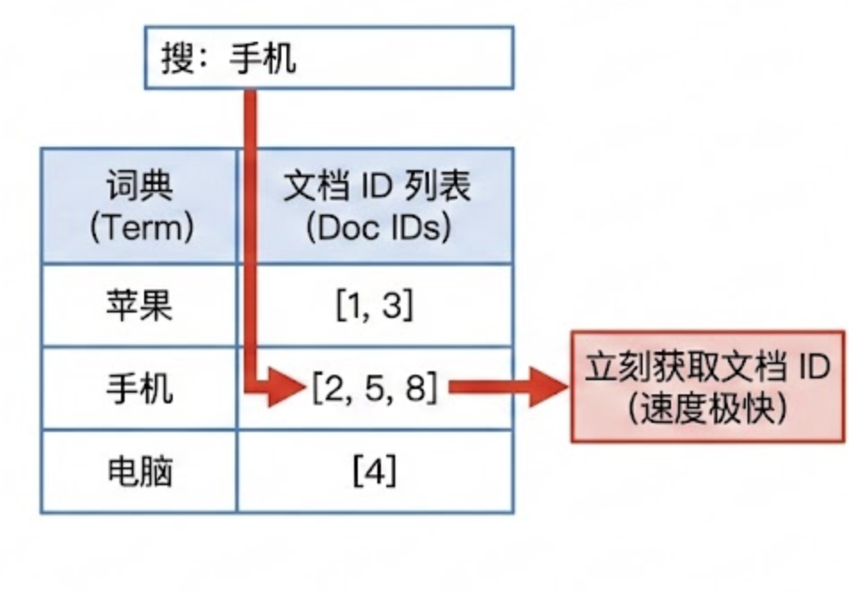
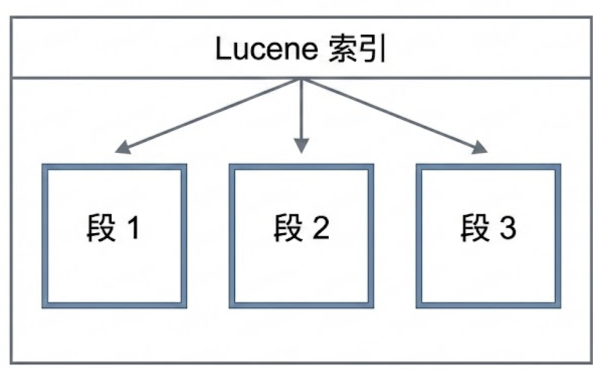

### 一、 知识点讲解

Lucene 不是一个像 MySQL 那样可以直接启动的“软件”或“服务”，它本质上是一个 Java 类库。

你可以把它理解为搜索引擎界的“乐高积木”或者“发动机”。如果你想在自己的 Java 代码里实现全文检索功能（比如给一个单机版的 APP 做个搜索框），你直接引入 Lucene 的包，调用它的 API 就能实现建索引和搜索。

Elasticsearch 其实就是把 Lucene 这个“发动机”装进了车壳子里，配上了 HTTP 接口、分布式管理、高可用架构，变成了开箱即用的“汽车”。

#### 倒排索引

这是 Lucene 最核心的数据结构。

    - **正向索引**：类似书的章节内容，你要找某个词，得从头翻到尾（遍历），速度慢。
    - **倒排索引**：类似书后的“术语索引表”。它记录了“某个词出现在哪几页”。
    1. 在 Lucene 中，它维护了一个词典，记录了所有切分出来的词，以及这些词对应的文档 ID 列表。当你搜“手机”时，它直接在词典里找到这个词，立刻就能把所有包含该词的文档 ID 给你，速度极快。

#### 段与不可变性

Lucene 里的索引并不是一整块巨大的文件，而是由很多个**段**组成的。

1. **不可变性**：一旦一个段被写在这个磁盘上，它就不能被修改了。这样做的好处是不需要锁，读写性能极高。
2. **删除与更新**：因为不能修改，所以“删除”其实只是在一个 .del 文件里打个标记说“这行数据废了”；“更新”就是“先标记删除，再新增一条”。
3. **合并**：为了防止段文件越来越多，Lucene 会在后台偷偷把几个小段合并成一个大段，并顺便把标记删除的数据真正清理掉。

---

### 二、 面试标准回答（实战篇）

Lucene 本质上是一个高性能、全功能的**文本搜索引擎类库**。

它不是一个可以独立运行的服务，而是一个工具包。我们可以通过调用它的 API 来实现数据的索引和检索。

关于 Lucene 的内部原理，三个点最关键：

1. **倒排索引**：这是它性能强大的根基。Lucene 通过维护‘词项’到‘文档 ID 列表’的映射，实现了毫秒级的关键词检索，避免了全表扫描。
2. **段式存储**：Lucene 的索引是由多个 Segment 组成的。每个 Segment 一旦生成就是**不可变**的。这种设计极大地简化了并发控制，不需要复杂的锁机制。数据的删除和更新是通过‘标记删除’文件和‘追加新文档’来实现的，系统会定期进行 **Merge** 操作来合并段并回收空间。

### 购买了课程的同学，本八股动画视频持续更新！

### 后续视频更新也会在群里分享，一定要先进群！
