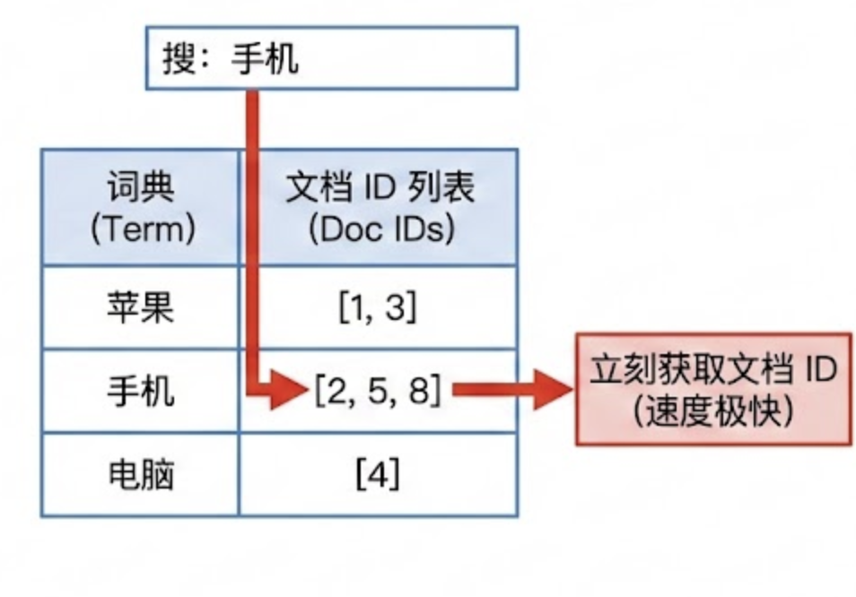
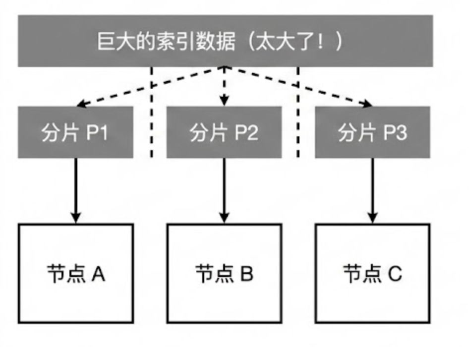

### 一、 知识点讲解

ES (Elasticsearch) 说白了就是一个基于 Lucene 的分布式搜索和分析引擎。你可以把它理解为是一个对 Lucene 做了封装的“超级壳子”，把原本复杂难用的 Lucene 变成了支持分布式、高可用、提供 RESTful API 接口的开箱即用的服务。它主要解决的是传统关系型数据库在海量数据全文检索和复杂聚合分析上性能极其低下的问题。

#### 倒排索引

这是 ES 的灵魂。MySQL 用的是 B+ 树，适合精确查找；而 ES 用的是倒排索引。一般的数据库是“通过 ID 找内容”。ES 是反过来的，它是“通过内容找 ID”。

1. 当你存数据时，ES 会先把内容分词（比如把“华为手机”拆成“华为”、“手机”），然后建立一个字典，记录每个词出现在哪些文档 ID 里。当你搜“华为”时，它直接查字典就能告诉你哪些文档里有，不用去遍历每一行数据。这就是为什么它能在亿级数据中毫秒级响应。

#### 分片与副本

ES 天生就是为了分布式设计的。

**分片** ：数据量太大，一台机器存不下怎么办？切开了存。一个索引切成几个分片，分散在不同的机器（节点）上，并行查询，提高吞吐量。

1. **副本** ：机器坏了数据丢了怎么办？备份。每个分片都有副本，主分片挂了，副本立马顶上，保证高可用。

---

### 二、 面试标准回答（实战篇）

Elasticsearch 是一个基于 Lucene 开发的、分布式的、实时的搜索和分析引擎。它对外提供了 RESTful 风格的接口，非常易于使用。在目前的架构中，我们主要用它来解决海量数据的全文检索和实时数据分析的需求。

它之所以被广泛使用，主要有两点核心优势：

**第一是查询性能极强。**

这主要归功于它底层的倒排索引机制。和传统数据库不同，ES 在写入数据时就会对内容进行分词建立索引，这让它在处理模糊搜索、多条件组合过滤时，比 MySQL 的 Like 查询快几个数量级，基本能做到亿级数据毫秒级返回。

**第二是天生的分布式架构。**

它支持水平扩展，通过**分片机制**，我们可以把庞大的数据切分存储在多台节点上，提升系统的吞吐量；同时通过**副本**机制，保证了即使某台节点宕机，数据也不会丢失，服务也不会中断，天然具备高可用性。
