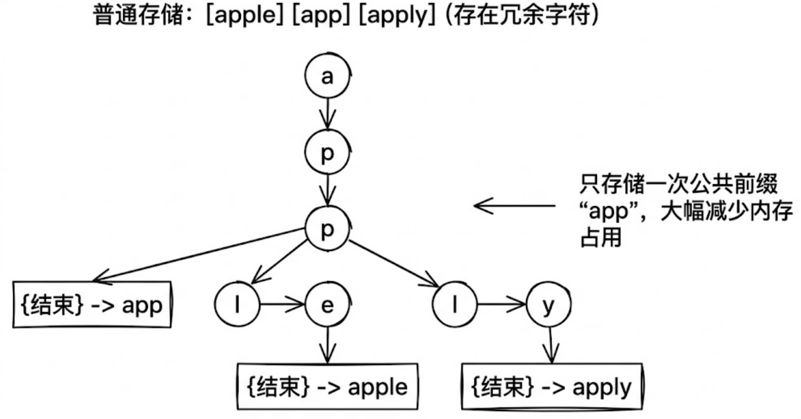

### 一、 知识点讲解

要理解 ES 的快，不能只回答“因为用了倒排索引”，这只是表层。真正的核心在于 ES是如何将**数据结构**与**操作系统特性**结合。。

#### 倒排索引与 FST

大家通过倒排索引都知道 Term 到 ID 的映射，但 ES 快就快在“如何快速找到那个 Term”。

- **Term Dictionary：** 如果词汇量巨大，词典本身大到无法放入内存。
- **FST ：** Lucene 没有把整个词典傻傻地塞进内存，而是用 FST 这种极度压缩的数据结构来存储词典的前缀。

    - FST 极其节省内存，这使得 ES 可以把 Term Index **常驻内存**。
    - 查询时，先在内存通过 FST 快速定位到磁盘上 Term Dictionary 的 Block，再做一次磁盘 I/O 就能拿到倒排链。

哪怕数据量是 PB 级，定位一个关键词也几乎是毫秒级的，因为主要路径都在内存。

#### Filesystem Cache

ES 进程本身的 JVM Heap 其实不用设得特别大，为什么？因为 ES 极其依赖操作系统的 **Filesystem Cache（页面缓存）**。

ES 生成的索引文件一旦写死就是不可变的。因为不可变，操作系统可以放心地把这些文件热加载到 Page Cache 中，且几乎不需要考虑数据一致性锁的问题。当你查询时，如果数据已经被 OS 缓存在内存中，这其实就是一次**内存搜索**，完全绕过了磁盘 I/O。这也是为什么 ES 刚启动时查询慢，预热后飞快的原因。

---

### 二、 面试标准回答

Elasticsearch 的高性能查询，本质上是因为它在**底层数据结构**和**操作系统资源利用**上做到了极致。

**第一，基于 FST 的倒排索引机制。**

这是 ES 快的根本。ES 底层通过倒排索引映射 Term 到 DocId。但关键在于，它使用了 FST 这种极度压缩的数据结构来存储 Term Index。这允许 ES 将索引的前缀数据常驻内存，查询时几乎不需要磁盘随机 I/O 就能定位到具体的词条位置，实现了极致的检索速度。

**第二，充分利用操作系统的 Filesystem Cache。**

ES 的索引文件写入后是**不可变**的。这种特性让操作系统可以放心地把大量索引文件缓存在 Page Cache 中。只要内存够大，绝大多数查询请求实际上走的是内存，而不是磁盘。这也解释了为什么我们调优时强调留一半物理内存给操作系统，而不是全给 JVM。
