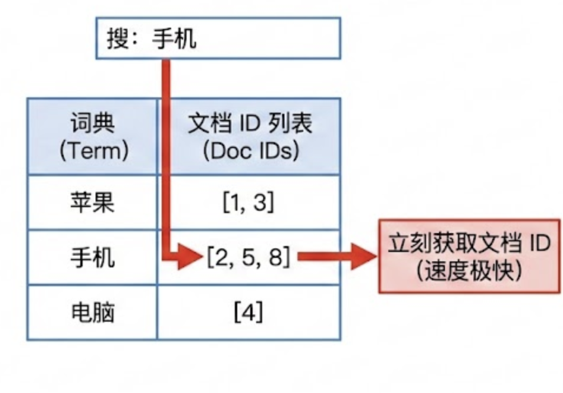

#### **一、 知识点讲解**

要理解倒排索引，得先看它的对立面——**正排索引**

**正排索引**

- 想象你在存数据。通常我们是以“文档ID”为核心来存储的。比如：
    - 文档1：包含了“搜索”、“技术”、“Java”
    - 文档2：包含了“搜索”、“算法”
    - 这种**“通过文档找关键词”**的结构就是正排索引。它在写入时很快，但在检索时非常慢。如果你想找“谁包含了‘搜索’这个词”，系统必须把所有文档从头到尾扫一遍，数据量一大，性能直接崩溃。

**倒排索引**

- 为了解决检索慢的问题，我们将上述关系反转过来，建立一个**“通过关键词找文档”**的映射结构：
    - 关键词“搜索” -> 出现于 [文档1, 文档2]
    - 关键词“技术” -> 出现于 [文档1]
    - 关键词“Java” -> 出现于 [文档1]
    - 关键词“算法” -> 出现于 [文档2]

---

#### **二、 面试标准回答**

倒排索引是搜索引擎和数据库全文检索的核心数据结构。简单来说，它主要是为了解决‘如何在海量数据中快速找到包含特定关键词的数据’这个问题。

我们可以对比着来讲：

传统的数据库或文件系统，通常是正排索引，也就是‘文档到关键词’的映射，通过 ID 找内容。但这在做全文搜索时效率很低，因为必须全表扫描。

而**倒排索引**，顾名思义，是将这个关系反转过来，建立的是‘关键词到文档 ID’的映射。
