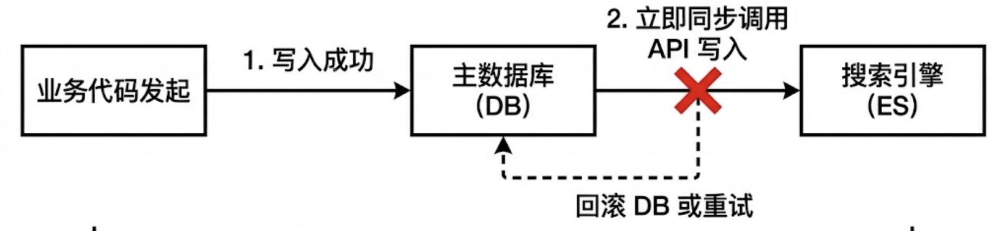
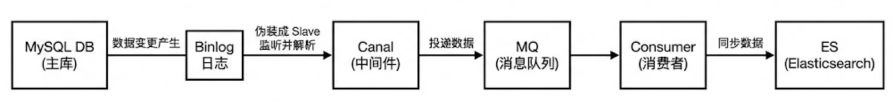

### 知识点讲解

在分布式架构中，Elasticsearch 通常作为搜索引擎或复杂聚合分析的组件，而 MySQL 等关系型数据库作为数据的“真实”来源。保证两者一致性，本质上是在解决**分布式事务**或**异构数据源同步**的问题。

由于 ES 和 DB 是两个独立的系统，只要有网络通信和并发，就无法做到绝对的“强一致性”（即写入 DB 的瞬间 ES 也能读到）。在实际工程中，我们追求的是**最终一致性**。

目前主流的解决方案主要分为三种，分别对应不同的业务场景和复杂度：

- **同步双写：**

    - **原理：** 在业务代码中，写入 DB 成功后，直接调用 ES 的 API 写入数据。
    - **特点：** 实现简单，但代码耦合度高。如果写入 ES 失败，需要考虑回滚 DB 或重试，会拖慢主业务接口的响应时间。
    - **适用场景：** 数据量小、并发低、对实时性要求极高且允许轻微性能损耗的后台管理系统。
- **异步通知：**

    - **原理：** 业务代码写入 DB 后，发送一条消息到消息队列。消费者订阅消息后，异步写入 ES。
    - **特点：** 实现了业务解耦，主接口响应快。但引入了 MQ 中间件，系统复杂度增加，需要处理消息丢失、重复消费（幂等性）和顺序性问题。
    - **适用场景：** 高并发、业务逻辑复杂、对数据实时性要求在秒级左右的场景。
- **监听 Binlog：**

    - **原理：** 使用中间件（Canal）伪装成 MySQL 的 Slave 节点，监听 MySQL 的 Binlog 日志。一旦 DB 数据变更，Canal 解析日志并投递到 MQ，再由消费者同步到 ES。
    - **特点：****完全解耦**，业务代码无需感知 ES 的存在。可靠性最高，且不仅限于 ES，还可以同步到 Redis、HBase 等。
    - **适用场景：** 核心业务、大型微服务架构、对代码侵入性有严格要求的场景。

---

### 面试标准回答

关于 ES 和数据库的一致性问题，在分布式环境下，我们很难做到强一致性，所以通常我们的目标是保证**最终一致性**。

在实际项目中，根据业务场景的不同，通常会采用以下几种策略，这里重点推荐**Binlog 订阅**方案。

**第一种方案：同步双写**

如果是早期的简单业务，或者并发量很低，我会直接在代码里的 Transaction 之后加入写入 ES 的逻辑。

但这有个大问题：性能差，而且如果 ES 写入超时或失败，会影响主业务流程，甚至导致数据库事务无法回滚，造成数据不一致。所以在大流量场景下我基本不推荐。

**第二种方案：异步 MQ 通知**

为了解耦，我们会在数据库更新成功后，发送一个消息到 MQ。有一个独立的消费者服务来订阅这个消息，负责把数据更新到 ES。这样做的好处是主业务接口很快，不依赖 ES 的状态。但需要注意两点：

1. **消息可靠性：** 必须保证消息不丢失
2. **顺序问题：** 如果同一个 ID 的数据被快速修改两次，必须保证 MQ 消费的顺序，否则 ES 里的数据可能会被旧值覆盖。

**第三种方案：监听 Binlog**

这是目前最成熟、对业务代码侵入最少的方案。使用 Canal 这样的中间件，让它伪装成 MySQL 的 Slave 节点，实时监听 MySQL 的 Binlog。

1. 当 MySQL 数据发生变更，Canal 捕获到变动，将数据发送到 MQ。
2. 我们的同步服务从 MQ 消费数据，写入 ES。

**这种方案的核心优势在于：**

- **零侵入：** 业务代码完全不需要关心 ES 的写入逻辑，专注于 DB 即可。
- **容错性强：** 即使 ES 挂了，消息还在 MQ 里，等 ES 恢复后继续消费即可，保证了最终一致性。
