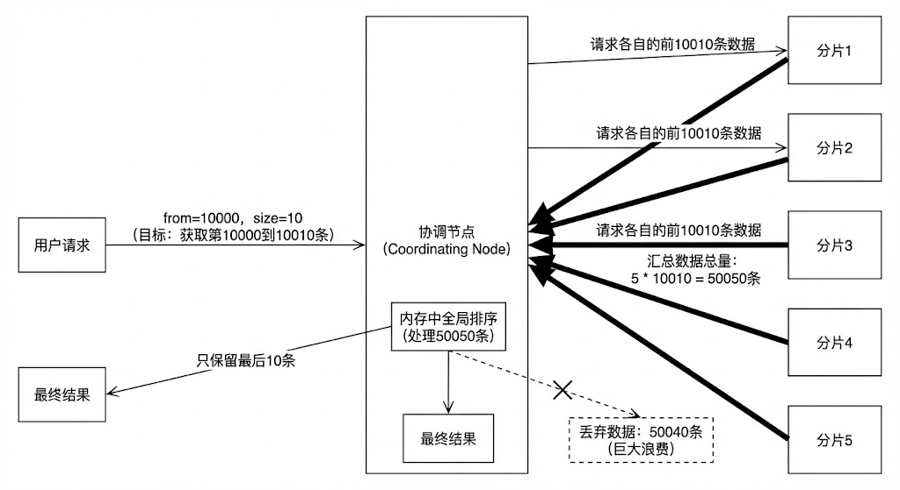
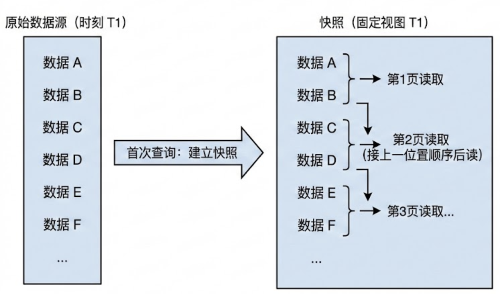
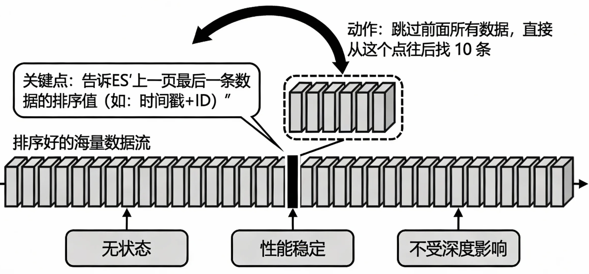

### **知识点讲解**

#### 由于分布式架构导致的“读放大”

很多人误以为 ES 分页慢是因为数据量大，其实核心原因是它的分布式查询机制。

**<u>ES 无法“直接定位到第 N 条”</u>**

当你请求 from=10000, size=10 时，ES 不能只去各个分片拿第 10000 到 10010 条数据。相反，协调节点必须向所有分片请求 前 10010 条数据。

假设你有 5 个分片，协调节点实际上要处理 5 * 10010 = 50050 条数据，在内存中进行全局排序，最后只留下 10 条，扔掉 50040 条。

页码越深，from 值越大，网络传输量和协调节点的内存消耗呈指数级上升，极其容易导致 OOM或者 CPU 飙升。

#### **三种解决方案对比：**

- **常规分页 (**`**from**` **+** `**size**`**)**：
    - **机制**：傻瓜式分页。所有分片都返回 from + size
    - **缺点**：from 越大：拉取的数据越多，排序数据越多，丢弃的数据越多。**每一页都是 O(N) 累积成本**
    - **适用**：浅分页，比如前 10-20 页。
- **快照遍历(**`**Scroll**`**)：**

    - **机制**：第一次查询的时候，建立一个 快照。固定住当时的数据视图，后续每一页，直接从上一次的位置 顺序往后读。
    - **缺点**：维护快照上下文非常耗资源，且<u>不是实时</u>的。
    - **适用**：全量数据导出、数据迁移、离线批处理。**切记：严禁用于前端实时搜索接口。**
- **游标查询 (Search After)【这是 ES 唯一为“实时深分页”设计的方案。】**

    - **机制**：类似于书签。不需要翻过前 10000 页，而是告诉 ES：“上一页最后一条数据的排序值（比如时间戳+ID）是什么”，然后直接从这条数据后面开始找 10 条。
    - **优点**：无状态，性能稳定，不受深度影响。
    - **缺点**：只能下一页，不支持随机跳转（比如直接跳到第 500 页）。
    - **适用**：手机端无限下拉刷新（Feed流）。

---

### **面试标准回答**

关于 ES 的深分页问题，我们在生产环境中主要通过**业务规避**和**技术选型**两个层面来解决。

**首先，最直接的手段是业务规避。**

ES 原生的 from+size 机制在深度分页时会产生巨大的性能损耗，因为它需要召回大量数据在协调节点做全局排序。所以，我们通常会设置 max_result_window 限制，比如限制用户只能看前 100 页。实际上用户几乎不会翻到几百页之后，这种限制对用户体验影响很小，但能极大地保护集群。

如果是技术层面必须要查深分页的数据，我们分两种场景处理：

**第一种是海量数据的离线导出（比如财务导出报表）。**

我们会使用 Scroll API。它相当于建立了一个数据快照，通过游标分批拉取，效率很高。但因为它是非实时的且消耗上下文资源，**一般不能在实时的 C 端接口中使用它。**

**第二种是移动端的无限下拉（Feed 流场景）。**

这种场景下，我们使用 Search After 机制。它利用上一页最后一条数据的 sort values 作为定位符，直接向后查找。这种方式没有 from 的跳过开销，无论翻到多少页，性能都是恒定的，非常适合实时深分页。
