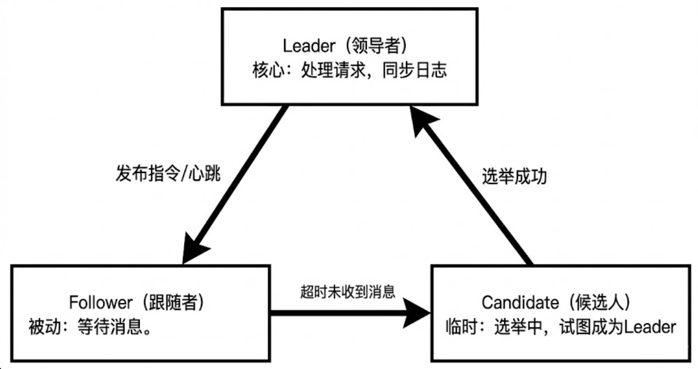
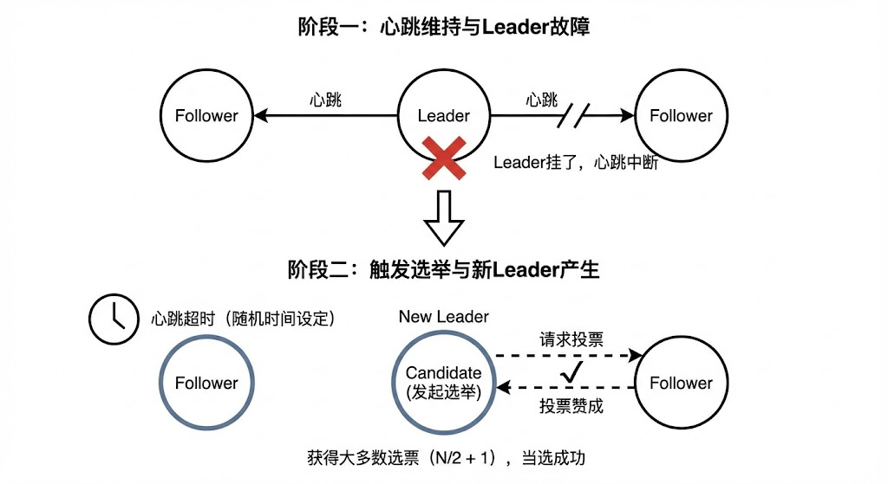
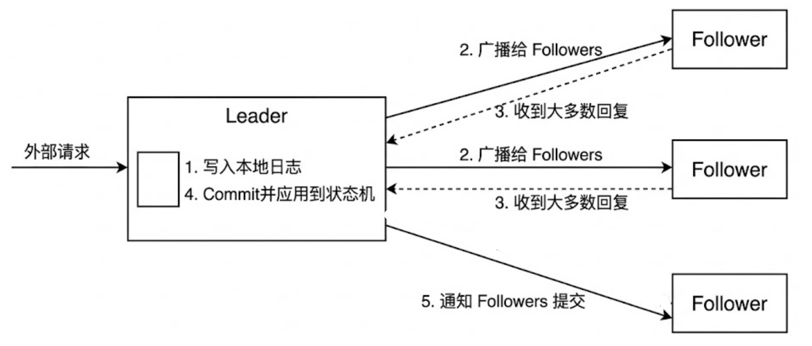

### 知识点讲解

RAFT 协议的核心设计目标是**易理解性**，它把复杂的分布式共识问题拆解成了几个独立的子问题来解决。理解 RAFT，本质上就是理解它是如何通过“强领导者”模型来保证系统状态一致的。

#### 角色与状态机

在 RAFT 集群中，任意时间点，每个节点只可能处于以下三种状态之一：

- **Leader（领导者）**：负责处理所有客户端请求，并向其他节点同步日志。集群中同一时刻只能有一个 Leader。
- **Follower（跟随者）**：被动响应 Leader 和 Candidate 的请求。如果不超时，它一直当 Follower；一旦超时收不到领导消息，就准备造反（变成 Candidate）。
- **Candidate（候选人）**：处于选举过程中的临时状态。正在拉票，试图成为新的 Leader。

#### **两个关键流程**

- **选主**：

    - **触发**：通过“心跳超时”机制触发。如果 Follower 此时没听到 Leader 的心跳，就认为 Leader 挂了，发起选举。
    - **机制**：利用**随机超时时间**来避免多个节点同时发起选举导致选票瓜分。
    - **原则**：获得集群**大多数**（N/2 + 1）选票的节点当选。
- **日志复制** ：

    - **流向**：强单向流动，只能从 Leader -> Follower。
    - **两阶段提交**：Leader 收到请求 -> 写入本地日志 -> 广播给 Followers -> 收到大多数回复 -> Commit并应用到状态机 -> 通知 Followers 提交。

#### **安全性与任期**

- **Term (任期)**：相当于逻辑时钟。每个 Term 都有一个唯一的 ID。如果你的 Term 比我小，说明你是旧时代的残党，我不听你的；如果你的 Term 比我大，我立刻退位变成 Follower。
- **日志匹配原则**：如果两个日志在相同的索引位置拥有相同的 Term，那么从头到这个索引位置的所有日志一定完全相同。这是数据一致性的基石。

---

### 面试标准回答

它是一种为了管理复制日志的共识算法，相比 Paxos，它最大的特点就是结构清晰，易于理解和实现。

在面试中，我通常把 RAFT 的核心机制拆解为三个部分来阐述：**选主**、**日志复制** 和 **安全性**。

**第一，关于选主。**

RAFT 维持一个强领导者模型。集群启动或 Leader 挂掉时，会通过‘心跳超时’机制触发选举。节点会从 Follower 变为 Candidate 发起投票。这里有一个精妙的设计是随机超时时间，它有效避免了多个节点同时选举导致的死锁。只要一个 Candidate 获得了集群‘大多数’节点的投票，它就成为了新的 Leader。

**第二，是日志复制。**

这是 RAFT 保证一致性的主要手段。所有的写请求必须由 Leader 处理。流程大概是这样的：Leader 接收命令，写入本地日志，然后并行发 RPC 给 Followers。一旦收到半数以上节点的成功回复，Leader 就会将这条日志标记为 **已提交**并应用到状态机，最后通知 Followers 也进行提交。这种机制保证了只要已提交的数据，就不会丢失。

**第三，是安全性**

RAFT 保证了‘日志匹配特性’。如果在不同节点的日志中，某条记录的索引和任期号相同，那么它之前的所有记录都认为是完全一致的。此外，在选举时还有一条硬性规定：只有拥有最新已提交日志的节点才有资格当选 Leader。这直接从根源上防止了旧 Leader 覆盖新数据的问题。
