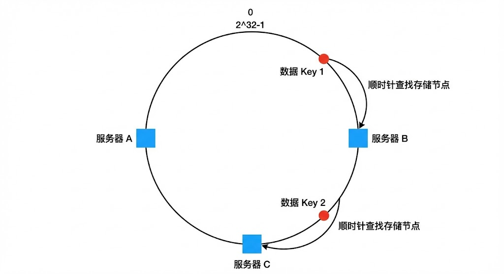
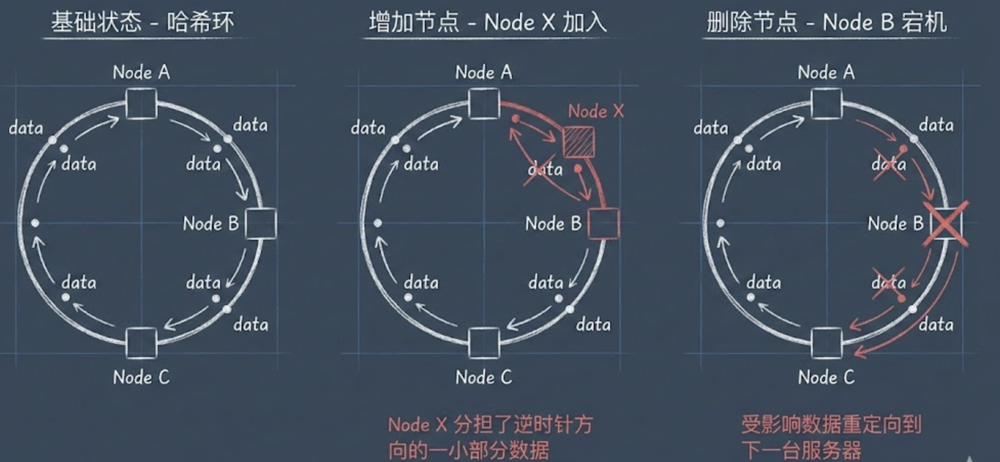

### 一、 知识点讲解

在分布式缓存或负载均衡场景中，我们经常面临一个问题：如何将大量的数据均匀地分配到多台服务器上？

#### 传统哈希的局限性

最直观的做法是 hash(key) % N（N为服务器数量）。

- **问题：** 这种算法对“扩容”和“缩容”极其敏感。一旦 N 发生变化（比如增加一台服务器，N 从 3 变为 4），由于取模的基数变了，几乎所有 Key 的计算结果都会改变。
- **后果：** 导致绝大部分缓存失效，请求瞬间穿透到数据库，引发“缓存雪崩”。

#### 一致性哈希的原理：哈希环

一致性哈希不再对服务器数量 N 取模，而是对 $$2^{32$$ 取模。

- **构建环：** 想象一个从 0 到 $$2^{32}-1 $$ 的线性空间，首尾相连形成一个闭合的圆环。
- **节点映射：** 首先，将服务器（IP或主机名）进行哈希，映射到环上的具体位置。
- **数据存储：** 当有一个数据 Key 进来时，使用同样的哈希函数计算其 Hash 值，映射到环上的某个点。
- **顺时针查找：** 从数据 Key 的位置开始，沿**顺时针**方向查找，遇到的**第一台**服务器，就是该数据存储的节点。

#### 容错性与扩展性

这是一致性哈希最大的优势：

**增加节点：** 如果在环上加入一台新服务器 `Node X`，它只会分担它在环上“逆时针方向”那一部分数据（即原本属于下一台服务器的一小部分数据）。

**删除节点：** 如果一台服务器宕机，受影响的仅仅是该服务器上的数据，这些数据会被重定向到顺时针方向的下一台服务器。

**结论：** 无论增删节点，都只会影响局部数据，而不会导致全量数据重新洗牌。

#### 数据倾斜与虚拟节点

如果服务器节点很少（例如只有 2 台），由于哈希的随机性，这两个节点在环上的分布可能极不均匀（例如挤在一起）。这会导致一台服务器负载极高，另一台很空闲，这就是数据倾斜。

**解决方案：虚拟节点**

不改变物理服务器数量，而是为每台物理服务器创建多个“分身”（例如每台机器创建 150 个虚拟节点）。

将这些虚拟节点均匀散列在哈希环上。数据定位时，先找到虚拟节点，再映射回物理节点。

这样做既保证了数据的均匀分布，又能在节点宕机时，将其负载均匀地分摊给剩下的所有节点。

---

### 二、 面试标准回答

一致性哈希是一种特殊的哈希算法，主要解决分布式系统中，在动态扩缩容（增加或减少节点）时，能够尽可能减少数据迁移量的问题。它常用于分布式缓存和负载均衡系统。

普通的 Hash(key) % N 算法，一旦服务器数量 N 发生变化，会导致几乎所有的映射关系失效，引发大量的缓存穿透或数据震荡。而一致性哈希能保证在节点变动时，只影响极少部分的数据，具有很好的单调性。

一致性哈希将整个哈希值空间组织成一个虚拟的圆环（范围通常是 $$$$ 到 $$2^{32}-1 $$）。

1. 首先，我们将服务器节点（通过 IP 或 Hostname）哈希后映射到这个环上。
2. 然后，将数据的 Key 也是用相同的函数哈希到环上。
3. **寻址策略是：** 从数据 Key 的位置开始，沿**顺时针**方向查找，遇到的第一个服务器节点，就是该数据所属的节点。

在节点数量较少的情况下，单纯的物理节点映射容易造成数据倾斜（即节点分布不均，导致某台机器负载过高）。

为了解决这个问题，一致性哈希引入了虚拟节点机制。即对每一个物理节点，构建多个虚拟的副本节点（比如几百个），并将它们均匀地散列在哈希环上。数据先找到虚拟节点，再路由到对应的物理机器。这样不仅实现了负载均衡，在节点宕机时，也能将流量均匀分摊给其他机器，避免雪崩。
