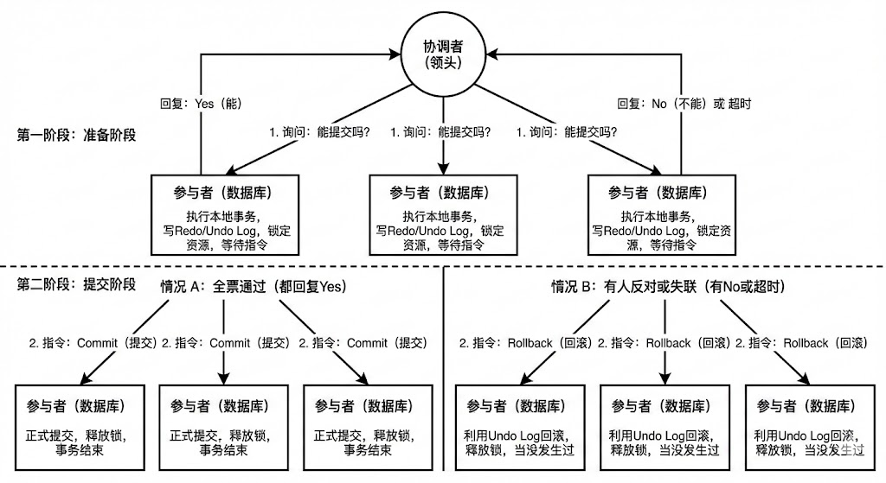

### 知识点讲解

两阶段提交的本质，是为了解决分布式系统里“怎么让多个人同时做成一件事，或者都不做”的问题。

在单机数据库里，事务要么全成要么全败很简单；但在分布式环境下，不同的数据库在不同的机器上，谁也不知道对方是成功了还是死机了，这就需要一个领头的（协调者）来统一指挥。

为了保证大家步调一致，2PC 把提交过程强行拆成了两个阶段：

#### **第一阶段：准备阶段**

协调者问所有参与者：“这个事务你们能提交吗？”

参与者在这一步**不仅是回答“能”或“不能”，而是真的去执行了本地事务逻辑**，写了 Redo/Undo Log，并**锁定了相关资源**。也就是，*万事俱备，只欠东风*。大家都在等协调者的一声令下，到底是“提交”还是“回滚”。

#### **第二阶段：提交阶段**

- **情况 A（全票通过）**：如果第一阶段所有人都回复“Yes”，协调者就发令“Commit”。大家正式提交，释放锁，事务结束。
- **情况 B（有人反对或失联）**：只要有一个人回复“No”，或者有人超时没理协调者，协调者就发令“Rollback”。大家利用之前的 Undo Log 回滚，释放锁，当什么都没发生过。

#### **缺点**

- **同步阻塞**：最致命的问题。在两个阶段之间，所有参与者都占着资源（锁），别人想用只能等着。如果协调者卡住了，大家就一直死锁着等。
- **单点故障**：协调者挂了，整个系统就瘫痪了，特别是如果协调者在第二阶段发指令前挂了，参与者就不知道该怎么办了。

---

### 面试标准回答

简单来说，它通过引入一个协调者，将事务的提交过程分成了两个阶段来处理：准备阶段和提交阶段，以此来保证所有节点要么全部提交，要么全部回滚。

具体的流程是这样的：

- **第一阶段是准备阶段**。协调者会询问所有参与者是否可以执行提交操作。这时候，参与者会执行本地的事务逻辑，记录好 Redo 和 Undo 日志，并**锁定资源**，但先不进行真正的提交，然后告诉协调者是“成功”还是“失败”。
- **第二阶段是提交阶段**。如果所有参与者在第一阶段都反馈成功，协调者就会发出 Commit 指令，大家正式提交并释放锁；但只要有一个参与者反馈失败，或者协调者等待超时，就会通知所有参与者执行 Rollback，回滚数据并释放锁。

不过，在实际应用中 2PC 也有比较明显的缺陷：

最主要的就是同步阻塞问题。在整个执行过程中，所有参与者都持有资源锁，其他事务想操作这些资源只能等待，性能比较差。其次是单点故障风险，一旦协调者挂了，参与者就会一直处于锁定状态，无法释放资源。

所以，现在很多高并发场景下，我们可能会更倾向于使用 TCC 或者基于消息队列的最终一致性方案，但在需要强一致性的场景下，2PC 依然是基础。
