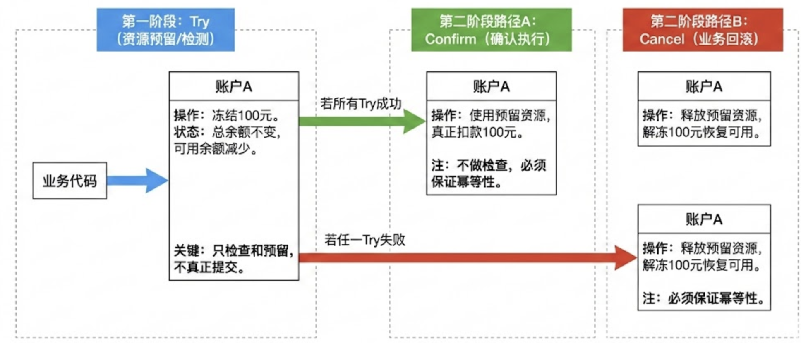

#### 一、 知识点讲解

TCC（Try-Confirm-Cancel）本质上是应用层面的二阶段提交（2PC）。它不依赖数据库层面的事务回滚（比如 XA 协议），而是通过业务代码来实现资源的锁定、提交和回滚。你把它理解为：先占座，再实锤，不行就退票。

#### **Try 阶段（资源预留/检测）：**

这是最关键的一步。在这个阶段，业务代码**不做**真正的业务提交，只做两件事：**检查业务条件**（一致性）和**预留业务资源**（隔离性）。

    1. *比如转账场景：* A 给 B 转 100 元。Try 阶段不是直接扣 A 的钱，而是冻结 A 的 100 元。这时候 A 的余额没变，但可用余额少了 100。

#### **Confirm 阶段（确认执行）：**

    1. 如果所有参与者的 Try 阶段都成功了，协调者就会调用 Confirm。这个阶段不做任何业务检查，直接使用 Try 阶段预留的资源，真正执行业务。
    2. *注意：* Confirm 操作必须保证幂等性（重复调用结果一致），因为网络抖动可能会导致重试。

#### **Cancel 阶段（业务回滚）：**

    1. 如果有一个参与者在 Try 阶段失败了，协调者就会调用所有参与者的 Cancel。这个阶段的核心是**释放** Try 阶段预留的资源。
    2. *比如转账失败：* 把 A 冻结的那 100 元解冻，恢复成可用余额。同样，Cancel 也必须保证幂等性。

---

#### 二、 面试标准回答

TCC 是一种位于应用层的分布式事务解决方案，全称是 Try-Confirm-Cancel。它其实就是业务层面的 2PC（两阶段提交），核心思想是通过业务逻辑来实现数据的最终一致性，而不是依赖数据库本身的事务机制。

它的流程分为三个阶段：

第一是 Try 阶段，主要是做业务检查和资源预留。比如我在扣减库存时，Try 阶段不是直接减库存，而是冻结库存字段。

第二是 Confirm 阶段，当所有参与者的 Try 都成功后，执行真正的业务提交，不做检查，只使用预留资源。

第三是 Cancel 阶段，如果 Try 阶段有任何异常，就执行 Cancel，把之前预留的资源释放掉，也就是执行反向补偿操作。
