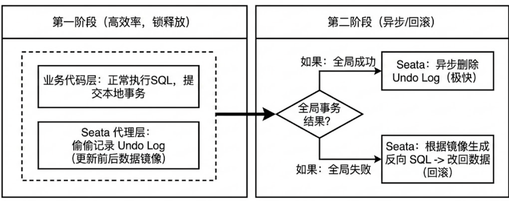
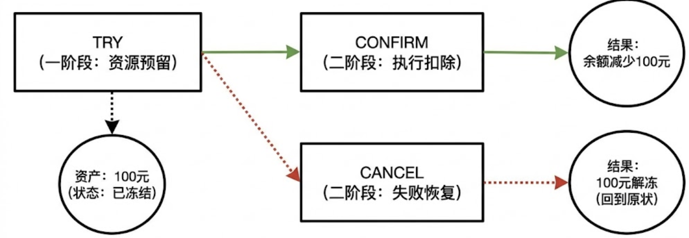
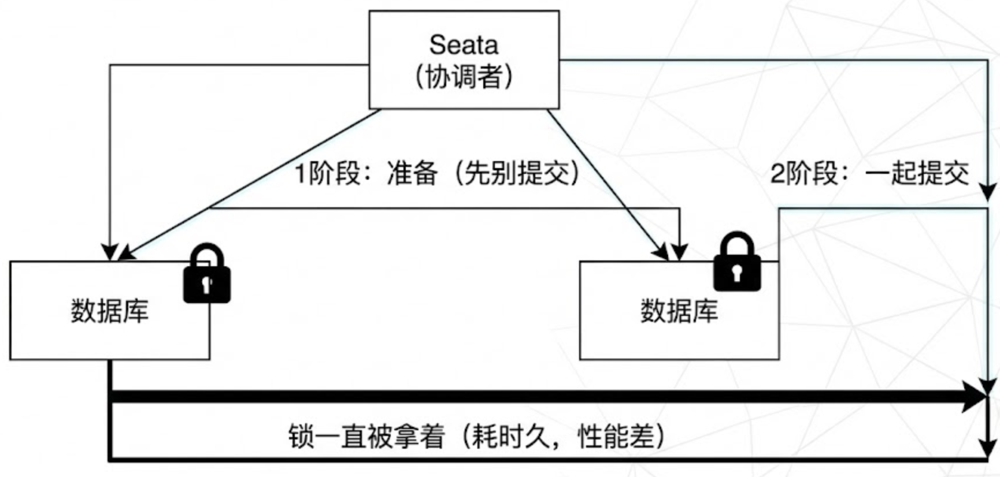

### 知识点讲解

Seata的各种模式，核心逻辑是“权衡”。Seata 提供了四种模式（AT、TCC、XA、Saga），本质上是在做这三个维度的取舍：**一致性强弱**、**业务侵入性**、**性能高低**。

大体区别如下：

1. **想省事、代码改动小**：选 **AT**（最常用）。
2. **追求极致性能、愿意写复杂代码**：选 **TCC**。
3. **要强一致性、主要用关系型数据库**：选 **XA**。
4. **业务流程极长、涉及遗留系统**：选 **Saga**。

#### **AT 模式 (Automatic Transaction)**

这是 Seata 的主打模式。它的核心思想是“代理”。你平时写代码像操作本地事务一样，Seata 在底层通过**代理数据源**把脏活累活干了。

- **第一阶段**：业务执行 SQL，Seata 偷偷记下更新前后的数据镜像（Undo Log），然后提交本地事务。这时候锁已经释放了，效率很高。
- **第二阶段**：如果全局成功，Seata 异步删除镜像日志（极快）；如果失败，Seata 根据镜像生成反向 SQL 把数据改回去（回滚）。
- **关键点**：它会有短暂的数据不一致（最终一致性），且需要数据库支持事务。

**【面试标准回答】**

AT 模式是 Seata 的默认模式，主打的是**无侵入**和**高性能**。

它的工作机制是在业务 SQL 执行时，自动拦截并记录‘前置镜像’和‘后置镜像’生成 Undo Log。一阶段直接提交本地事务，释放数据库锁，所以性能比传统 XA 高很多。二阶段如果是提交，直接异步删除 Log；如果是回滚，就利用 Undo Log 反向补偿数据。

在生产中，这是最常用的模式，因为我们不需要改动业务代码，只需要建一张 `undo_log` 表就行。不过要注意，因为它提前释放了锁，如果是高并发下的热点数据竞争，需要配合 Seata 的全局锁来防止‘脏写’。

---

#### **TCC 模式 (Try-Confirm-Cancel)**

AT 模式虽然省事，但因为要解析 SQL 和加全局锁，性能有上限。TCC 就是把控制权完全交给程序员。

你需要手动写三个方法：

- **Try**：做资源检查和预留（比如冻结 100 元，而不是直接扣）。
- **Confirm**：真正的业务执行（扣掉冻结的 100 元）。
- Cancel：预留失败的恢复（解冻那 100 元）。

这个模式不依赖数据库事务，全靠业务逻辑保证。

**【面试标准回答】**

TCC 是一种**强业务侵入**的模式，适用于对性能要求极高，或者需要操作不支持事务的资源（比如 Redis、第三方 API）的场景。

它的核心是**资源预留**。我们需要手动实现 Try（预留资源）、Confirm（确认执行）、Cancel（取消预留）三个接口。

相比 AT 模式，TCC 不依赖数据库的 Undo Log，不加全局行锁，所以并发度极高。但缺点也很明显，代码量翻倍。

---

#### **XA 模式**

这是数据库厂商的标准玩法（2PC）。Seata 只是做了一个协调者。

- **第一阶段**：告诉数据库“你准备好，先别提交”。
- 第二阶段：所有人都准备好了，再一起提交。

它的特点是锁得久。在整个事务结束前，数据库锁一直被拿着，性能较差，但能保证强一致性。

**【面试标准回答】**

XA 模式利用了数据库本身对 XA 协议的支持，属于**强一致性**方案。

在这个模式下，Seata 代理会利用数据库机制，在一阶段执行 SQL 后不提交，而是保持连接处于 Prepared 状态，直到二阶段全局决议通过才真正 Commit。

它的优势是完全符合 ACID 规范，数据绝对安全，且对业务无侵入。但缺点是长事务会长时间占用数据库锁，导致并发性能急剧下降。一般只在金融核心这种对数据一致性有洁癖，且并发量不大的边缘场景使用。

---

#### **Saga 模式**

适用于“长跑”业务。比如一个业务流程要好几分钟，甚至涉及人工审核。如果用 XA 或 AT，锁要拿几分钟，系统早崩了。Saga 就是把长事务拆成一串短事务。做完一个提交一个。如果中间哪一步错了，就顺着回头路执行“补偿操作”（相当于手动写的反向逻辑）。

**【面试标准回答】**

Saga 模式主要用于**长事务**场景，特别是涉及遗留系统整合时。

它的机制是把长事务拆解成一系列本地短事务，做完一个就提交一个，不长时间占锁。如果中间失败了，就依次回调定义好的补偿接口来恢复数据。

这种模式性能好，但只保证最终一致性，而且隔离性较差（可能出现脏读）。面试中我会强调它适合那种流程很长、跨越多个异构系统、且无法使用强一致性方案的复杂业务链路。
