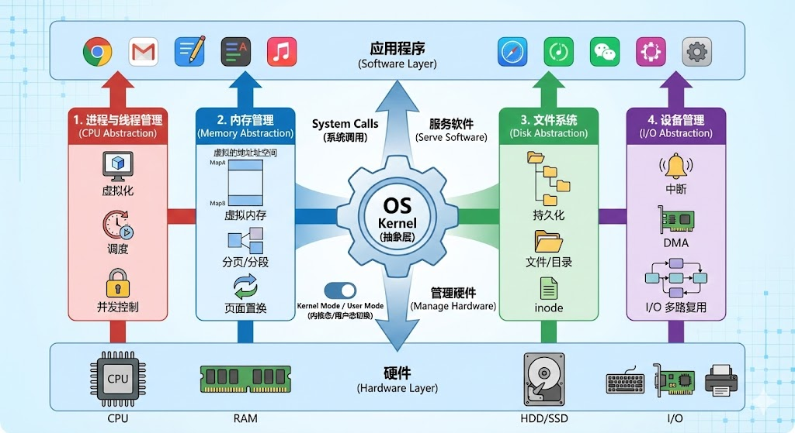

简单来说，操作系统这门课的核心任务就解决两个问题：一是如何管理硬件，二是如何服务软件。

它本质上是在硬件（CPU、内存、磁盘等）和应用程序之间构建的一个‘抽象层’。它的工作就是通过合理的调度和管理，把有限、复杂的物理硬件资源，虚拟化成无限、易用的逻辑资源，提供给上层应用使用。

具体展开来讲，这门课主要通过四个核心抽象来实现上述目标：

第一，进程与线程管理（对 CPU 的抽象）

这是面试最常考的重点。它主要讲操作系统怎么把一个 CPU ‘虚拟化’成多个，让多个程序看起来在同时运行。

- **关键点**包括：进程/线程的状态流转、CPU 调度算法（比如时间片轮转）、还有最难的**并发控制**（锁、信号量、死锁检测等）。

第二，内存管理（对 内存 的抽象）

它解决的是程序觉得内存不够用、或者内存地址冲突的问题。操作系统通过‘虚拟内存’技术，给每个进程画了一个独享内存的大饼。

- **关键点**包括：虚拟地址与物理地址的映射（分页、分段）、页表、TLB 快表，以及当物理内存不足时使用的**页面置换算法**（如 LRU）。

第三，文件系统（对 磁盘 的抽象）

它解决的是数据如何持久化存储的问题。把硬盘上杂乱的扇区抽象成我们熟悉的文件和目录树。

- **关键点**包括：文件的逻辑结构、索引节点（inode）、空闲空间管理，以及磁盘的调度算法。

第四，设备管理（对 I/O 的抽象）

它解决的是 CPU 如何跟慢速的外部设备（键盘、网卡、打印机）打交道的问题。

- **关键点**包括：中断处理机制、DMA（直接内存访问）技术，以及 I/O 的多路复用模型（Select/Epoll 等）。”

所以，整个操作系统学下来，其实就是在学这四个模块如何通过中断、系统调用和内核态/用户态切换紧密协作，最终实现系统的高效与稳定。
