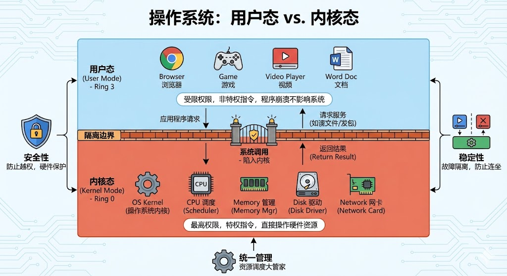

这个问题，说白了就是为了“别让普通程序把电脑搞崩了”。

它的核心目的是**对系统资源进行保护和隔离**。操作系统把 CPU 的权限分成了两级：最高的权限（内核态）给自己用，受限的权限（用户态）给应用程序用。这就好比银行里，柜员（内核）可以进金库，但客户（用户）只能站在柜台外面，想要取钱必须通过柜员办理。

具体的理由可以从以下三个维度来拆解：

1. **安全性（防止越权）**
- **硬件保护：** 像硬盘读写、网卡发送数据、内存分配这些操作，直接涉及硬件资源。如果让普通程序（比如一个游戏或者浏览器）随意操作，它可能会读取其他程序的内存（偷密码），或者误删系统文件。
- **权限锁死：** 只有在内核态下，CPU 才能执行特权指令（Privileged Instructions）。在用户态下，如果程序想干这些事，CPU 直接会报错并把程序杀掉。
1. **稳定性（故障隔离）**
- **防止连坐：** 现在的软件很难保证没有 Bug。如果所有程序都跑在内核态，一个看视频的软件崩了，可能会导致整个内存数据错乱，系统直接蓝屏（BSOD）。
- **隔离机制：** 划分状态后，用户态程序崩了，操作系统只是把它清理掉，其他程序和系统本身照样运行，互不影响。
1. **统一管理（资源调度）**
- 多个程序都要用 CPU、都要用内存。如果大家平级，肯定会打架（抢占资源）。内核态作为唯一的“大管家”，可以统一调度，谁先用、谁后用、用多少，保证公平和效率。

### 面试标准回答

操作系统划分用户态和内核态，核心目的是为了**系统的安全性、稳定性和资源管理**。

第一，为了保护硬件和系统资源（安全性）：

CPU 指令集分为特权指令和非特权指令。

- **内核态（Ring 0）**：拥有最高权限，可以执行所有指令，访问所有硬件资源（如磁盘、网卡、内存管理）。
- **用户态（Ring 3）**：权限受限，只能进行简单的运算，不能直接操作硬件。这防止了恶意或有 Bug 的用户程序破坏系统核心数据。

第二，为了实现故障隔离（稳定性）：

如果没有这种区分，任何一个应用程序的崩溃都可能导致整个操作系统的瘫痪（蓝屏）。划分后，用户态程序的崩溃会被限制在自己的空间内，不会波及内核和其他进程。

第三，为了统一的资源调度：

这种架构强制用户程序必须通过系统调用（System Call）陷入内核，由内核统一代理执行 I/O 操作和资源分配，从而实现了对 CPU、内存等竞争资源的统一管理和调度。
