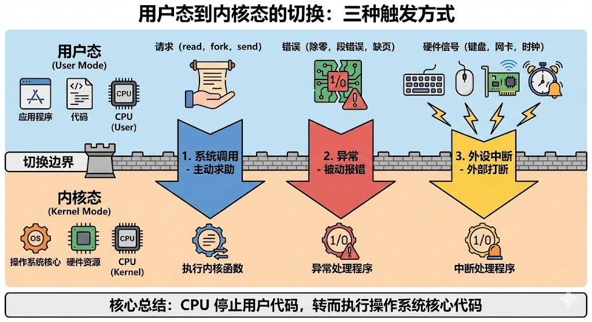

用户态切换到内核态，本质上就是**CPU 停止执行当前用户的代码，转而去执行操作系统的核心代码**。

虽然细节很多，但归根结底，只有**三种情况**会触发这个动作。我们可以把它们总结为：**“主动求助”、“被动报错”和“外部打断”**。

具体场景如下：

1. 系统调用（System Call）

这是最常见的情况。用户程序是不能直接操作硬盘、网卡或屏幕的。

- **场景：** 当你的代码执行 `read()` 读文件、`fork()` 创建进程、或者 `send()` 发网络包时。
- **过程：** 程序会显式地执行一条指令（比如 Linux 下的 `int 0x80` 或 `syscall`），主动告诉 CPU：“我不行了，麻烦内核帮我干一下这个事”。
1. 异常（Exception）

这是代码运行出问题了，不得不交给内核来收拾烂摊子。

- **场景：** 代码里写了个 `1/0`（除以零），或者访问了一块不该访问的内存（段错误），或者**缺页异常**（数据不在内存里，要去硬盘加载）。
- **过程：** CPU 执行到错误指令时，发现没法继续了，就会触发一个异常，自动切换到内核态去执行异常处理程序（比如杀掉进程，或者从磁盘调入页面）。
1. 外设中断（Interrupt）

这是硬件发来的信号，跟当前运行的程序没关系，但 CPU 必须停下来去处理。

- **场景：** 键盘被按下了、鼠标动了、硬盘数据读完了、网卡收到数据包了，或者**时间片到了**（时钟中断）。
- **过程：** 硬件控制器向 CPU 发送电信号，CPU 立马暂停当前用户态的任务，切换到内核态去执行中断处理程序。

---

### 面试标准回答

用户态切换到内核态，主要有三种触发方式，涵盖了程序的主动请求、被动暂停和外部干预：

第一种是系统调用（System Call），这是程序主动发起的。

当用户程序需要进行 I/O 操作（如读写文件）、申请内存或创建进程时，必须通过系统调用接口（如 read, write, fork）向内核发出请求，从而陷入内核态。

第二种是异常（Exception），这是程序被动触发的内部错误。

当 CPU 执行指令时遇到无法处理的错误（如缺页异常、除零错误、非法内存访问），会触发异常机制，CPU 自动切换到内核态来执行对应的异常处理程序。

第三种是外设中断（Interrupt），这是由外部硬件触发的。

当外部设备（如网卡、磁盘、键盘）完成任务或需要 CPU 介入时，会发送硬件中断信号。CPU 会暂停当前用户态指令，转而去执行中断处理程序。
