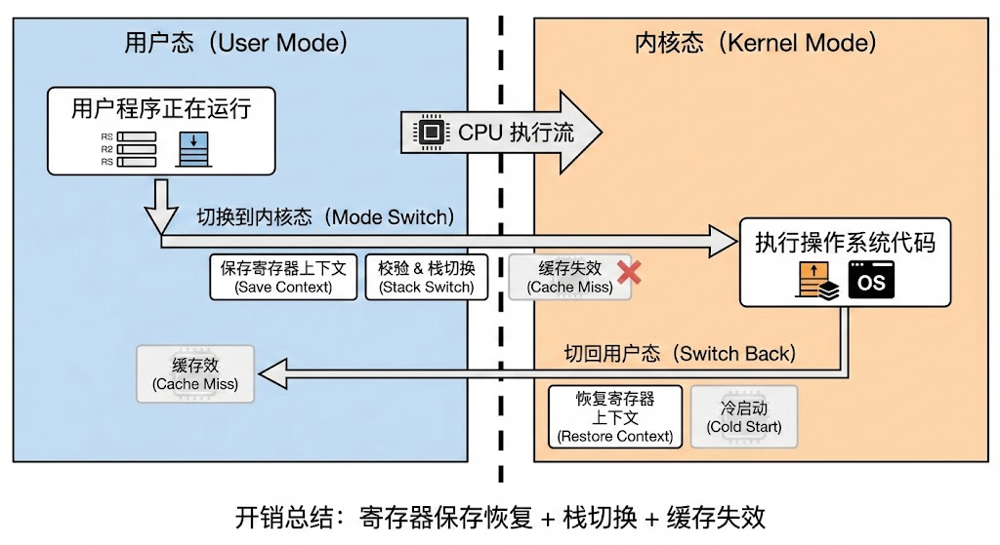

**用户态和内核态是两个完全隔绝的区域。** 从一个世界跨越到另一个世界，CPU 不仅要停下手里的活，还得把现场封存好，换一套工作环境，最后还得经过一系列严格的安全检查。这比普通的函数调用要累得多。

具体的开销主要来自以下三个方面：

1. **现场的“保存”与“恢复”**
- 当 CPU 还在用户态时，寄存器里存的是你的程序变量、临时数据、下一条指令的地址。
- 一旦要切入内核态，这些数据**全部**都得保存到内存（内核栈）里去，防止被覆盖。这就好比你打游戏要存档。
- 等内核态任务干完了，切回来的时候，又得把这些数据从内存里读出来，填回寄存器。这一存一取，涉及到大量的内存读写，非常耗时。
1. **栈的切换**
- 用户态有“用户栈”，内核态有“内核栈”。
- 切换状态时，CPU 必须修改堆栈指针寄存器（SP），从用户栈指到内核栈。这涉及到内存地址空间的转换和检查。
1. **缓存失效**
- 这是最致命的。CPU 为了快，有 L1/L2 缓存和 TLB（页表缓存）。这些缓存里存的都是刚才用户程序“热乎”的数据。
- 一旦进了内核态，执行的是操作系统代码，刚才缓存的那些用户数据就没用了（Cache Miss）。CPU 必须去慢吞吞的内存里重新加载内核所需的数据。
- 同样，等切回用户态时，原本热乎的缓存已经被内核数据挤掉了，用户程序又得经历一次“冷启动”。

---

### 面试标准回答

从用户态切换到内核态（Mode Switch）的开销远大于普通函数调用，主要原因包含三个层面：

第一，寄存器上下文的保存与恢复：

CPU 必须暂停当前执行流，将用户态的通用寄存器、程序计数器（PC）、栈指针等全部压入内核栈中保存。切换回来时又需要从栈中恢复。这是一笔硬性的内存 I/O 开销。

第二，CPU 特权级的校验与栈切换：

硬件需要进行保护检查（如 Ring 3 到 Ring 0 的权限校验），同时需要从用户栈切换到内核栈。

第三，缓存命中率下降：

这是性能损耗最大的地方。

- CPU 流水线（Pipeline）可能会被打断，导致指令预取失效。
- TLB（页表缓冲）和 **L1/L2 Cache** 中的内容可能因为上下文变化而失效或被污染（Cache Pollution）。这导致在进入内核态初期以及切回用户态初期，CPU 访问内存的命中率大幅降低，不得不直接访问物理内存。
