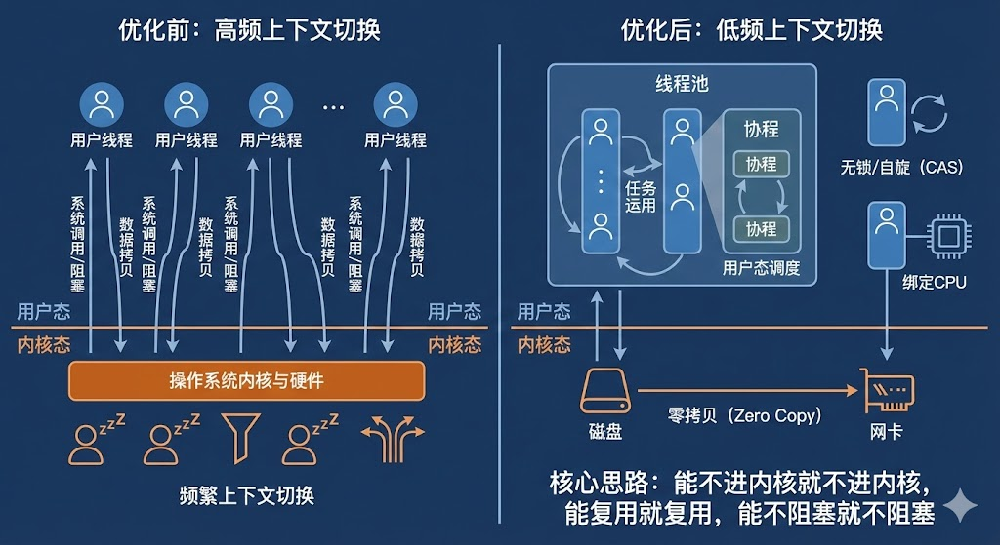

想要减少上下文切换，核心思路其实就一句话：**“能不进内核就不进内核，能不阻塞就不阻塞，能复用就复用”。**

上下文切换最大的成本在于操作系统内核的介入（保存现场、调度、恢复现场）。所以，优化的方向就是尽量让程序在**用户态**就把事情办了，或者让线程一直干活别停下来。

具体的技术手段，主要集中在以下这四个方面：

1. **协程**
    1. **原理：** 线程是内核调度的，切换太重。协程是**用户态**的“轻量级线程”。
    2. **怎么减：** 协程的调度完全由用户程序自己控制（比如 Go 语言的调度器）。当一个协程卡住时，程序自己在用户态就切到另一个协程去了，**根本不需要操作系统内核参与**，也不需要切到内核栈，开销极低。
2. **线程池**
    1. **原理：** 创建和销毁线程都需要进内核，而且新线程启动往往伴随着一次调度。
    2. **怎么减：** 用线程池维护一堆“长生不老”的线程。任务来了直接扔给活着的线程干，干完别死，接着干下一个。这样就避免了频繁创建/销毁线程带来的上下文切换。
3. **零拷贝**
    1. **原理：** 传统的读写文件需要在用户态和内核态之间反复横跳，并搬运数据。
    2. **怎么减：** 利用 `mmap`（内存映射）或 `sendfile` 技术。
        - 比如 Kafka 发消息，直接让磁盘和网卡在内核层对接，数据不用拷贝到用户态，应用程序连“手”都不用伸（不发生系统调用），自然就没了切换。
4. **无锁编程**
    1. **原理：** 当线程拿不到锁时，通常会被操作系统挂起（阻塞），进入睡眠，这就发生了一次上下文切换。等锁释放了，又要被唤醒，又是一次切换。
    2. **怎么减：** 使用 **CAS** 或 **自旋锁**。
        - 如果预计等待时间很短，线程就别睡了，在那儿空转（Spin）两圈等等看。虽然浪费了一点 CPU，但避免了沉重的上下文切换，总体是赚的。
5. **绑定 CPU**
    1. **原理：** 线程在核 1 上跑得好好的，被调度到核 2 上，会导致 L1/L2 缓存失效。
    2. **怎么减：** 强制把线程绑定在固定的 CPU 核心上运行（如 Nginx 的 worker 绑定），减少因跨核调度带来的缓存失效和上下文重建成本。

---

### 面试标准回答

减少上下文切换是高性能系统（如 Redis, Nginx, Kafka）优化的核心目标之一。主要的技术手段可以归纳为以下四点：

第一，使用协程：

这是目前最主流的方案（如 Go 语言、Kotlin 协程）。协程是用户态的轻量级线程，其调度完全由用户程序控制，无需陷入内核态，避免了沉重的内核上下文切换开销。

第二，使用线程池：

通过复用线程，避免了线程频繁创建和销毁带来的开销。更重要的是，它将‘线程数’控制在合理范围内（通常配合 CPU 核心数），避免了因线程过多导致操作系统频繁进行抢占式调度。

第三，采用无锁编程或自旋锁：

传统的互斥锁在竞争失败时会导致线程阻塞（挂起），触发上下文切换。

利用 CAS 算法或自旋锁，可以让线程在等待时保持运行状态（忙等待），避免被挂起，从而消除切换成本（适用于锁竞争不激烈的场景）。

第四，利用零拷贝技术：

在 I/O 密集型场景下，使用 mmap 或 sendfile 可以减少用户态与内核态之间的切换次数，同时减少数据拷贝。
