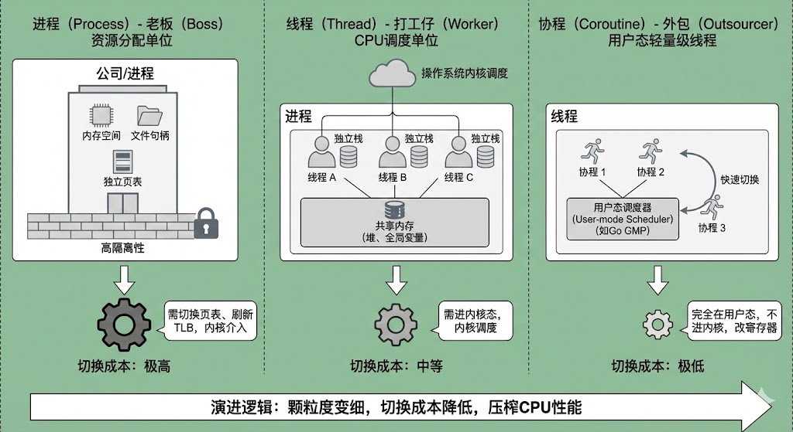

简单来说：**进程是老板，掌握资产；线程是打工仔，负责干活；协程是外包/临时工，自己安排时间，不需要走正规人事流程。**

它们的演进逻辑是：为了压榨 CPU 的性能，颗粒度切得越来越细，切换成本越来越低。

具体对比可以从以下三个维度展开：

1. **进程（Process）—— 资源分配的最小单位**
- **定义：** 一个运行中的程序。
- **特点：** 它是**拥有资源**（内存、文件句柄、页表）的独立单位。
- **隔离性：** 极高。一个进程崩了，不会影响其他进程（比如你的 Chrome 崩了，不会导致微信也挂了）。
- **切换成本：****极高**。因为要切换页表、刷新 TLB（缓存），涉及大量内存上下文的保存和恢复。
- **通信：** 麻烦。必须通过 IPC（管道、消息队列、Socket）来传数据。
1. **线程（Thread）—— CPU 调度的最小单位**
- **定义：** 进程里的一个执行流。一个进程可以有多个线程。
- **特点：** 它是**被内核调度**的基本单位。线程之间**共享**进程的内存（堆、全局变量），但有自己独立的栈。
- **隔离性：** 差。一个线程因为非法访问内存崩了，整个进程（包括其他线程）全都得死。
- **切换成本：****中等**。虽然不用切页表，但还是得进内核态，由操作系统来调度。
- **通信：** 简单。直接读写共享内存就行（但要小心加锁，防止数据打架）。
1. **协程（Coroutine）—— 用户态的轻量级线程**
- **定义：** 跑在线程上面的“微线程”。
- **特点：** 操作系统根本**不知道它的存在**。它的调度完全由**用户程序**（代码）自己控制（比如 Go 的 GMP 模型）。
- **隔离性：** 取决于代码处理。
- **切换成本：****极低**。就像在同一个函数里调用另一个函数一样，只改一下寄存器指针，**完全不需要进内核**。
- **优势：** 特别适合高并发的 I/O 密集型任务（比如在一台机器上跑 100 万个连接）。

---

### 面试标准回答

进程、线程和协程是操作系统中并发执行的三个不同层次的概念，它们的区别主要体现在**资源归属**、**调度方式**和**切换开销**上：

**第一，从定义和归属上看（是什么）：**

- **进程**是**资源分配**的最小单位。它拥有独立的内存空间和系统资源。
- **线程**是**CPU 调度**的最小单位。它依附于进程，多个线程共享进程的内存（堆区），但拥有独立的栈空间。
- **协程**是**用户态**的轻量级线程。它不被操作系统内核管理，完全由应用程序（用户代码）控制调度。

**第二，从切换开销上看（快不快）：**

- **进程切换最慢**：需要切换虚拟内存空间（页表）、刷新 TLB，上下文切换成本最高。
- **线程切换次之**：虽然共享内存，但线程切换仍需**陷入内核态**，由操作系统调度，涉及内核栈和寄存器的保存恢复。
- **协程切换最快**：完全在**用户态**进行，不需要陷入内核，只需修改寄存器指针，开销极低（纳秒级），适合超高并发场景。

**第三，从通信和稳定性上看：**

- 进程间通信（IPC）复杂，但隔离性好，一个崩溃不影响其他。
- 线程间通信简单（共享内存），但一个线程崩溃会导致整个进程退出。
