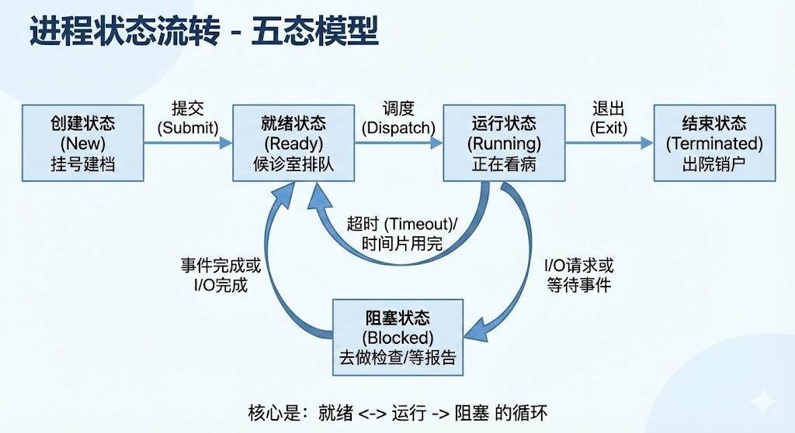

进程的状态流转，说白了就是“一个程序从生到死，在 CPU 面前争宠的过程”。

在操作系统里，进程不是一直在跑的，它大部分时间其实都在**“等”**——要么等 CPU 临幸（就绪），要么等硬盘/网卡的数据（阻塞）。

最经典的模型是 **“五态模型”**。我们可以把这五个状态比作去医院看病：

1. **创建状态（New）—— “挂号建档”**
- 进程正在被创建。操作系统正在给它分 ID（PID）、生成档案（PCB），但还没资格进诊室，还在门外。
1. **就绪状态（Ready）—— “候诊室排队”**
- 这是最关键的状态。进程已经拿到了除了 CPU 以外的所有资源（内存到位了、文件打开了）。
- **状态特征：** 万事俱备，只欠东风。只要调度器叫到它的号，它立马就能跑。
1. **运行状态（Running）—— “正在看病”**
- 进程真正拿到了 CPU 的使用权，正在执行指令。
- **注意：** 如果是单核 CPU，同一时刻只有一个进程处于这个状态。
1. **阻塞状态（Blocked/Waiting）—— “去做检查/等报告”**
- 进程正在等待某个事件（比如读磁盘、等网络数据、等锁）。
- **状态特征：** 就算这个时候 CPU 空下来给它用，它也**跑不起来**（因为数据还没到）。所以它会被踢出 CPU，不占用 CPU 资源。
1. **结束状态（Terminated）—— “出院销户”**
- 任务跑完了，或者出 Bug 被强制杀死了。操作系统正在回收它的内存、删除 PCB 档案。

---

### 面试标准回答

进程的生命周期通常由 **五态模型** 来描述。除了**创建**和**终止**这两个起止状态外，最核心的是以下三种状态的流转：

第一，就绪状态（Ready）：

进程已经分配到了除 CPU 以外的所有必要资源，正在就绪队列中等待调度。一旦获取 CPU 时间片，就会转换到运行状态。

第二，运行状态（Running）：

进程正在 CPU 上执行。

- 如果**时间片用完**了，它会被剥夺 CPU，退回到**就绪状态**。
- 如果它需要**执行 I/O 操作**或**申请锁**，就会主动放弃 CPU，进入**阻塞状态**。

第三，阻塞状态（Blocked）：

进程因等待某个事件（如磁盘读取完成、网络数据到达）而暂停。

关键点：当等待的事件完成后（如 I/O 中断触发），进程不会直接回到运行状态，而是必须先回到就绪状态，重新排队等待 CPU 调度。

**总结**：整个过程就是进程在‘排队等待（就绪）’、‘正在执行（运行）’和‘等待资源（阻塞）’之间不断切换的过程。
