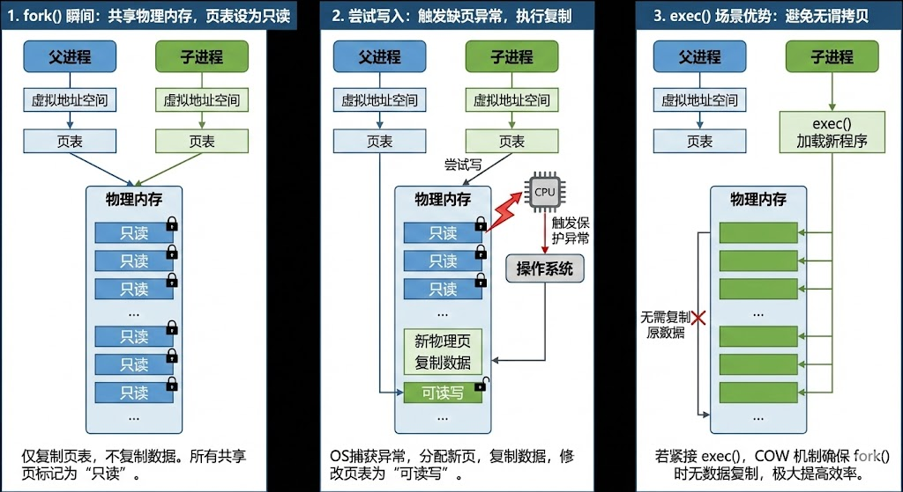

简单来说：`**fork()**` **就是搞克隆，但为了快，它采用了一种“延时”策略，这就是写时复制（COW）。**

以前的老系统（如早期的 Unix），`fork()` 一下是真的要把父进程的所有内存数据（代码段、数据段、堆栈）统统拷贝一份给子进程。如果父进程占了 1G 内存，那还得再申请 1G，这不仅慢，还浪费。

现在的 Linux 系统里，`fork()` 和 COW 的配合逻辑如下：

### 1. `fork()` 发生的那一瞬间（只拷目录，不拷书）

当你调用 `fork()` 时，内核并没有把真正的物理内存搬运一份。它只做了两件最快的事：

- **复制PCB：** 复制父进程的 PCB（进程控制块），给子进程申请一个 PID。
- **复制“目录”：** 复制父进程的**页表**（Page Table）。
    - **关键点：** 此时，父子进程的页表指向的**全是同一块物理内存**。

### Copy-on-Write 的核心机制（只读标记 & 缺页异常）

既然父子进程共用同一块物理内存，万一谁改了数据，岂不是乱套了？COW 的黑科技就在这里：

- **设为只读：** 在 `fork()` 完的瞬间，内核会把父子进程共享的所有物理内存页，在页表中都标记为 **“只读”（Read-Only）**。
- **触发异常：**
    - 如果父子进程都只是**读**数据，那就相安无事，一直共享，不用拷贝。
    - 一旦其中任一方想要**写**数据（比如修改一个变量），CPU 就会发现：“哎，这个页是只读的，你怎么敢写？”，于是触发**缺页异常（Page Fault）**（具体是保护异常）。
- **偷梁换柱：**
    - 操作系统捕获这个异常，发现是因为 COW 引起的。
    - 它会立刻**申请一个新的物理页**，把原来那个页的数据**复制**过来。
    - 然后修改页表，让发起写入的进程指向这个新页，并把权限改成 **“可读写”**。
    - 最后，让进程重新执行刚才那条写指令。

### 为什么要这么做？

绝大多数时候，我们 `fork()` 之后会紧接着调用 `exec()` 去执行一个新的程序（比如 shell 执行命令）。

- `exec()` 会把现有的内存全部清空，加载新程序。
- 如果没有 COW，刚才辛苦拷贝的 1G 内存，下一毫秒就被 `exec()` 清空了，简直是巨大的浪费。
- 有了 COW，`fork()` 之后立刻 `exec()`，**根本就不会发生内存复制**，效率极高。

---

### 面试标准回答

`fork()` 是 Linux 创建新进程的核心系统调用，而 Copy-on-Write（COW）是优化这一过程的关键技术。

首先，关于 fork() 的执行过程：

当执行 fork() 时，内核会为子进程创建一个新的 PCB，并复制父进程的页表，但不会立刻复制父进程的物理内存数据。此时，父子进程的虚拟地址空间虽然不同，但通过页表映射到了同一块物理内存上。

其次，关于 Copy-on-Write（写时复制）的工作原理：

为了保证隔离性，内核会将这些共享的物理页在页表中标记为只读（Read-Only）。

1. **触发时机**：当父进程或子进程尝试向这些页面**写入数据**时，会触发 CPU 的**保护异常（缺页中断）**。
2. **内核处理**：内核捕获异常后，会为发起写入的进程分配一个新的物理页，将原页面的内容**拷贝**一份过去（这时候才真正发生了复制）。
3. **权限恢复**：修改页表映射，将新页面的权限更新为**可读写**，然后程序继续执行。

最后，这种机制的核心优势在于：

它极大地降低了创建进程的时间和内存开销。特别是在 fork() 后紧接着调用 exec() 的常见场景下，避免了大量无意义的内存拷贝，实现了进程的秒级启动。
