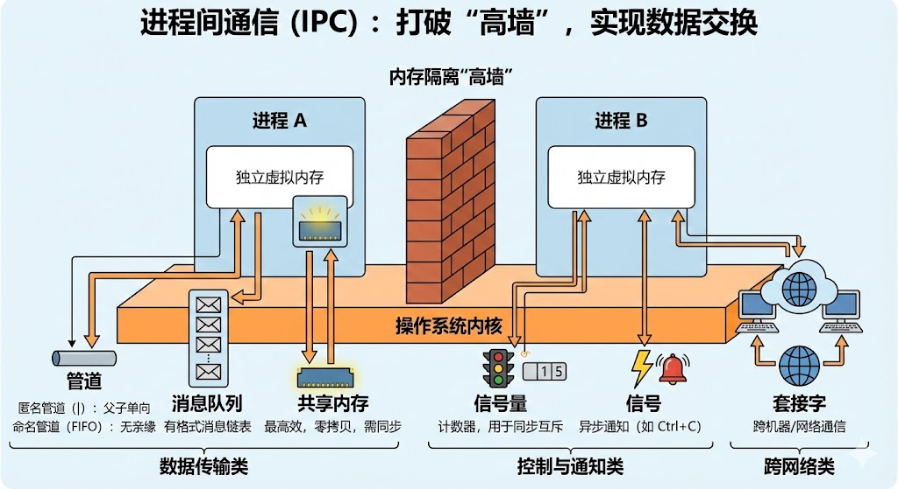

进程间通信（IPC, Inter-Process Communication），简单说就是**打破进程之间的“高墙”**，让它们能交换数据。

因为操作系统为了安全，每个进程的内存都是独立的，谁也看不到谁。所以要想沟通，必须由操作系统在中间当“传话筒”或者“开后门”。

常见的通信方式主要有 **6 种**，我们可以根据“效率”和“场景”把它们分为三类：

1. **管道（****Pipe****）**
- **匿名管道（|）：** 你在 Linux 命令行里经常用的，比如 `ps -ef | grep java`。那个竖线就是管道。
    - **特点：** 只能单向传输（半双工），而且只能在**有亲缘关系**的进程间使用（比如父子进程）。数据流过去就没了，像水流一样。
- **命名管道（FIFO）：** 既然匿名管道只能父子用，那就给管道起个名字（文件路径）。
    - **特点：** 任何进程只要知道这个名字，都能往里写数据。突破了亲缘关系的限制。
1. **共享内存****（****Shared Memory****）**
- **原理：** 操作系统拿出一块物理内存，映射到两个进程的虚拟地址空间里。这就好比两个不同的房间开了一扇窗户，大家直接通过窗户递东西。
- **特点：****最快**的 IPC 方式。因为数据不需要在用户态和内核态之间来回拷贝（其他方式通常要拷贝两次）。
- **缺点：** 自由也是代价。两个进程同时改这块内存怎么办？所以它通常要配合**信号量**一起用，来解决并发问题。
1. **消息队列（Message Queue）**
- **原理：** 在内核里建一个链表，一个进程往里扔消息块（带类型、带内容），另一个进程去取。
- **特点：** 比管道高级。管道是无脑的字节流，消息队列是有“格式”的。而且它独立于进程，进程死掉了，队列里的消息还在。
1. **信号量（Semaphore）**
- **原理：** 它其实不是用来传输大数据的，而是一个**计数器**。
- **作用：** 用来做**同步和互斥**的。比如配合共享内存，标记“现在这块内存有人在用，你等会儿”。
1. **信号（Signal）**
- **原理：** 唯一的**异步**通信机制。
- **场景：** 比如你按 `Ctrl+C` 强行终止程序，或者运行命令 `kill -9`，这都是给进程发信号。告诉进程：“出大事了，赶紧处理”。
1. **套接字（Socket）**
- **特点：** 前面的都是在一台电脑里玩，Socket 是唯一能**跨网络**、跨机器通信的。当然，本地通信也能用（Unix Domain Socket）。

---

### 面试标准回答

Linux 系统中进程间通信（IPC）主要有六种方式，每种方式解决的问题侧重点不同：

**第一类是基于数据传输的：**

1. **管道（Pipe）**：这是最基本的 IPC。**匿名管道**用于父子进程间的单向通信；**命名管道（FIFO）**则允许无亲缘关系的进程通信。它们的缺点是缓冲区有限，且效率较低（需要内核拷贝）。
2. **消息队列（Message Queue）**：它是保存在内核中的消息链表。相比管道，它支持有格式的数据传输，并且消息独立于进程存在，不会随进程结束而消失。
3. **共享内存（Shared Memory）**：这是**效率最高**的方式。通过将同一块物理内存映射到不同进程的虚拟地址空间，实现了数据的‘零拷贝’直接读写。

第二类是基于控制和通知的：

1. 信号量（Semaphore）：它主要不是为了传数据，而是作为一个计数器，用于多进程对共享资源的访问控制（同步与互斥），常配合共享内存使用。
2. 信号（Signal）：这是一种异步通信机制，用于通知进程发生了某种系统事件（如 kill 指令、段错误）。

第三类是跨网络的：

1. 套接字（Socket）：上述方式都局限于同一台主机，而 Socket 允许不同机器上的进程通过网络协议进行通信（如 TCP/IP）。
